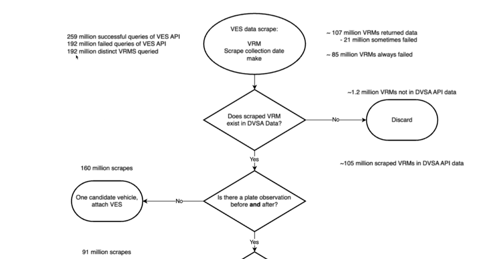
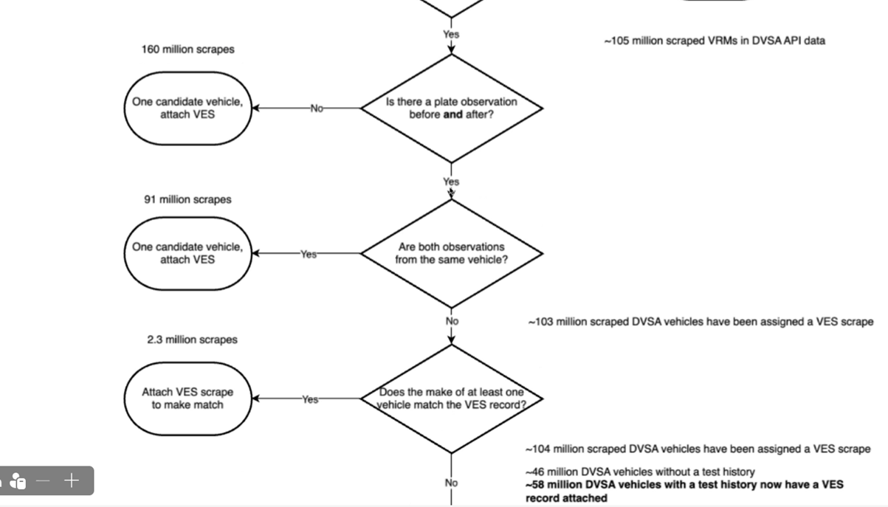

# Source data and linkage {#sec-sources-linkage}

```{r}
source("R/book.R")
sc <- read_pipeline("outputs", "quality", "scope_counts.csv")
input_rows <- sc$n_vehicles[sc$measure == "input_rows"]
```

The CARS data is built in two stages. The University of Bristol team links the
three source datasets and turns each vehicle's test history into annual
figures. The University of Leeds pipeline then cleans and enhances the result
and produces the published tables (@sec-pipeline). This chapter describes the
sources and the Bristol stage.

::: {.callout-note .todo title="To be written: Bristol method"}
This chapter summarises the Bristol stage from project notes. A full
description, by the Bristol team, of the data processing and the database
built to carry it out will be added; it is also the subject of the project's
second webinar, *Under the bonnet* (January 2027).
:::

## The three sources

All three are published under the Open Government Licence (@sec-data-landscape).

### Anonymised MOT test data

Every MOT test since 2005: the date, result, odometer reading, test class and
the postcode area of the testing station, with the vehicle's make, model, fuel,
engine size and first-use date. Vehicles carry an anonymous identifier rather
than their registration number. The data was first published by DfT in 2010
and is now published by DVSA, roughly annually; in recent years over 40 million
tests a year are added.

**Gives CARS:** the location of each test, and the test class.

### DVSA MOT history (bulk download)

Every vehicle registered in Great Britain, including those not yet tested, with
its registration number, make, model, fuel, engine size, colour, dates of first
use, registration and manufacture, and its full MOT history: every test with
its date, result and odometer reading. There is no location. The download is
available through the
[MOT history API](https://documentation.history.mot.api.gov.uk/mot-history-api/download-vehicle-mot-history-data/files/)
to anyone who applies for a key, and is a set of zipped JSON files of over
400 GB.

**Gives CARS:** the registration number, which links to the DVLA, and the
backbone of one record per vehicle.

### DVLA Vehicle Enquiry Service

The DVLA's
[Vehicle Enquiry Service API](https://developer-portal.driver-vehicle-licensing.api.gov.uk/)
returns, for one registration number at a time, the vehicle's details from the
DVLA register: make, colour, fuel, engine capacity, CO~2~ emissions, Euro
status, type approval category, revenue weight, wheel plan, tax status and due
date, MOT status and expiry, year of manufacture, month of first registration,
whether it is marked for export, and the date of the latest V5C.

**Gives CARS:** the emissions and specification details that DVSA does not
hold, and evidence of whether and when the vehicle was taxed, declared SORN or
exported.

## Linking the anonymised MOT data to the MOT history

The anonymised test data has the location but no registration number; the MOT
history has the registration number but no location. The two are linked
through the tests themselves: the sequence of test dates and odometer readings
of a vehicle is, in practice, a unique **fingerprint**. Matching fingerprints
attaches the postcode area of each test to the vehicle in the MOT history.

::: {.callout-note .todo title="To be written"}
The fingerprint matching method: which fields are used, how ties and partial
matches are resolved, and the match rate.
:::

## Linking the DVLA records

DVLA details were collected by querying the Vehicle Enquiry Service for every
registration number in the DVSA download, many of them several times between
2024 and 2026. Each query returns the vehicle that carries that registration
*at the time of the query*. Because registrations can move between vehicles
(@sec-number-plates), a query does not always describe the same vehicle as the
DVSA record with that registration, and the Bristol team built rules to decide
which DVSA vehicle each returned record belongs to.

::: {#fig-ves-linking layout-ncol=1}




Draft flowchart of the rules for attaching Vehicle Enquiry Service records to
DVSA vehicles, with approximate counts at each step (Bristol team, June 2026).
:::

The Leeds pipeline adds a further check, comparing the make, year and engine
size of the DVSA and DVLA records, and does not use DVLA values where they
clearly describe a different vehicle (@sec-pipeline).

::: {.callout-note .todo title="To be written"}
A description of the VES linking rules to accompany the flowchart, and of the
VES status categories: data returned; invalid registration that will never
return data; invalid registration with a proposed cleaned version that does;
vehicle not found, assumed to have left the register long ago; vehicle not
found now but found at some point; never queried.
:::

## Annualisation

The tests of a vehicle happen on whatever dates they happen. For analysis it
is far more useful to have one figure per vehicle per calendar year. The
Bristol team's *annualisation* converts each vehicle's test history into, for
each year from 2005 to 2025:

- `mileage_YYYY`: the distance driven in the year, in miles;
- `legit_mileage_YYYY`: whether that mileage is plausible;
- `pca_YYYY`: the postcode area the vehicle is assigned to in the year;
- flags describing the vehicle's stage of life in the year
  (@sec-lifecycle).

### Annual mileage

The odometer readings at two consecutive tests give the distance driven
between them. That distance is shared across the calendar years the interval
spans, however long the interval, so a year can only have a mileage if it is
covered by an interval with an odometer reading at each end.

::: {.callout-note .todo title="To be confirmed"}
How the distance is shared between years (we understand it to be in
proportion to the time in each, so an interval from March 2018 to March 2019
contributes most of its distance to 2018), and how the distance before the
first test is treated.
:::

```{r}
#| label: fig-test-intervals
#| fig-cap: "Draft figure (Bristol team): the date of the test at the start of each interval between tests, against the test at its end, for a sample of vehicles, 2017–2023. Most intervals lie on the one-year diagonal. The disruption in 2020 shows as a break and a shifted line."
#| out-width: 75%
knitr::include_graphics("images/draft/test-intervals.png")
```

### Plausible mileage

Odometer readings contain errors: typing mistakes, odometers replaced or
reset, readings in kilometres taken as miles, and occasional fraud
(*clocking*). The Bristol team judges whether each annual mileage is
plausible, and **removes the mileage** where it is not. `legit_mileage_YYYY`
therefore has three states: `TRUE` (plausible), blank with a mileage (not
assessed) and `FALSE` (judged implausible; the mileage is then blank).

::: {.callout-note .todo title="To be written"}
The rules for judging mileage plausible, including the thresholds on miles
per day, the treatment of odometer units and resets, and what share of
readings each rule removes.
:::

### Postcode area in each year

A vehicle is assigned the postcode area of the test closest in time to the
year for which a postcode area is available. Years with no test nearby have no
postcode area, and the Leeds pipeline then labels them `unborn`, `unknown` or
`dead` (@sec-lifecycle).

::: {.callout-note .todo title="To be written"}
The exact rule for choosing the test that gives a year its postcode area, and
how many years it can reach across.
:::

## What the Bristol stage produces

The output of the Bristol stage is one table with one row per vehicle,
`r fmt_n(input_rows)` rows in the delivery the current data is built from, and
around 200 columns: the DVSA vehicle details, the per-year columns, the
attached DVLA columns, and columns recording the history of the DVLA lookups.
It is the input to the pipeline described in @sec-pipeline. It is not itself
published (@sec-data-products).
