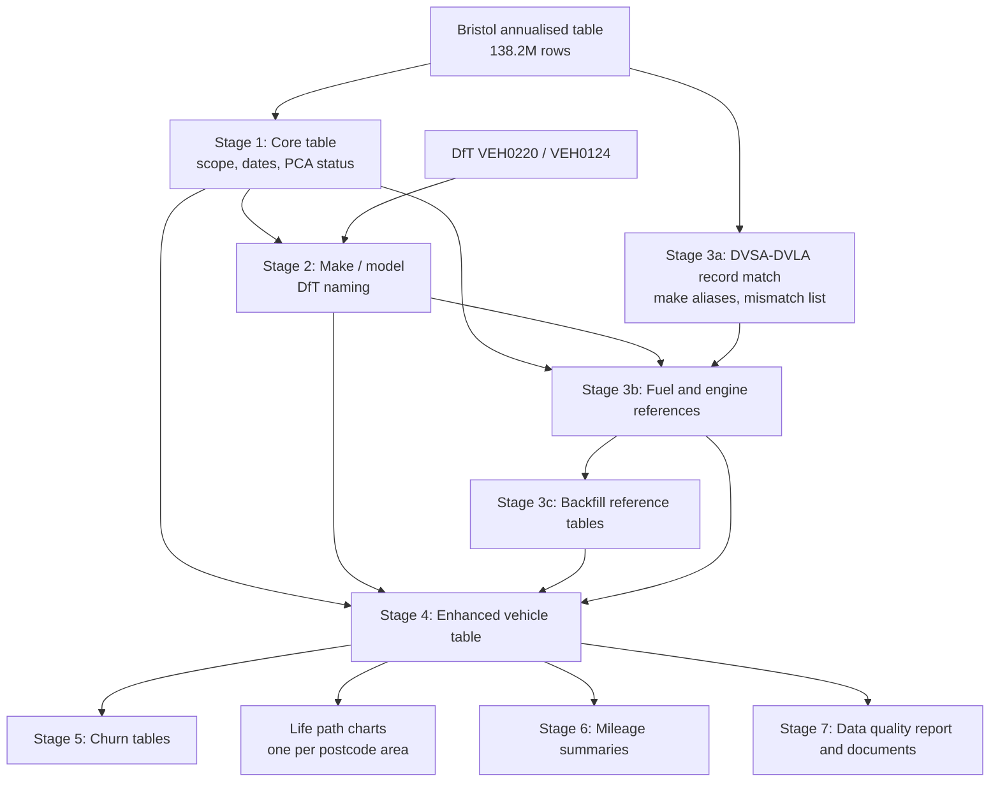

# Methodology {#sec-methodology-report .unnumbered}

::: {.callout-note title="Generated by the pipeline"}
This appendix is `methodology.md` from the MOT-pipline repository, copied unchanged into the book by `scripts/sync-pipeline.R`. Paths such as `outputs/...` refer to that repository. See @sec-maintaining.
:::

*Generated from `reports/methodology.qmd` by the MOT-pipline
`methodology_doc` target. Every figure comes from the latest build
(profile: main). Edit the template, not this file.*

This document describes how MOT-pipline turns the Bristol vehicle-level
MOT table into the enhanced vehicle dataset and summary tables. For each
stage it sets out what is done, how, and the assumptions behind it, so
users of the outputs can judge how far to rely on each column.

The code for each stage is named in its section. Column-level
definitions are in `outputs/data_dictionary.csv`, which the pipeline
writes. The pipeline was audited end to end in October 2026;
`pipeline_audit.md` records what was checked, what was found and what
changed.

### How to read this document

It is written for two readers. **If you use the outputs but not the
code**, read the plain-language summary below, then the *Assumptions*
paragraph at the end of each section and the summary table in Section
12: they say what each column and table can and cannot support. You do
not need to read SQL. **If you maintain the code**, each section starts
with the file that implements it, and the table below maps every stage
to its code and its `targets` target, so you can go from a sentence here
to the function that does it.

### The method in plain language

The Bristol team supply one row per vehicle that has appeared in the MOT
(roadworthiness test) records, with its make, model and fuel as recorded
at its tests, a postcode area and annual mileage for every year, and the
matching record from the DVLA vehicle register. The pipeline:

1.  **keeps every vehicle that existed from 2005** (Section 3), and
    marks each year in which the vehicle has no postcode area as not yet
    born, gone (`dead`) or simply not located (`unknown`);
2.  **gives every vehicle a standard make and model**, the names DfT
    uses in its vehicle licensing statistics, so the data can be
    compared with and joined to official tables (Section 4);
3.  **checks the DVLA record belongs to the same vehicle**, because a
    moved number plate can attach another vehicle’s record (Section
    5.1);
4.  **fills gaps** in engine size, CO2, weight, Euro status and other
    attributes from similar vehicles (same make, model, year and fuel),
    always recording that the value was borrowed, and never borrowing
    across fuels (Section 5);
5.  **builds the published tables**: where vehicles are and how they
    move between postcode areas (the churn tables, Section 7), mileage
    (Section 8), fleet profiles, and quality checks, then **cross-checks
    every pair of tables that should agree** (Section 9.1).

Three facts about the source data matter for every result and are easy
to miss:

- **A postcode area in a year is not always a test in that year.**
  Bristol copies a vehicle’s first-test area back to its first
  registration, and carries its last-test area forward for two years
  after its last test (Section 3.3). Young vehicles therefore cannot be
  seen to move before their first test, and a scrapped vehicle stays in
  its area’s counts for about two years. As a result, more cars aged 3+
  are placed in a postcode area than DfT counts as licensed or SORN.
- **Most Euro statuses, weights and many CO2 values are borrowed or
  assumed, not recorded** on the vehicle’s own record (Sections 5.6 and
  5.7).
- **The old churn “movement rate” falls with age by construction**
  (Section 7.3); the windowed rate is the one to compare.

### Code map

| Stage | What it does | Code | Main targets |
|----|----|----|----|
| Configuration | Settings, profiles | [`R/config.R`](R/config.R), [`config.yml`](config.yml) | `cfg`, `cfg_*` |
| 1 Core table | Scope, dates, PCA status | [`R/stage_core.R`](R/stage_core.R) | `core_parquet` |
| 2 Make / model | DfT naming, body type | [`R/make_model.R`](R/make_model.R) | `dft_reference`, `make_model_lookup` |
| 3a Record match | DVSA vs DVLA record | [`R/dvla_match.R`](R/dvla_match.R) | `dvla_make_aliases`, `dvla_mismatch_file` |
| 3b Fuel, engine | Harmonised fuel and engine size | [`R/fuel_engine.R`](R/fuel_engine.R), [`R/fuel_dft.R`](R/fuel_dft.R) | `fuel_refs` |
| 3c Backfill | Gaps from similar vehicles | [`R/backfill.R`](R/backfill.R), [`R/euro_status.R`](R/euro_status.R) | `backfill_refs` |
| 4 Enhanced tables | Joins, derived fields, plates | [`R/assemble.R`](R/assemble.R), [`R/plates.R`](R/plates.R) | `enhanced_parquet` (maximal), `simplified_parquet`, `data_dictionary` |
| 5 Churn | Sets 0-7, life paths | [`R/summary_churn.R`](R/summary_churn.R), [`R/report_churn.R`](R/report_churn.R), [`R/lifepath_alluvial.R`](R/lifepath_alluvial.R) | `churn_*`, `lifepath_figures` |
| 6 Mileage, profile | Mileage and fleet profile tables | [`R/summary_mileage.R`](R/summary_mileage.R), [`R/report_mileage.R`](R/report_mileage.R), [`R/summary_profile.R`](R/summary_profile.R), [`R/racf_fleet.R`](R/racf_fleet.R) | `mileage_*`, `profile_*` |
| 6b RACF linked fleet | SMMT segment and EU / RDW model attributes linked to the MOT cars | [`R/racf_linked.R`](R/racf_linked.R) | `racf_reference`, `racf_linked_tables` |
| 7 Quality | Quality tables, DfT comparison, cross-checks | [`R/report_quality.R`](R/report_quality.R), [`R/dft_compare.R`](R/dft_compare.R), [`R/report_inputs.R`](R/report_inputs.R), [`R/cross_checks.R`](R/cross_checks.R) | `quality_tables`, `dft_comparison`, `cross_checks` |
| Reports | Quarto templates rendered to Markdown | [`R/reports.R`](R/reports.R), [`reports/`](reports/) | `*_report`, `methodology_doc` |
| Shared | DuckDB helpers, CSV writer | [`R/utils_duckdb.R`](R/utils_duckdb.R) | \- |
| Pipeline | Every target and its inputs | [`_targets.R`](_targets.R) | \- |

## Contents

1.  [Overview](#1-overview)
2.  [Input data](#2-input-data)
3.  [Stage 1: Core vehicle table](#3-stage-1-core-vehicle-table)
4.  [Stage 2: Make and model](#4-stage-2-make-and-model)
5.  [Stage 3: Record matching, fuel and engine checks, and
    backfill](#5-stage-3-record-matching-fuel-and-engine-checks-and-backfill)
6.  [Stage 4: Derived fields and number
    plates](#6-stage-4-derived-fields-and-number-plates)
7.  [Stage 5: Churn tables](#7-stage-5-churn-tables)
8.  [Stage 6: Mileage summaries](#8-stage-6-mileage-summaries)
9.  [Stage 7: Data quality report and
    documents](#9-stage-7-data-quality-report-and-documents)
10. [Reproducibility](#10-reproducibility)
11. [Validation](#11-validation)
12. [Summary of key assumptions](#12-summary-of-key-assumptions)

------------------------------------------------------------------------

## 1. Overview

All processing of the full table happens in DuckDB (SQL over parquet
files). Only small tables come back into R: distinct make/model pairs,
make aliases and aggregated results. The pipeline is managed by R
`targets`, which rebuilds only the stages affected by a change.

Principles applied throughout:

- **Supplied values are never overwritten.** Cleaned, harmonised or
  backfilled values go into new columns next to the originals.
- **Every inferred value records its source.** Examples are
  `first_use_source`, `make_method`, `model_method`, `*_src`, the
  `scope_*` flags, `dvla_match`, `fuel_check` and `engine_check`.
- **Weak evidence is flagged, not acted on.** A value is only changed
  when the vehicle’s own records disagree and a second source settles
  it.
- **Results are deterministic.** Ties are broken by explicit rules, and
  random sampling (sample project only) uses a fixed seed.

## 2. Input data

**Source:** annualised_with_ves_4.parquet, produced by the Bristol team
and accessed through the RDSF.

| Property                    | Value                              |
|-----------------------------|------------------------------------|
| Rows                        | 138,238,617                        |
| Distinct DVSA registrations | 138,238,617                        |
| Columns                     | 202                                |
| Years covered               | 2005–2025 (2025 is a partial year) |

The January 2026 delivery
(`jan26_annualised_with_2025_anon_and_ves.parquet`) differed from the
earlier `annualised_with_ves.parquet` in three ways. It added 2025. It
had 5,997 fewer rows, exactly the number of surplus duplicate
registrations in the earlier file, so the duplicates were removed. And
it renamed every VES column to carry a `_DVLA` suffix, while replacing
the lookup bookkeeping columns (`n_api_vehicles_with_vrm`, `vrm_in_ves`,
`n_ves_obs`) with a fuller set that counts the lookups and records what
changed between them. The pipeline reads either layout: see
`resolve_core_columns()` in `R/stage_core.R`.

The file has one row per vehicle, with:

- **Vehicle attributes from the DVSA MOT history API:** make, model,
  fuel, engine size, colours, first used / registration / manufacture
  dates, and the anonymised test class (`test_class_ANON`).
- **Per-year columns for each year 2005–2025:**
  - `mileage_YYYY`: annual mileage
  - `pca_YYYY`: postcode area
  - `legit_mileage_YYYY`: whether the mileage is plausible
  - `is_new_vehicle_YYYY`, `is_intertest_YYYY`, `is_end_use_YYYY`:
    status flags
- **DVLA Vehicle Enquiry Service (VES) columns:** make, fuel, engine
  capacity, weight, CO2, Euro status, type approval, wheel plan, tax and
  MOT status, and key dates. These are attached by registration.
- **VES lookup bookkeeping:** how often VES was queried for the
  registration (`n_VES_checks`, renamed
  `n_VES_checks_to_linked_DVSA_regs` in the October 2026 `ves_4`
  delivery, which also counts the checks against the DVLA registration
  alone in `n_VES_checks_for_DVLA_reg`; both include errored checks),
  how often it answered (`n_VES_returns`), the first and last of each,
  whether the last lookup errored (`is_error`, `error`), and flags for
  what changed between lookups: `plate_ever_changed_VES`, `ever_SORN`,
  `v5C_issue_date_ever_changed`, `change_in_other_VES_field` and
  `ever_export_marked` (a count, not a flag).

Assumptions about the input:

- **Bristol’s annualisation is taken as given.** The pipeline does not
  re-derive annual mileage, postcode area or the per-year flags; see
  Bristol’s documentation for how they are built. In particular, the
  mileage columns are treated as **annual miles** (mean 7,065 in 2018)
  and are not rescaled.
- **The VES record is not always the same vehicle.** Because VES is
  attached by registration, a registration that has moved to another
  vehicle brings that vehicle’s record. Section 5.1 detects these.
- **Gaps are common.**
  - `test_class_ANON` is missing for 64.2M rows.
  - `firstUsedDate_DVSA` is missing for 61.4M rows.
  - VES columns are missing wherever no VES record was found (23.9% of
    rows).

## 3. Stage 1: Core vehicle table

*Code: `R/stage_core.R` · Output:
`outputs/intermediate/01_core.parquet`*

### 3.1 Identifiers and duplicates

- **`vehicle_id`** is the row number in the input file. It is stable
  only for that input file; a new Bristol delivery will renumber
  vehicles.
- **`dup_vrm`** is TRUE when the DVSA registration appears on more than
  one row. No registration appears more than once in this input (earlier
  deliveries had duplicates). Duplicates are **kept and flagged**, not
  removed, because it is not known which row is correct.

### 3.2 Dates

- **`birth_date`** is the earliest of DVSA first used date, registration
  date and manufacture date. Only 10,030 input vehicles have none of
  these; for them it is the DVLA month of first registration, else the
  DVLA month of first DVLA registration, else 1 July of the DVLA year of
  manufacture (mid-year, so the year is right). `birth_date_source`
  records which (`dvsa` for nearly every vehicle).
- **`first_use_date`** is the first available of:
  1.  DVSA first used date
  2.  DVLA month of first registration
  3.  `birth_date`

  `first_use_source` records which one was used.
- **`last_mot_year`** is the latest year with `is_end_use_YYYY = TRUE`.
  Where no year is flagged, it is the last year with a recorded postcode
  area, unless that year is one of the final two years of data.

Why the fallback: the January 2026 Bristol delivery leaves the
end-of-use flag off for most vehicles that stopped being tested. For
example, 1.6 million of the 2.4 million vehicles whose last MOT was in
2019 have no flag, against 20 thousand in the earlier delivery. Without
the fallback, those vehicles would be `unknown` for ever, not `dead`.
Where a vehicle has both a flag and a recorded postcode area, the flag
year is its last postcode area year for 99.9% of vehicles. A vehicle
last seen in the final two years may simply not be due a test yet, so it
keeps no last MOT year and stays `unknown`.

Assumptions:

- **Birth date is the earliest recorded DVSA date.** For vehicles that
  sat in stock, or were imported, the manufacture date can be well
  before first use. The DVLA fallback cannot be checked against DVSA
  dates; for the vehicles that use it, the DVLA record matches the
  vehicle on make and engine.
- **The DVLA month of first registration is the first of that month,**
  so it is accurate to the month only.
- **Vehicles with no dates get no invented one.** The previous code
  assigned 2000-01-01 to such vehicles; that placeholder has been
  removed. Only a vehicle with no DVSA and no DVLA date has no birth
  date.

### 3.3 Postcode area status infill

Bristol supplies a postcode area for most years of a vehicle’s life, not
only the years it was tested. Two features of Bristol’s annualisation,
found in the October 2026 audit, matter for every table built on
`pca_YYYY`:

- **Back-fill before the first test.** A new car has no MOT until it is
  three years old (four in Northern Ireland), but Bristol copies its
  first test’s postcode area back to the year it was first registered:
  of the vehicles first used in 2016, 99.4% have the same area in 2016,
  2017 and 2018. So a vehicle cannot be seen to move before its first
  test, and those years’ areas are not observations. Bristol estimates
  mileage for those years too.
- **Carry-forward after the last test.** A vehicle keeps its last test’s
  area for two more years: 95% of the vehicles last tested in 2015 still
  have a postcode area in 2016 and 2017, with no mileage, and become
  `dead` in 2018. In 2019, 4,644,271 of the 45,687,132 vehicles in a
  postcode area (10.2%) were past their last MOT year. This is why the
  MOT stock of cars aged 3+ exceeds DfT’s licensed + SORN count (Section
  4.8), and why every `dead` and “leaver” count lags the end of testing
  by about two years.

`quality/pca_observation_by_year.csv` measures both every build. Where
Bristol supplies no area, the blank is replaced with a status:

| Condition (checked in order) | `pca_YYYY` becomes |
|----|----|
| A postcode area is recorded | the postcode area, unchanged |
| Birth year is **the same as or later than** year YYYY | `unborn` |
| The last MOT year (`last_mot_year`) is earlier than YYYY | `dead` |
| Otherwise | `unknown` |

Assumptions:

- **“Dead” means no longer observed, not scrapped.** A vehicle is `dead`
  in every year after the year of its last MOT. This includes vehicles
  that were exported, declared off-road (SORN), or simply stopped being
  tested.
- **Unobserved years before the last MOT are “unknown”.** This prevents
  vehicles from apparently coming back to life when a later test
  appears. It is rare (tens of thousands of vehicles a year), because
  Bristol back-fills the years before the first test (above).
- **Birth is compared by calendar year.** A vehicle born during 2010
  with no recorded PCA in 2010 is `unborn` for 2010.
- **A vehicle with no dates is treated as already born** in every year.
  It is then `dead` or `unknown` by the rules above.
- **Recorded postcode areas are used as supplied,** including
  single-letter areas (B, G, L, …). The data covers the whole UK, and
  Northern Ireland is its real postcode area `BT`, as Bristol’s
  deliveries code it since October 2026 and as the boundary, area name
  and DfT reference files in `inputs/` do. An older delivery’s `NI` is
  recoded to `BT` (`pca_bt_sql()` in `R/stage_core.R`). A small number
  of vehicles have the code `XX`, left as supplied.

### 3.4 Scope: which vehicles are kept

The output aims to include every vehicle that **existed at some point
from 2005 onwards**, including vehicles that are too new to have been
tested and vehicles that were never tested. A vehicle is kept if **any**
of these is true (scope start date 2005-01-01, set in `config.yml`):

| Flag | Rule | Input vehicles meeting it |
|----|----|----|
| `scope_mileage` | Total mileage across all years \> 0 | 77,265,716 |
| `scope_pca` | A postcode area recorded in any year | 75,437,173 |
| `scope_born` | `birth_date` on or after the start date | 59,048,376 |
| `scope_dvla_activity` | DVLA tax due, last V5C issue, MOT expiry or first registration date on or after the start date | 71,810,699 |

Vehicles kept under each rule:

| Rule                                      | Vehicles kept  |
|-------------------------------------------|----------------|
| Previous code: mileage OR born since 2005 | 89,014,270     |
| This pipeline: any of the four flags      | **93,352,241** |

Assumptions:

- **A DVLA record dated 2005 or later is evidence the vehicle existed
  then.** Examples are a V5C issued or tax due in that period.
- **Vehicles with none of these signals are assumed to have left the
  fleet before 2005.** This includes every vehicle with no dates at all.
- **Total mileage is a plain sum across years,** so a small negative
  value can offset a positive one. This is rare.

### 3.5 Tidying

- **VES columns get a `_DVLA` suffix** where the delivery does not
  already use one (in earlier files `make` becomes `make_DVLA`; the
  January 2026 file supplies `make_DVLA` already). The VES lookup
  bookkeeping columns are carried through under their own names,
  whichever set the delivery has.
- **`engineSize_DVSA` is converted to an integer;** non-numeric values
  become missing.
- **The last MOT test date is taken from `final_test_date_DVSA`** and
  published under that name. DVSA now put a date in the future in
  `lastMotTestDate_DVSA` for the untested vehicles DVLA supplies (5.22M
  of them in the October 2026 file, the latest 2028-12-30);
  `final_test_date_DVSA` equals it on every tested vehicle and is
  missing rather than invented on the rest. A delivery that has only
  `lastMotTestDate_DVSA` falls back to it, converted from text to a
  date.
- **Every other input column is carried through unchanged** to the
  maximal enhanced table: the `is_new_vehicle`, `is_intertest` and
  `is_end_use` flags, `odometer_est_YYYY`, `n_DVLA_makes`,
  `lastMotTestDate_DVSA` and anything a later delivery adds. The
  pipeline uses only `is_end_use_YYYY` (for `last_mot_year`) and
  `legit_mileage_YYYY` (for the mileage summaries). Mileage,
  plausibility and PCA columns for years outside `years` in `config.yml`
  are dropped.

## 4. Stage 2: Make and model

*Code: `R/make_model.R` · Outputs: `outputs/intermediate/dft_*.parquet`,
`outputs/intermediate/make_model_*.parquet`,
`outputs/quality/make_model_review.csv`*

Makes and models follow the naming of the **DfT vehicle licensing
statistics**: tables VEH0220 (vehicles by make, generic model, model,
fuel and engine size) and VEH0124 (by make, generic model, model and
year of first use), which DfT builds from the DVLA register. Using the
same names means MOT results can be joined to, and checked against, the
official counts. No language model is used: every step is a rule, and
every result records how it was reached.

| Column | Meaning |
|----|----|
| `make_final` | DfT make, upper case (`FORD`, `MERCEDES`) |
| `model_final` | DfT generic model without the make (`FIESTA`, `C CLASS`, `1 SERIES`) |
| `dft_genmodel` | The DfT GenModel (`FORD FIESTA`), for joins to DfT tables |
| `dft_model` | The DfT model string, when the raw model is exactly one |
| `derivative_final` | The rest of the raw model text: trim, engine, body style |
| `body_type` | DfT body type (Cars, Light goods vehicles, Motorcycles, …) |
| `make_method`, `model_method`, `model_confidence`, `body_type_src` | How each was found |

Of 93,352,241 in-scope vehicles, 94.9% have a DfT generic model, 4.3%
have a placeholder model such as `UNKNOWN` (so no model), and 0.8% keep
their normalised raw model because nothing matched.

### 4.1 The DfT reference

`inputs/df_VEH0220.csv` and `inputs/df_VEH0124_AM.csv` / `_NZ.csv` are
read as Latin-1 text. Each count is the number of vehicles (licensed
plus SORN) at the end of a year, from 2014. To name models, each row is
weighted by its largest count in any year, so a model that has since
left the fleet still counts.

DfT’s coding has some quirks, which are tidied before matching:

- **Makes spelt two ways are merged.** Makes differing only in
  punctuation or spaces (IVECO-FORD / IVECO FORD) join the larger.
  `inputs/make_aliases.csv` merges others: DfT files most Mercedes-Benz
  vehicles under MERCEDES, and uses MERCEDES-BENZ for recent
  registrations whose generic model is just the model text.
- **Generic models that are just a model string are recoded.** Some
  recent registrations have a GenModel of the make plus the model string
  (HYUNDAI TUCSON ADVANCE PHEV AUTO). These model strings are matched
  like raw text against the rest of the make (TUCSON).
- **A long generic model name that extends a much more common one joins
  it,** when it adds two or more words and has a tenth of the vehicles
  or fewer.
- **`MODEL MISSING` is no model.**

Four reference tables come out of this
(`outputs/intermediate/dft_*.parquet`): model names and body types, fuel
group by engine band (used to settle ambiguous models, Section 4.4),
year of first use, and the **fuel as DfT records it**, which is the only
source that separates plug-in hybrids from other hybrids and is used in
Section 5.5.

### 4.2 Makes

Each distinct raw make is resolved once. The first step that matches
wins:

| `make_method` | Rule | Vehicles |
|----|----|---:|
| `placeholder` | `UNKNOWN`, `NOT KNOWN` and similar: no make | 520,947 |
| `alias` | Listed in `inputs/make_aliases.csv` (SMART (MCC) → SMART; CHRYSLER-JEEP → JEEP or CHRYSLER, whichever has the model) | 4,148,373 |
| `exact` | A DfT make, after upper-casing and collapsing spaces | 88,368,719 |
| `punctuation` | A DfT make ignoring punctuation and spaces | 12,036 |
| `dvla` | At least 80% of the raw make’s vehicles with a recognised DVLA make have the same one (ENFIELD → ROYAL ENFIELD, VOLKSWAGON → VOLKSWAGEN) | 25,700 |
| `prefix` | Starts with a DfT make as whole words (DODGE (USA) → DODGE) | 29,148 |
| `fuzzy` | One letter from a DfT make (two for 8+ letters) with at least 100 times the vehicles, and not contradicted by the DVLA make | 3,216 |
| `dvla_vehicle` | A placeholder or unmatched DVSA make, where this vehicle’s own DVLA make is a DfT make | 113,922 |
| `override` | `inputs/make_model_overrides.csv` (Section 4.7) | 101 |
| `unmatched` | Kept as recorded, upper case. Many are trailer makers, or old makes DfT groups as OTHER BRITISH | 130,079 |

### 4.3 Models

Each distinct make and model text is matched once, within its make. Text
is compared in upper case with punctuation as spaces. The first step
that matches wins:

| `model_method` | Rule | Example | Vehicles |
|----|----|----|---:|
| `exact` | A DfT model string of the make | FIESTA ZETEC CLIMATE → FIESTA | 49,339,904 |
| `generic` | A DfT generic model name, ignoring punctuation, or with CLASS or SERIES added | A-CLASS → A CLASS; GL → GL CLASS | 35,159,622 |
| `prefix` | The longest start of the text, in whole words, that begins DfT model strings of the make or is a generic model name; character prefixes of 3+ characters also count. At least 90% of the DfT vehicles under it must share one generic model | 118 → 1 SERIES; C200 → C CLASS | 3,036,563 |
| `words` | Every word of the text appears in DfT model strings of the make that are at least 90% one generic model, and at least one word is used by fewer than three makes and is not a body style word such as PICKUP or MOTOR HOME | LDV CONVOY → 400 SERIES | 85,265 |
| `fuzzy` | A spelling fix, then the steps above: a leading letter that repeats the make’s initial is dropped, or a first word of 5+ letters is one letter (two for 8+) from a single word that starts DfT model strings and has at least 20 times the DfT vehicles | RENAULT R19 → 19; MOMDEO → MONDEO | 67,398 |
| `ambiguous` | The longest prefix is split between generic models, or the text is a series: chosen per vehicle (Section 4.4) | LEXUS NX → NX 300 / NX 350; VOLVO 400 SERIES → 440 / 480 | 500,689 |
| `make_only` | The text only repeats the make: every generic model of the make is a candidate, chosen per vehicle | MINI MINI | 435,384 |
| `placeholder` | `UNKNOWN`, `N/A`, `NOT STATED` and similar: no model |  | 3,986,494 |
| `override` | `inputs/make_model_overrides.csv` | PORSCHE TARGA → 911 | 101 |
| `unmatched` | The normalised text is kept as `model_final`, with no `dft_genmodel` | KAWASAKI ZZR600 | 740,821 |

Text that starts with the make’s name (MINI COOPER) is also tried
without it. Matches from the `prefix`, `words` and `fuzzy` steps must
fit the vehicles’ MOT test class: motorcycles (classes 1 and 2) need a
generic model that DfT mostly records as motorcycles, and other classes
one it mostly does not. This stops HONDA S-WING 125 becoming the S800
car.

`model_confidence` is the share of the DfT vehicles under the matched
text that have the chosen generic model: 1 for `exact` and `generic`, at
least 0.9 for `prefix` and `words`.

### 4.4 Choices made per vehicle

For `ambiguous` and `make_only` text, each candidate generic model
starts from its share of the DfT vehicles under the text. That share is
multiplied by how common the vehicle’s fuel group and engine size band,
and its year of first use, are among DfT vehicles of that generic model
(with add-half smoothing, so a combination DfT never records is unlikely
but possible). The candidate with the largest weight is chosen, and
`model_confidence` is its share of the total weight. 936,073 vehicles
are chosen this way, and 129,941 vehicles have a `model_confidence`
below 0.5.

Engine size bands follow DfT: up to 50cc, 51–125cc, 126–200cc, then
100cc steps. Fuel groups are petrol, diesel, electric, hybrid (including
plug-in and range extended), gas and other.

### 4.5 Derivative

`derivative_final` is the raw model text after the words that gave the
make and model, kept as recorded apart from case and spacing. FIESTA
ZETEC CLIMATE gives ZETEC CLIMATE; 118I M SPORT keeps all its words,
because the badge is not part of the generic model name 1 SERIES. It is
not standardised: it keeps the detail the DfT scheme drops (Discovery
SPORT, C4 GRAND PICASSO) for analyses that need it. A derivative that
only repeats the start of the model name (E for E CLASS) is dropped.

### 4.6 Body type

`body_type` uses the DfT body types. The first source that gives one
wins (`body_type_src`):

| `body_type_src` | Rule | Vehicles |
|----|----|---:|
| `model` | The DfT model string’s body type, where at least 90% of its vehicles have one | 44,568,625 |
| `type_approval` | The type approval (L1–L3 Motorcycles; L5–L7 and T Other vehicles; M1 Cars; M2–M3 Buses and coaches; N1 Light goods vehicles; N2–N3 Heavy goods vehicles), where DfT has vehicles of the generic model with that body type and the type approval is allowed with the test class (Section 9.2) | 38,818,657 |
| `genmodel` | The generic model’s most common body type | 6,198,615 |
| `test_class` | The MOT test class (1–2 Motorcycles, 3 Other vehicles, 4 Cars, 5 Buses and coaches, 7 Light goods vehicles) | 843,459 |

The type approval mapping was checked against vehicles whose DfT model
string has a single body type: 94% of N1 vehicles and over 99% of M1 and
L3 vehicles agree.

### 4.7 Reviewed decisions and the review list

- **`inputs/make_model_overrides.csv`** is applied last and wins over
  every step. Each row fixes one raw make/model spelling, gives the DfT
  make, generic model and derivative, and states the evidence. It is
  checked when read: a make is required, each raw pair may appear once,
  every row needs a reason, and a model must be a DfT generic model of
  the make. It has 15 rows. The first came from the fuel checks in
  Section 5.3, which caught an earlier lookup giving electric models to
  old petrol vehicles (PORSCHE TARGA as a Taycan).
- **`inputs/make_aliases.csv`** merges make spellings (Sections 4.1 and
  4.2), with a reason for each.
- **`outputs/quality/make_model_review.csv`** lists the raw pairs most
  worth reviewing, by vehicles: those matched by spelling fixes, word
  sets or vehicle attributes, or not matched at all, with the three
  nearest generic models of the make. Adding reviewed rows to the
  overrides file is how the matching improves.

Edit these files in R or a text editor. A spreadsheet re-saves numbers
in its own format (`45.160` becomes `45.16`, `130E18` becomes
`1.3E+020`), which changes the raw keys.

### 4.8 Comparison with the DfT counts

`R/dft_compare.R` counts the in-scope vehicles observed in each year (a
real PCA, not `unborn`, `dead` or `unknown`) by body type, age and
make/model, and sets them against VEH0124’s licensed plus SORN counts
(`outputs/quality/dft_stock_*.csv`). `unknown` is left out because it
never ends for a vehicle with no last MOT year. Both sources cover the
whole UK, Northern Ireland included. They differ by design: vehicles
under three years old (four in Northern Ireland) have no MOT, and a SORN
vehicle stays in DfT’s count but is not tested. The `age3plus` columns
compare only vehicles first used at least three years earlier.

| year |      n_mot |      n_dft | ratio | n_mot_age3plus | n_dft_age3plus | ratio_age3plus |
|:-----|-----------:|-----------:|------:|---------------:|---------------:|---------------:|
| 2014 | 41,740,695 | 39,343,796 |  1.06 |     33,923,440 |     30,082,307 |           1.13 |
| 2015 | 42,827,668 | 40,733,900 |  1.05 |     34,279,463 |     30,758,412 |           1.11 |
| 2016 | 44,042,339 | 42,313,138 |  1.04 |     34,965,030 |     31,744,621 |           1.10 |
| 2017 | 44,441,732 | 43,312,393 |  1.03 |     35,955,633 |     32,659,695 |           1.10 |
| 2018 | 45,204,703 | 44,127,401 |  1.02 |     37,015,879 |     33,737,202 |           1.10 |
| 2019 | 45,687,132 | 45,065,076 |  1.01 |     37,892,554 |     35,040,138 |           1.08 |
| 2020 | 45,534,442 | 45,423,040 |  1.00 |     38,031,696 |     36,367,504 |           1.05 |
| 2021 | 45,673,106 | 46,018,975 |  0.99 |     38,895,189 |     37,594,987 |           1.03 |
| 2022 | 45,018,795 | 46,692,409 |  0.96 |     39,142,029 |     38,986,256 |           1.00 |
| 2023 | 43,394,273 | 47,571,998 |  0.91 |     39,391,403 |     39,505,696 |           1.00 |
| 2024 | 41,576,160 | 48,347,774 |  0.86 |     39,600,723 |     39,961,014 |           0.99 |
| 2025 | 39,129,586 | 49,363,856 |  0.79 |     38,996,387 |     40,519,427 |           0.96 |

Assumptions:

- **The DfT scheme is the target.** Its generic models are sometimes
  coarser than a buyer would use (DISCOVERY includes the Discovery
  Sport; ZX covers Kawasaki’s ZX-6R and ZX-10R) and sometimes finer
  (Lexus NX 300 and NX 450). The derivative keeps the raw detail.
- **A raw spelling means the same vehicle wherever it appears.**
  Matching is per raw make/model pair, except where Section 4.4 uses
  each vehicle’s own fuel, engine size and year.
- **Prefixes and word sets are trusted at 90%.** Raw text whose DfT
  vehicles are split more evenly is chosen per vehicle, or left
  unmatched.
- **Spelling fixes need a clear target.** A misspelling must be rare
  next to the word it is corrected to, so real models DfT barely records
  (Toyota Sienna, Norton Commander) are left alone.

## 5. Stage 3: Record matching, fuel and engine checks, and backfill

*Code: `R/dvla_match.R`, `R/fuel_engine.R`, `R/euro_status.R`,
`R/backfill.R` (reference tables) and `R/assemble.R` (application) ·
Outputs: `outputs/quality/dvla_make_aliases.csv`,
`outputs/quality/suspected_dvla_mismatches.csv`,
`outputs/intermediate/fuel_*.parquet`,
`outputs/intermediate/backfill_*.parquet`, then columns in the enhanced
table*

Eight attributes are harmonised: `fuel`, `engine_cc`, `revenue_weight`,
`co2`, `euro_status`, `type_approval`, `wheelplan` and `test_class`. The
stage runs in four steps:

1.  Check whether each VES record describes the same vehicle (5.1).
2.  Decide the fuel from the vehicle’s own records, then check it
    against its make/model (5.2, 5.3).
3.  Set the engine size, with 0 for vehicles that have no engine (5.4).
4.  Fill remaining gaps from vehicles with the same fuel (5.5, 5.6).

Figures below are for the 93,352,241 in-scope vehicles.

### 5.1 DVSA–DVLA record match

The DVSA and VES records of each vehicle are compared in three
independent ways:

| Comparison | Disagrees when |
|----|----|
| Make | The makes differ after removing punctuation, neither is a prefix of the other, and they do not share their first five characters. Known naming pairs (below) agree. |
| Year | Manufacture years differ by more than one year. Where either is missing, first registration years are compared instead. |
| Engine | Both engine sizes are recorded and differ by more than 100cc and by more than 10%. |

A comparison that cannot be made counts as agreement. **When at least
two comparisons disagree, `dvla_match` is `different`**: the VES record
belongs to another vehicle, and none of its values (fuel, engine size,
weight, CO2, Euro status, type approval, wheel plan) is used.
`dvla_evidence` counts the disagreements.

Some make pairs are the same vehicle under another name: CHRYSLER-JEEP /
JEEP, ROVER / AUSTIN, and motorhome converters such as FIAT /
AUTO-TRAIL. They are found from the whole input file. A pair is an alias
when it has at least 20 rows with comparable years
(`checks.dvla_alias_min_rows`), and the years agree for at least 90% of
them (`checks.dvla_alias_min_year_agreement`). This finds 392 pairs. The
split is clear-cut:

- Naming pairs agree on year 90–100% of the time.
- Different makes, in pairs large enough to have qualified, agree 16.4%
  of the time. For example, BMW / AUDI agree 15.9% of the time.
- Vehicles with the same make agree 99.90% of the time.

| `dvla_match`                      | Vehicles   |
|-----------------------------------|------------|
| `same` (no disagreement)          | 71,198,556 |
| `same` (one disagreement)         | 526,704    |
| `different` (two disagreements)   | 89,803     |
| `different` (three disagreements) | 33,352     |
| `no_dvla`                         | 21,503,826 |

Every such row of the input file (123,360, including out-of-scope
vehicles) is listed with its evidence in
`suspected_dvla_mismatches.csv`, for Bristol to check.

### 5.2 Fuel

Fuel is taken from the records and is **never backfilled**. VES fuel is
mapped to DVSA terms with `inputs/fuel_dvla_to_dvsa.csv`
(e.g. `ELECTRICITY` becomes `Electric`, `PETROL/GAS` becomes `LPG`), and
is used only when `dvla_match` is `same`.

**Step 1: recorded fuel.** The first that applies:

1.  **VES hybrid, where DVSA says Electric or Fuel Cells**
    (`HYBRID ELECTRIC` or `ELECTRIC DIESEL`)
2.  **VES fuel with an engine, where DVSA says Electric or Fuel Cells
    and an engine size is recorded**
3.  **DVSA fuel**, unless it is “Other”
4.  **VES fuel**
5.  **“Other”**

**Step 2: fuel from engine size.** Some vehicles are recorded as
Electric or Fuel Cells but have an engine size, and no VES record
confirms that fuel. These take the most common fuel of vehicles with an
engine and the same make, model, birth year and engine size. At least 10
such vehicles are needed (`checks.fuel_from_engine_min_vehicles`). For
example, a 1798cc Toyota Prius recorded as Electric becomes a hybrid,
because other 1798cc Priuses of that year are hybrids.

**Step 3: make/model check.** See 5.3; it can set the fuel back to
Electric.

`fuel_src` records the outcome:

| `fuel_src` | Meaning                                 | Vehicles   |
|------------|-----------------------------------------|------------|
| `dvsa`     | DVSA fuel                               | 91,962,640 |
| `dvla`     | VES fuel (steps 1.1, 1.2 or 1.4)        | 291,069    |
| `variant`  | fuel from engine size (step 2)          | 4,894      |
| `model`    | set to Electric by the make/model check | 3,733      |

The main changes from the DVSA fuel are:

| DVSA fuel  | Final fuel      | How                      | Vehicles |
|------------|-----------------|--------------------------|----------|
| Electric   | Hybrid          | VES says hybrid          | 31,909   |
| Electric   | Hybrid          | engine size              | 3,848    |
| Electric   | Petrol / Diesel | VES fuel and engine size | 2,866    |
| Electric   | Petrol / Diesel | engine size              | 1,013    |
| Fuel Cells | Hybrid          | VES or engine size       | 423      |
| Other      | a recorded fuel | VES fuel                 | 255,689  |

The Electric and Fuel Cells changes are mostly Toyota, Lexus, Hyundai
and Honda hybrids. DVSA fuel is never missing; 128,451 vehicles (0.14%)
are “Other” in both sources.

### 5.3 Fuel check against the make/model

Each vehicle’s fuel is compared with the fuels of all vehicles of its
make/model (`make_final` + `model_final`). The result is `fuel_check`:

| `fuel_check` | Rule | Vehicles |
|----|----|----|
| `ok` | The fuel is at least 1% (`checks.rare_fuel_share`) of the make/model, or of the make/model in the vehicle’s birth year when that year has at least 100 vehicles | 88,756,208 |
| `rare_conversion` | Rarer, and a plausible aftermarket change: a gas fuel (LPG, CNG, LNG, Gas, Gas Bi-Fuel, Gas Diesel) or Electric | 47,417 |
| `rare_for_model` | Rarer, any other fuel | 13,872 |
| `corrected_electric` | A fuel with an engine on an electric-only make/model (at least 99% Electric, `checks.electric_model_share`), where the records disagree. **Fuel is set to Electric** (or back to Fuel Cells) | 3,733 |
| `implausible_for_model` | A fuel with an engine on an electric-only make/model that the records agree on. **Kept** | 55 |
| `unknown_fuel` | Fuel is “Other” | 128,451 |
| `no_reference` | No make/model, or fewer than 100 vehicles of it (`checks.min_model_vehicles`) | 4,402,505 |

“The records disagree” means either:

- DVSA said Electric or Fuel Cells and step 1 or 2 changed it, or
- nothing but one fuel label suggests an engine: no engine size is
  recorded, and VES either has no fuel or says Electric.

The most common make/models behind each outcome in this build (from
`fuel_engine_issues.csv`):

- **`rare_conversion`:** LPG VAUXHALL ASTRA, LPG FORD TRANSIT, LPG
  VAUXHALL VECTRA and LPG TOYOTA AVENSIS. Many are factory or
  aftermarket conversions.
- **`rare_for_model`:** Petrol MERCEDES SPRINTER, Hybrid Electric
  (Clean) FORD FIESTA, Diesel FORD KA and Petrol MERCEDES VITO. These
  are genuine but uncommon variants, or make/model cleaning merges.
- **`corrected_electric`:** BMW IX, AUDI Q4, AUDI E-TRON and BMW I4:
  vehicles recorded by DVSA as Electric whose VES record, for another
  vehicle of the same make and year, said petrol or diesel.
- **`implausible_for_model`:** usually make/model cleaning errors, which
  go into the overrides file once reviewed (Section 4.7). The largest in
  this build are NISSAN LEAF recorded as Hybrid Electric (Clean) (10
  vehicles, born 2011–2018), AUDI Q4 recorded as Hybrid Electric (Clean)
  (8 vehicles, born 2023–2024) and MERCEDES EQC CLASS recorded as Diesel
  (3 vehicles, born 2021–2021).

### 5.4 Engine size

`engine_cc` is the first of:

1.  **0 if the fuel is Electric or Fuel Cells** (`engine_cc_src` =
    `no_engine`), whatever engine size is recorded
2.  **DVSA engine size if above 0, otherwise VES engine capacity if
    above 0** (`dvsa` or `dvla`; VES only when `dvla_match` is `same`)
3.  **the most common recorded engine size among vehicles with the same
    make, model, birth year and fuel** (`model_year_fuel`)
4.  **the most common recorded engine size among vehicles with the same
    make, model and fuel, any birth year** (`model_fuel`)
5.  **otherwise missing**

| `engine_cc_src`   | Vehicles   |
|-------------------|------------|
| `dvsa`            | 77,259,027 |
| `dvla`            | 10,192,094 |
| `no_engine`       | 2,741,714  |
| `model_year_fuel` | 2,296,610  |
| `model_fuel`      | 58,972     |
| missing           | 803,824    |

`engine_check` flags vehicles where the engine size needed attention:

| `engine_check` | Meaning | Vehicles |
|----|----|----|
| `engine_removed` | Electric or Fuel Cells, with a recorded engine size that was replaced by 0 | 4,437 |
| `zero_replaced` | A fuel with an engine, recorded as 0cc, filled by steps 3–4 | 11,350 |
| `missing` | A fuel with an engine and still no engine size | 763,810 |
| `ok` | Everything else | 92,572,644 |

The most common make/models with a removed engine size are BMW IX, AUDI
Q4, AUDI E-TRON and BMW I4. Of the vehicles still `missing`, 652,129 are
diesel; these are mostly tractors and plant with no model, so there is
nothing to backfill from.

### 5.5 Plug-in hybrids: the DfT fuel detail

Neither source distinguishes a plug-in hybrid from any other hybrid.
DVSA records `Hybrid Electric (Clean)` for a mild hybrid, a full hybrid
and a plug-in alike, and `Electric Diesel` for both kinds of diesel
hybrid; the VES fuel types map onto the same two labels. The DfT vehicle
licensing statistics do distinguish them: table VEH0220, already read
for the make/model naming scheme (Section 4.1), records eleven fuels,
among them PLUG-IN HYBRID ELECTRIC (PETROL), PLUG-IN HYBRID ELECTRIC
(DIESEL) and RANGE EXTENDED ELECTRIC.

VEH0220 counts vehicles rather than naming them, so the detail is
attached by make and model (`R/fuel_dft.R`). Every DfT fuel and every
harmonised fuel is put into the same set of narrow groups, and a vehicle
is only ever matched against DfT rows in its own group:

| Group | DfT fuels (VEH0220) | Harmonised fuels |
|----|----|----|
| `hybrid_petrol` | HYBRID ELECTRIC (PETROL), PLUG-IN HYBRID ELECTRIC (PETROL), RANGE EXTENDED ELECTRIC | Hybrid Electric (Clean) |
| `hybrid_diesel` | HYBRID ELECTRIC (DIESEL), PLUG-IN HYBRID ELECTRIC (DIESEL) | Electric Diesel |
| `electric` | BATTERY ELECTRIC | Electric |
| `fuel_cell` | FUEL CELL ELECTRIC | Fuel Cells |
| `petrol` | PETROL | Petrol |
| `diesel` | DIESEL | Diesel |
| `gas` | GAS | LPG, CNG, LNG, Gas, Gas Bi-Fuel, Gas Diesel |

The groups are what makes the replacement safe. A vehicle recorded as
Electric can only match BATTERY ELECTRIC, so it can never become a
hybrid; a petrol vehicle can only match PETROL, so it can never pick up
a diesel fuel; and a petrol hybrid can only become one of the three
petrol hybrid fuels. A range extender sits with the petrol hybrids, not
with battery electric, because it has a petrol engine and DVSA records
those vehicles as hybrids. `Other` and `Steam` have no DfT counterpart
and are matched in no group at all.

Within its group a vehicle takes the most common DfT fuel for:

1.  **its DfT model string** (`fuel_DFT_src` = `dft_model`), the value
    of `dft_model` from Section 4.3
2.  **its generic model** (`dft_genmodel`), when the raw model text gave
    no DfT model string

A level is used only when one DfT fuel holds at least 0.9 of that
level’s DfT vehicles in the group. Otherwise the vehicle is left
unmatched and recorded as `ambiguous_model` or `ambiguous_genmodel`.

That threshold is the answer to models sold both as a plug-in and not.
Model strings are nearly always clear-cut, because the string names the
variant: “NIRO 3 PHEV S-A” against “NIRO 3 HEV S-A”, “X1 XDRIVE25E M
SPORT AUTO” against “X1 SDRIVE 20I M SPORT MHEV A”, “XC40 + T4 RECHARGE
AUTO” against “XC40 + B4 MHEV AUTO”. Of the DfT model strings that carry
a petrol hybrid, 3,125 of 3,126 have one fuel above the threshold
(measured once against the full build, as are the model shares below).
Generic models often are not clear-cut: BMW X1 petrol hybrids are 56%
mild hybrid and 44% plug-in, and KIA NIRO petrol hybrids 84% full hybrid
and 16% plug-in, so an X1 or a NIRO whose model text gave no model
string is left unmatched rather than guessed at. HYUNDAI KONA shows the
other case: it is sold as petrol, battery electric and full hybrid but
has never been sold as a plug-in, so its petrol hybrids are unambiguous
at generic-model level and are matched.

| `fuel_DFT_src`       | Vehicles   |
|----------------------|------------|
| `dft_model`          | 49,215,969 |
| `dft_genmodel`       | 38,965,844 |
| `ambiguous_model`    | 1          |
| `ambiguous_genmodel` | 244,401    |
| `no_reference`       | 4,793,811  |
| no fuel group        | 132,215    |

`fuel_DFT` is written for 94.5% of in-scope vehicles and is kept as DfT
writes it, in upper case, so it is always clear which column a value
came from.

The harmonised `fuel` is then replaced **only** for the three plug-in
fuels, and only when the vehicle has an engine size above 0: a plug-in
hybrid has both an engine and a plug, so a “plug-in hybrid” with no
engine contradicts itself and keeps its recorded fuel. `fuel_src`
becomes `dft` where the replacement was made.

| New `fuel` value                                   | Vehicles  |
|----------------------------------------------------|-----------|
| `Plug-in Hybrid Electric (Petrol)`                 | 1,063,010 |
| `Plug-in Hybrid Electric (Diesel)`                 | 11,080    |
| `Range Extended Electric`                          | 15,815    |
| plug-in in DfT but no engine size, so not replaced | 170       |

Nothing else is overwritten: a full hybrid that DfT confirms as a full
hybrid keeps the fuel it already had, and `fuel_check` (Section 5.3)
still describes the fuel as it was before this step. `fuel_simple` gains
a sixth group, `Plug-in Hybrid Electric`, so the distinction is visible
in every summary that uses it; the churn tables use the same six groups
(Section 7.1).

**What this does not do.** The DfT fuel is a property of the make, model
and variant, not of the individual vehicle, so a vehicle whose model
text was matched to the wrong model string takes the wrong fuel with it.
The match is only as good as Section 4, and `model_confidence` is the
guide to that. Nor can it find a plug-in hybrid whose make/model DfT
does not record at all (`no_reference`), or one of an ambiguous generic
model: those vehicles are undercounted as ordinary hybrids, which makes
1,089,905 a lower bound on the plug-in fleet.

### 5.6 Other attributes

| Attribute | Recorded value |
|----|----|
| `revenue_weight`, `co2`, `euro_status`, `type_approval`, `wheelplan` | VES value, when `dvla_match` is `same` |
| `test_class` | DVSA anonymised test class |

The recorded Euro status is standardised first (`R/euro_status.R`),
because VES writes one status in many ways: “EURO 6 AP”, “EURO 6AP”,
“EURO6AP” and “EURO 6 (AP)” all become “EURO 6 AP”. Case, spacing and
punctuation are made consistent, “+” is written as PLUS, clear typing
errors are fixed (V1 for VI, 1SC or 15C for ISC, 0BD for OBD), and
repeats of the standard are dropped (“EURO 6 EURO 6 AP”, “EURO 5
(FIVE)”, “EURO VI E (6)”). Nothing else is removed, and
`euroStatus_DVLA` keeps the value as supplied. The value is written as
EURO, the standard, then the remaining letters and digits, with hyphens
around the words TEMP, EVAP, ISC, FCM, BIS, OBD, WLTP and PLUS (“EURO 6
D-TEMP-EVAP-ISC”, “EURO VI OBD-E”). Spaces are kept only between two
numbers (“EURO VI 66D0”, “EURO 5 134 2014”).

Revenue weight, CO2 and Euro status each take the first available of:

1.  **the recorded value** (`*_src` = `dvla`)
2.  **the most common value for the same make, model, birth year, fuel
    and engine size** (`variant`). The engine size is the vehicle’s
    `engine_cc` from 5.4, so it may itself be backfilled, and electric
    vehicles match other electric vehicles at 0.
3.  **the most common value for the same make, model, birth year and
    fuel** (`model_year_fuel`)
4.  **for `euro_status` only, the standard that was compulsory for new
    registrations when the vehicle was made** (`euro_schedule`, Section
    5.7)
5.  **otherwise missing** (`*_src` empty)

**Type approval, wheel plan and test class are filled together**,
because they describe one thing: what kind of vehicle it is. Filled each
on its own, as the pipeline did until October 2026, they produced
562,000 impossible combinations, such as motorcycles with a car’s type
approval, mostly because a few wrong recorded values (an M1 on a
motorcycle) filled whole groups (`pipeline_audit.md`, F26). The rules
(`R/backfill.R`, `category_fill_ctes_sql()` in `R/assemble.R`):

- **Donors must be consistent.** A vehicle gives its recorded type
  approval, wheel plan or test class to others only if its own recorded
  values break no consistency rule involving it (Section 9.2): a
  recorded M1 on a class 2 motorcycle, or an L1 (moped) approval on a
  600cc bike, gives nothing.
- **Test class first.** From vehicles with the same recorded type
  approval (variant, then model-year-fuel), else from the group as a
  whole. Minibuses (class 5) have their first MOT at one year and cars
  and vans at three, so in the latest birth years most of the vehicles
  already tested are minibuses, and until October 2026 untested vans
  born in 2023-2025 took class 5. Within one type approval the bias is
  small, so that step uses every year; the group step uses only donors
  born at least 3 years (`backfill.test_class_min_age`) before the last
  year of data, and younger vehicles borrow from that birth year.
- **Then type approval and wheel plan,** from vehicles with the same
  final test class, else from the group.
- **A borrowed value must fit the vehicle’s other values.** One that
  would make a pair the rules do not allow (Section 9.2) is skipped and
  the next candidate tried; if none fits, the value stays missing and
  its `*_src` is `conflict`.
- `*_src` is `variant` or `model_year_fuel` by the level the value came
  from, whether it was matched on the other attribute or taken from the
  group.
- **The DfT body type** (Section 4.6) uses the type approval only when
  it is allowed with the test class, so a recorded M1 on a class 2
  motorcycle no longer makes it a car.

For vehicles with a mismatched VES record, recorded VES values are
ignored and filled as if missing. This affects the CO2 value of 115,761
vehicles.

**A recorded CO2 of 0 g/km is only kept for a vehicle with no engine.**
Only a pure electric or fuel cell vehicle can emit nothing; anywhere
else a zero is a value the VES never held, and taken at face value it
would put millions of petrol cars and diesel vans in the “0 g/km” band.
The zero is cleared in `R/fuel_engine.R`, before the backfill references
are built, so that the modal CO2 of a variant is taken from real values
only and a vehicle recorded as 0 is filled from similar vehicles
instead. A vehicle with no fuel recorded is not known to be electric, so
its zero goes too. `co2Emissions_DVLA` keeps the value as supplied, and
`co2_check` records what happened:

| `co2_check` | Meaning |
|----|----|
| `ok` | Recorded or backfilled normally, or a real 0 on an electric or fuel cell vehicle |
| `zero_replaced` | Recorded as 0 g/km with an engine; backfilled from similar vehicles |
| `zero_removed` | The same, but no backfill value was available, so CO2 is missing |
| `missing` | No CO2 recorded or backfilled |

### 5.7 Euro status from the registration date

A Euro status is recorded for only a minority of vehicles. The VES
returns one mostly for vehicles first registered from 2018 onwards, so
after the variant backfill of Section 5.6 64.0% of in-scope vehicles
still had none.

The standards were phased in on fixed dates, though, and a vehicle
cannot have been registered new in Great Britain after the date a
standard became compulsory without meeting it. So where nothing else
says otherwise, a missing Euro status takes the standard in force when
the vehicle was made (`R/euro_status.R`, `euro_status_src` =
`euro_schedule`).

Three decisions make that assumption as weak as the rules allow:

- **The compulsory dates, not the type-approval dates.** Each standard
  opened for new type approvals a year or more before it became
  compulsory for all new registrations. Using the later date means a
  vehicle may well meet a newer standard than it is given here, but it
  cannot meet an older one.
- **The date the vehicle was made, not its British registration date.**
  `birth_date` is the earliest of the DVSA first-used, registration and
  manufacture dates (Section 3.2), which for an import is the
  manufacture date rather than the later British first registration.
  Tested against the 11.3 million vehicles whose `birth_date` is more
  than a year before their `first_use_date`, `birth_date` errs towards
  an older standard and `first_use_date` towards a newer one, so
  `birth_date` is used (`first_use_date` only where `birth_date` is
  missing).

The percentages in the rest of this section were measured once, against
the full build, by comparing the schedule with the vehicles that do have
a recorded Euro status; they are a record of that check and are not
recomputed here. - **One schedule per vehicle class.** Vans were a year
or two behind cars, lorries and buses ran on the heavy-duty timetable,
and motorcycles reached Euro 4 only in 2017. Applying the car dates to
motorcycles would be too new for 99.98% of the motorcycles that do have
a recorded status.

The dates are below; the pipeline prints the same table in the data
quality report, so the documented dates are always the ones the code
uses. Lorries and buses get Roman numerals, as the register writes them
for 77% of the lorries and 53% of the buses that have a recorded status.

| body_type            | standard | euro_status | from       |
|:---------------------|---------:|:------------|:-----------|
| Buses and coaches    |        1 | EURO I      | 1993-10-01 |
| Buses and coaches    |        2 | EURO II     | 1996-10-01 |
| Buses and coaches    |        3 | EURO III    | 2001-10-01 |
| Buses and coaches    |        4 | EURO IV     | 2006-10-01 |
| Buses and coaches    |        5 | EURO V      | 2009-10-01 |
| Buses and coaches    |        6 | EURO VI     | 2014-01-01 |
| Cars                 |        1 | EURO 1      | 1992-12-31 |
| Cars                 |        2 | EURO 2      | 1997-01-01 |
| Cars                 |        3 | EURO 3      | 2001-01-01 |
| Cars                 |        4 | EURO 4      | 2006-01-01 |
| Cars                 |        5 | EURO 5      | 2011-01-01 |
| Cars                 |        6 | EURO 6      | 2015-09-01 |
| Heavy goods vehicles |        1 | EURO I      | 1993-10-01 |
| Heavy goods vehicles |        2 | EURO II     | 1996-10-01 |
| Heavy goods vehicles |        3 | EURO III    | 2001-10-01 |
| Heavy goods vehicles |        4 | EURO IV     | 2006-10-01 |
| Heavy goods vehicles |        5 | EURO V      | 2009-10-01 |
| Heavy goods vehicles |        6 | EURO VI     | 2014-01-01 |
| Light goods vehicles |        1 | EURO 1      | 1994-10-01 |
| Light goods vehicles |        2 | EURO 2      | 1998-01-01 |
| Light goods vehicles |        3 | EURO 3      | 2002-01-01 |
| Light goods vehicles |        4 | EURO 4      | 2007-01-01 |
| Light goods vehicles |        5 | EURO 5      | 2012-01-01 |
| Light goods vehicles |        6 | EURO 6      | 2016-09-01 |
| Motorcycles          |        1 | EURO 1      | 1999-06-17 |
| Motorcycles          |        2 | EURO 2      | 2004-01-01 |
| Motorcycles          |        3 | EURO 3      | 2007-01-01 |
| Motorcycles          |        4 | EURO 4      | 2017-01-01 |
| Motorcycles          |        5 | EURO 5      | 2021-01-01 |

Two groups get no assumed status. `Other vehicles` (tricycles,
quadricycles, tractors and the rest) follow none of these timetables:
against the vehicles that do have a recorded status, the car schedule is
right for 32% of them and the motorcycle schedule for 45%, so neither is
used. Vehicles with no body type are no better (69% on the car schedule)
and are also left without a standard. Vehicles made before the first
standard of their class get none either, since there is no standard to
give them. Rather than leave these empty, `euro_status` holds the
reason: `pre_euro`, `no_schedule` or `no_date`, the `euro_check` labels
of the same name. `euro_status_src` and `euro_standard` stay empty for
them, so count real statuses by either of those columns.

Checked against the vehicles that do have a recorded status, the
schedule reproduces it exactly for 99.8% of cars, 99.8% of vans, 99.1%
of lorries, 99.8% of buses and 95.3% of motorcycles. Where it is wrong
it is usually one standard out, and most of those are used imports and
rebuilt vehicles, which take a British registration long after they were
built.

| Euro status                          | Vehicles   |
|--------------------------------------|------------|
| recorded or backfilled (Section 5.6) | 33,590,549 |
| assumed from the schedule            | 51,515,075 |
| still missing                        | 8,246,617  |

`euro_check` records how each vehicle’s Euro status stands against its
age. Nothing is overwritten, so a value that contradicts the vehicle’s
age is flagged rather than corrected:

| `euro_check` | Meaning | Vehicles |
|----|----|----|
| `ok` | A status that the vehicle’s age allows | 30,305,063 |
| `later_than_date` | A status naming a standard that did not exist when the vehicle was made. Kept as it is. | 3,285,486 |
| `assumed` | Filled from the schedule | 51,515,075 |
| `pre_euro` | No status, and made before the first standard of its class | 4,816,775 |
| `no_schedule` | No status, and a body type with no schedule | 3,429,719 |
| `no_date` | No status, and no date to place the vehicle | 123 |

`later_than_date` is worth reading as a check on the variant backfill
rather than on the register. Of the 3,285,486 vehicles flagged, 24,796
have a recorded VES value and the rest were backfilled from similar
vehicles. With `backfill.min_vehicles` at 1, as it was until October
2026, a single wrong VES value spread to every vehicle of its make,
model, birth year, fuel and engine size, and the Euro status is the
attribute where that showed most clearly. The setting is now 5: a
group’s value needs that many vehicles behind it, and vehicles in
smaller groups fall through to the next step (for the Euro status, the
schedule). Capping backfilled Euro statuses at the schedule would reduce
it further; that is not done, because the brief was to fill missing
values rather than to change existing ones.

### 5.8 How “most common” is calculated

The pipeline builds these reference tables:

| Table | Group defined by | Supplies |
|----|----|----|
| Fuel by engine size | make_final + model_final + birth year + engine size | fuel (step 2 of 5.2), from vehicles with a fuel that has an engine |
| Fuel profile | make_final + model_final (+ birth year) + fuel | vehicle counts for the fuel check |
| Variant | make_final + model_final + birth year + fuel + engine size | weight, CO2, Euro status |
| Model-year-fuel | make_final + model_final + birth year + fuel | the same three, plus engine size |
| Model-fuel | make_final + model_final + fuel | engine size |
| Category, variant and model-year-fuel | the variant or model-year-fuel group + test class (or any) | type approval and wheel plan, from consistent donors |
| Test class, variant and model-year-fuel | the variant or model-year-fuel group + type approval (or any, born early enough) | test class, from consistent donors |

Every table also records each value’s support (`n_<attribute>`: the
vehicles with a value in the group).

- **Only recorded values are counted,** plus the 0 engine size given to
  vehicles with no engine. Backfilled values are never fed back into the
  tables.
- **Ties go to the lowest value** (the smallest number, or
  alphabetically first for text), so results are the same on every run.
- **A group’s value is used only if at least `backfill.min_vehicles`
  vehicles had it recorded.** The setting is 5 (it was 1 until October
  2026, when one vehicle’s value could fill its whole group).
- **Vehicles without a make, model or fuel** contribute to no table and
  receive no backfilled values. Vehicles without a birth year are used
  only for the model-fuel table.

### 5.9 Assumptions and limitations

1.  **Two disagreements between DVSA and VES mean different vehicles.**
    One disagreement is common for genuine matches: imports registered
    years after manufacture, and engine sizes recorded differently. A
    registration moved between two vehicles of the same make and year,
    where one engine size is missing, is not detected; the fuel check
    catches some of these.
2.  **DVSA fuel is trusted unless another record contradicts it.** VES
    overrides it only for “Other”, and for Electric / Fuel Cells
    vehicles that VES shows as hybrids or as having an engine.
3.  **A recorded engine size on an Electric vehicle is evidence of an
    engine**, unless VES confirms it is electric (for example a
    converted classic that keeps its original engine size on record), or
    the make/model is electric-only.
4.  **Vehicles with no engine have engine size 0.** Range-extender and
    hybrid vehicles recorded as Electric by both DVSA and VES, with no
    engine size, get
    0.  
5.  **Rare fuels are flagged, not corrected.** LPG conversions, electric
    conversions of classic cars and uncommon factory variants are all
    legitimate, so only electric-only models, where the records
    disagree, are corrected.
6.  **The fuel check depends on the make/model cleaning.** Merged or
    wrong models produce `rare_for_model` and `implausible_for_model`
    flags; these point to raw spellings worth reviewing. Small
    make/models (under 100 vehicles) are not checked, and on the 1%
    sample most make/models are `no_reference`.
7.  **A model’s DfT fuel is its vehicles’ fuel.** The plug-in
    distinction of Section 5.5 is a property of the model string, not of
    the individual vehicle, so it is only as good as the make/model
    match and cannot find a plug-in hybrid of a model DfT records both
    ways. The plug-in counts are a lower bound.
8.  **A vehicle registered new after a standard became compulsory meets
    it.** The Euro status of Section 5.7 is an assumption about the
    rules, not an observation of the vehicle. It is wrong for used
    imports and rebuilt vehicles, which take a British registration long
    after they were built; `birth_date` limits that, and
    `euro_status_src` separates assumed values from recorded ones so
    they can be dropped.
9.  **Vehicles of the same make, model, birth year and fuel share
    attributes.** This is reasonable for wheel plan, type approval and
    test class. It is weaker for CO2 and weight, which vary with trim,
    gearbox and body style.
10. **Birth year stands in for model year.**
11. **At the variant level, engine size must match to the cc.**
    Near-identical engines (1596 cc vs 1598 cc) form separate groups;
    the model-year-fuel level then applies.
12. **A vehicle with a backfilled engine size matches the most common
    variant** of its make, model, year and fuel, and takes that
    variant’s attributes.
13. **5 recorded vehicles are needed to fill a group.** This follows
    from `min_vehicles` = 5.
14. **Missing values are not random.** VES values are mostly missing
    where no VES record was found, which is more common for older and
    scrapped vehicles. Their gaps are filled from vehicles that do have
    records.
15. **“Other” is treated as one fuel group,** although it covers a mix
    of fuels.
16. **Euro status spellings are standardised, not interpreted** (5.6).
    The letters after the standard are kept together, because the stage
    letter and the emission code cannot be told apart once the spacing
    varies: “EURO 6D AR” and “EURO 6 DAR” are both “EURO 6 DAR”, and
    stay separate from “EURO 6 AR”. Other misspellings still count as
    separate values. The derived `euro_standard` column (Section 6.1) is
    more robust.

For analysis sensitive to these assumptions, filter to recorded values
with `*_src IN ('dvsa', 'dvla')`, or to `fuel_check = 'ok'`. The churn
tables use the recorded DVSA fuel, engine size and test class columns by
default.

## 6. Stage 4: Derived fields and number plates

*Code: `R/assemble.R`, `R/plates.R` · Outputs:
`outputs/vehicles_enhanced_maximal.parquet`,
`outputs/vehicles_enhanced_simplified.parquet`*

The enhanced table is written twice. The **maximal** table has every
column of the input and every column the pipeline makes, including each
harmonised attribute’s `*_src` and `*_check` columns and the values as
supplied; every table and report the pipeline publishes is built from
it. The **simplified** table is a strict subset of it for everyday use:
the vehicle id and cleaned registration, `make_final`, `model_final`,
`derivative_final`, `dft_genmodel`, `body_type`, the harmonised fuel
(`fuel`, `fuel_simple`, `fuel_DFT`), `engine_cc`, `revenue_weight`,
`co2`, `euro_status`, `euro_standard`, `type_approval`, `wheelplan`,
`test_class`, the RACF size, mass and CO2 columns below, `birth_date`,
`first_use_date`, `last_mot_year`, `total_mileage`, and the
`mileage_YYYY`, `legit_mileage_YYYY` and `pca_YYYY` columns.
`in_simplified` in the data dictionary marks them.

**RACF / SMMT attributes.** Each car (`body_type` Cars) is linked to the
RACF enriched DfT car fleet as in the RACF linked report
(`R/racf_linked.R`): by make, DfT generic model, model string, year of
first use and fuel group, else without the model string.
`racf_link_level` says which (`model`, `genmodel` or `none`; missing for
other vehicles). The `racf_*` columns are the fleet-weighted means over
the linked RACF rows: the SMMT segment (`racf_smmt_type`), EU mass, RDW
kerb weight, footprint, length, width, height, wheelbase, NEDC and WLTP
CO2, energy use and electric range, plus the SUV share and the share
matched to the EU data for the exact year. They describe the model, not
the individual car. The RACF fleet counts are not carried.

### 6.1 Derived fields

- **`fuel_simple`** groups the harmonised fuel into six categories:

  | `fuel_simple` | Includes |
  |----|----|
  | Petrol | Petrol |
  | Diesel | Diesel |
  | Electric | Electric |
  | Hybrid Electric | Hybrid Electric (Clean), Electric Diesel |
  | Plug-in Hybrid Electric | Plug-in Hybrid Electric (Petrol), Plug-in Hybrid Electric (Diesel), Range Extended Electric (all from the DfT fuel detail, Section 5.5) |
  | Other | everything else (LPG, gas, steam, fuel cells, other) |

- **`euro_standard`** is the Euro emission standard number taken from
  the `euro_status` text, with Roman numerals converted. For example,
  “EURO 6 AP” gives 6 and “EURO VI E” gives 6. Heavy-duty (Roman) and
  light-duty (Arabic) standards share one scale, although they are
  different regulations.

### 6.2 Number plate decoding

The registration is upper-cased and stripped of non-alphanumeric
characters (`registration_clean`). It is then matched against a sequence
of plate formats, and the first match wins. The rules are an SQL
translation of `DVLAAPI::registration_analysis()`, in the same order.
The main formats are:

| Format | Example | Issue period from | Location from |
|----|----|----|----|
| GB current (2001 onwards) | AB12CDE | the age identifier: 12 = Mar–Aug 2012, 62 = Sep 2012–Feb 2013 | first two letters, the DVLA local office |
| GB prefix (1983–2001) | A123BCD | first letter | Great Britain |
| GB suffix (1963–1983) | ABC123D | last letter | Great Britain |
| Dateless / NI style | ABC1234 | assumed 1932–1953 | “Great Britain or Northern Ireland” |

Less common formats are also recognised: Q plates, diplomatic, Isle of
Man, Republic of Ireland, French, Channel Islands, Gibraltar, Swiss, and
strings that look like a VIN.

- **The plate period** gives `plate_date`, `plate_date_from` (first day
  of the first month) and `plate_date_to` (last day of the last month).
- **Two of DVLAAPI’s periods are corrected.** DVLAAPI dates the
  post-2001 age identifiers January-June and July-December, but they are
  issued March-August and September-February; and it ends the T, W and Y
  prefixes in July and starts V and X in August, when from 1999 the
  letters changed on 1 March and 1 September. Before the October 2026
  audit about 99% of cars registered in January, February, July or
  August were flagged as vanity plates for that reason
  (`pipeline_audit.md`).
- **`vanity_plate`** is TRUE when `birth_date` falls outside the plate
  period, widened by 30 days (`plates.vanity_tolerance_days`) at each
  end.
- **`vanity_plate` is missing** when the plate has no dated period, or
  the vehicle has no birth date.

Assumptions and limitations:

- **The DVSA registration is the plate the vehicle carries.**
- **The rules are simple pattern checks.** They follow the DVLAAPI
  package and should be read as indicative, not definitive.
- **`vanity_plate` flags any mismatch between plate and age,** not only
  cherished plates:
  - imported vehicles registered years after manufacture
  - Q plates
  - re-registered vehicles
  - vehicles whose earliest date (often manufacture) is well before
    first registration
- **The tolerance runs from the true end of the period** (the last day
  of its last month). `birth_date` is the earliest DVSA date, often the
  manufacture date, so a vehicle built a few months before it was
  registered is still flagged; that, not cherished plates, is the
  commonest reason for a flag on a current-format plate.

## 7. Stage 5: Churn tables

*Code: `R/summary_churn.R` · Outputs: `outputs/tables/churn/` (file list
in `README_outputs.csv`)*

The churn tables describe how vehicles enter, move between and leave
postcode areas. They reproduce the Sets 0–7 analysis of
`make_churn_output_tables_v2.R`.

This section covers the method.
**`outputs/reports/churn_tables_report.md`** documents the tables
themselves for someone reading the CSVs without reading the code: table
by table, which vehicles are counted, how each variable is grouped, what
every column means, and how complete and how distributed each underlying
variable is.

### 7.1 Population and definitions

- **Population:** vehicles with test class 4 (cars, vans and small
  motorhomes), using the harmonised `test_class`
  (`churn.test_class_column`). Vehicles with a missing test class are
  excluded; the harmonised column leaves 0% of vehicles without one,
  against 13.6% for the anonymised `test_class_ANON` the churn v2 tables
  used, which is missing for every Northern Ireland vehicle. The Set 1
  tables carry the class in a `test_class` column; churn v2 named it
  `test_class_ANON`.

- **Real PCA:** any `pca_YYYY` value other than `dead`, `unborn` or
  `unknown`. NI (Northern Ireland) is a real PCA;
  `churn.exclude_ni_rows` removes it from table rows while still
  counting moves to and from it.

- **Status relative to a reference year:**

  | Status | Meaning |
  |----|----|
  | `dead` | `dead` in the comparison year |
  | `unborn` | `unborn` in the comparison year |
  | `same` | same postcode area as the reference year |
  | `different` | anything else, including a different area, **`unknown`**, and - where the reference year is the earlier one (Sets 1b, 1c) - a reference-year status of `unborn`, so **new vehicles** |

- **Age** is whole years at 1 June of the year:
  `floor((1 June − first_use_date) in days / 365.25)`.

- **Bands** (age, mileage, engine size) include their lower bound and
  exclude their upper bound. Engine 2000 cc is in “1700–2000”; 2001 cc
  is “\>2000”.

- **Fuel groups:**

  - `fuel_simple`, as in Section 6.1.
  - `fuel3`: Petrol, Diesel, Other.
  - An **EV** is Electric only. Electric Diesel is counted as a hybrid.

### 7.2 Movement measures

- **A move** is a change of postcode area between two consecutive years
  in which **both** years hold a real PCA. A sequence such as LS →
  unknown → BD therefore counts no moves.
- **`movement_rate`** (churn v2) is the number of moves between 2007 and
  2017 divided by (age in 2017 − 3). It is only calculated for vehicles
  aged 4 or more in 2017. See Section 7.3 before comparing it across
  groups.
- **`movement_rate_window`** is the same number of moves divided by the
  number of consecutive-year pairs in which the vehicle was in a real
  PCA in both years.
- **`movement_rate_2022`** is the same as `movement_rate` for 2012–2022.
- **`static_2017`** means in the same real PCA in 2016, 2017 and 2018.
- **Per-vehicle history:**
  - `first_real_pca`: the first real PCA seen from 2005.
  - `birth_pca`: the first real PCA immediately after an `unborn` year.
    It is missing for vehicles already alive in 2005.
  - `ever_moved_pca`: ever seen in a real PCA other than the first one.
- **Clean Air Zone category:**
  - `petrol_pre2006`: petrol, first used before 2006, a proxy for
    pre-Euro 4.
  - `diesel_pre2015`: diesel, first used before 2015, a proxy for
    pre-Euro 6.
  - `other`: everything else.

### 7.3 Assumptions

- **`movement_rate` is biased by age in both directions, and should not
  be compared across ages or anything correlated with age.** Its
  numerator counts moves over at most ten year pairs (2007-2017),
  including the back-filled years before the first test, while its
  denominator is (age − 3). A vehicle aged 4 has about 4.5 observed year
  pairs over a denominator of 1, so its rate is inflated; a vehicle aged
  20 has at most 10 over a denominator of 17, so its rate is deflated.
  On the October 2026 build the mean churn v2 rate falls steadily from
  0.47 at age 4 to 0.04 at 25+, while `movement_rate_window` stays
  between 0.10 and 0.20. Use the windowed rate. Even it is a lower
  bound, because the back-filled and carried-forward years are counted
  as observed pairs although no move can appear in them.

- **`different` mixes three things:** genuine moves, vehicles that
  became unobserved (`unknown`), and in Sets 1b and 1c new vehicles.
  About 30% of Set 1b’s `different` are new vehicles; Set 1d separates
  the flows.

- **The CAZ categories use first use date,** not the Euro status. Set 7
  includes a cross-check of the proxy against the harmonised
  `euro_status`, which now covers 91.2% of in-scope vehicles against
  14.5% with a VES value. Read that cross-check with care: since Section
  5.7 fills a missing Euro status from the date the vehicle was made,
  most of the Euro statuses it compares are themselves derived from a
  date, so agreement is partly built in.
  `set7_check_caz_proxy_agreement_by_source.csv` splits the agreement by
  `euro_status_src`; only `dvla`, `variant` and `model_year_fuel` values
  are an independent test.

- **The data end in 2025, and 2025 is partial.** 25,803,313 vehicles
  have a 2025 mileage against 36,734,471 in 2024, so a vehicle last seen
  in 2024 may simply not have been tested yet. Measures described as
  “left by” a year are measured against the last year in `years`.

- **The churn tables use the harmonised attributes by default**
  (`churn.test_class_column`, `churn.fuel_column`,
  `churn.engine_column`, `churn.euro_column`), so they cover more
  vehicles than the values as supplied and carry the corrections of
  Section 5. Each setting takes the churn v2 column instead
  (`test_class_ANON`, `fuel_DVSA`, `engineSize_DVSA`, `euroStatus_DVLA`)
  to reproduce the old tables. What this changes, for class 4 vehicles:

  | Attribute   | As supplied |                      Harmonised |
  |-------------|------------:|--------------------------------:|
  | Test class  |       86.4% |                            100% |
  | Engine size |       88.7% |                            100% |
  | Euro status |       14.1% |                           59.1% |
  | Fuel        |        100% | 100% (0.3% of values corrected) |

- **The Set 7 Euro status check column is `euro_status`,** named
  `euro_status_recorded` in churn v2, because the value may now be
  backfilled rather than recorded.

- **An engine size of 0 cc is its own band, `0 (electric)`.** The
  harmonised `engine_cc` is 0 for the fuels with no engine, so the band
  is electric vehicles (1.66M class 4) and a handful of fuel cell
  vehicles. They are not small-engined vehicles, so the lowest size band
  starts at 1 cc and is named for that: `1-1400` in the 3 and 4 band
  breakdowns, `1-600` in the 100 cc breakdown and `1-1000` in the
  detailed one. Churn v2 treated 0 cc as missing. Set 3 gains an
  `n_engine_zero` column; `n_engine_lt1400` keeps its name and now
  counts 1-1399 cc.

- **In churn v2 reproduction mode** (`engine_column: engineSize_DVSA`)
  the same band instead holds every 0 cc recording, which is 48,800
  diesel and 294 petrol vehicles as well as 11,550 electric ones.

### 7.4 The sets

| Set | Contents |
|----|----|
| 0 | Where the first use date came from |
| 1 | Counts by PCA of each year’s status relative to 2017, and relative to 1, 2 or 3 years earlier (all ages, and aged 4+); Set 1d: year-on-year flows (stayed, moved in / out, new, dead, unobserved) that reconcile each area’s stock exactly |
| 2 | Vehicle counts by PCA × year by age, mileage, fuel and engine bands. Share of 2017 vehicles aged 4+ that stayed static 2016–2018, by characteristic and pairwise |
| 3 | Components of each PCA’s 2017 stock: a 3 × 3 cross-tab of 2016 status against 2018 status that sums to the total. Also mileage, age, fuel and engine counts, and the movement rate distribution |
| 4 | Electric vehicles by PCA: presence in 2017 and 2022, arrivals, departures, born here, high mileage |
| 5 | Mileage of vehicles that stayed, arrived or were new in 2016–2017 |
| 6 | Mean movement rate by characteristic, and pairwise |
| 7 | CAZ categories by PCA and year, and vehicles present in 2018 but gone by 2023, by characteristic; the proxy’s agreement with the Euro standard, by source |

### 7.5 Life path charts

*Code: `R/lifepath_alluvial.R` · Outputs:
`outputs/figures/lifepath_alluvial/lifepath_alluvial_<PCA>.png`*

One alluvial chart per postcode area, ported from
`MOT-data-analysis/Rscripts/Churn/lifepath_alluvial.R`. Each chart
covers 2015-2019 (`lifepath.years`) and shows every vehicle in the area
in at least one of those years, as long as it is not already `dead` in
the first year or still `unborn` in the last.

- **A ribbon is one trajectory:** a distinct sequence of states across
  the years, not one vehicle, and its width is the number of vehicles
  following it. Leeds has about 200 of them.
- **The states** are the area itself, split into vehicles in it every
  year (stable) and in it in only some years (transient), any other
  postcode area, and the `unborn`, `unknown` and `dead` statuses of
  Section 3.3. Those statuses are what keep every year’s total the same,
  so nothing enters or leaves the chart.
- **Colour** is the trajectory type: always in the area, there at the
  start and end, arriving (new or from elsewhere), leaving (scrapped or
  to elsewhere), or passing through. Flows that only carry a vehicle
  from `unborn` to `unborn`, or from `dead` to `dead`, are drawn
  faintly, because they are not movements.
- **Population:** test class 4, using the harmonised `test_class`
  (`lifepath.test_class_column`). This setting is separate from the
  churn one so that the charts can cover Northern Ireland, whose
  vehicles have no anonymised test class at all.
- **Area names** in the titles come from
  `inputs/postcode_area_names.csv`. The code `XX` gets no chart, as it
  is not a postcode area.

Assumptions:

- **“Scrapped” means the trajectory ends `dead`,** which is the end of
  MOT testing and not necessarily scrapping, and arrives about two years
  after the last test because Bristol carries the area forward (Section
  3.3).
- **“New vehicle” arrivals are placed in the area from their first
  registration,** using the area of their first test (Section 3.3).
- **A vehicle counted as stable is stable only within the chart years.**
  It may have moved before or after them.

## 8. Stage 6: Mileage summaries

*Code: `R/summary_mileage.R` · Outputs: `outputs/tables/mileage/`*

**Method:** for each year, every vehicle with a recorded `mileage_YYYY`
contributes one row, and the rows are summed into:

- **total annual mileage, vehicle count and mean** by PCA (or status),
  year and the Bristol `legit_mileage` flag
- **total mileage by legit flag and year**
- **total mileage by test class and year,** with class labels (the
  harmonised `test_class`, as in the churn tables)
- **total mileage by fuel group and year** (the harmonised
  `fuel_simple`, as in the churn tables)

Each breakdown is written in long form and wide form (years as columns).

**Area summaries for the mileage report**
(`build_mileage_area_summaries()`, target `mileage_area_tables`) hold
sums and counts, so any grouping can be rebuilt from them:

- `mileage_by_pca_year_body_fuel.csv`: by year, `pca_YYYY` value
  (postcode area or status), body type and `fuel_simple`: vehicles;
  vehicles with a mileage, with a mileage flagged plausible, and with a
  mileage Bristol removed; total and plausible mileage; negative and
  over-50,000 mileages; and the total and count of ages (whole years at
  1 June since first use, as in the churn tables, Section 7.1), with
  negative ages (first used after 1 June) counted apart.
- `mileage_by_age_year_body_fuel.csv`: observed vehicles (a real PCA) by
  year, body type, fuel and age (capped at 40; -1 for a negative age),
  with their plausible mileage.
- `mileage_distribution_by_year_body.csv`: recorded mileage in
  1,000-mile bands up to 50,000, then wider bands, by year, body type
  and flag.

These feed `outputs/reports/mileage_report.md` (Section 9), which also
uses postcode area boundaries (`inputs/postcode_areas_100m.gpkg`) and
DfT small-area vehicle counts added up to postcode areas
(`inputs/dft_lsoa_vehicles_by_pca.csv`); `inputs/README.md` describes
how both were built.

Assumptions:

- **Mileage is annual as supplied.** It is not rescaled or capped.
  Negative and very high values are included; the quality report counts
  them.
- **Bristol has already removed implausible mileage.** Where
  `legit_mileage_YYYY` is FALSE, `mileage_YYYY` is empty. A recorded
  mileage either has the flag TRUE (plausible) or has no flag (not
  assessed; up to about 5% of recorded mileage a year, and more in a
  partial final year). The `legit_mileage` groups in the tables above
  are therefore TRUE and missing.
- **Vehicles are grouped by their status in that year.** A vehicle
  recorded as `unknown` in a year that still has mileage appears under
  `unknown`.

## 9. Stage 7: Data quality report and documents

*Code: `R/report_quality.R`, `R/report_inputs.R`, `R/reports.R`,
templates in `reports/` · Outputs: `outputs/quality/*.csv`,
`outputs/quality/data_quality_report.md` and the documents below*

The quality tables are regenerated whenever the enhanced table changes.
The report built from them covers:

- **Row counts:** input rows, vehicles in scope, and each combination of
  scope reasons.
- **Dates and duplicates:** first-use date sources, and duplicated
  registrations.
- **PCA statuses:** counts by year, plus sequence checks that should be
  zero:
  - vehicles `dead` and later seen in a PCA
  - vehicles seen in a PCA and later `unborn`
- **Make and model:** vehicles by make and model method, the largest
  unmatched raw pairs, body type sources, and the comparison with DfT
  counts by year, body type, age and make/model (`dft_stock_*.csv`).
- **Number plates and VES:** plate type mix, vanity rate, VES match
  rates, and (where the delivery supplies them) what changed between VES
  lookups.
- **DVSA–DVLA record match:** `dvla_match` by number of disagreements,
  the VES values ignored as a result, and whether mismatched vehicles
  are the ones whose plate changed. The full list of suspected
  mismatches in the input file is `suspected_dvla_mismatches.csv`, with
  the make aliases used in `dvla_make_aliases.csv`.
- **Harmonised attributes:** source counts for each attribute, and how
  the fuel changed from the DVSA fuel.
- **Fuel and engine checks:** `fuel_check` and `engine_check` by fuel,
  engine size bands by fuel, and the top 100 make/models behind each
  issue (`fuel_engine_issues.csv`): rare fuels, corrected and
  implausible fuels, fuels inferred from engine size, and removed engine
  sizes.
- **Mileage:** per year, the number recorded, negative, above 50,000 and
  not plausible, with mean and median.
- **Column missingness:** from the data dictionary.

**Documents with figures are Quarto templates** in `reports/`, rendered
by the pipeline to Markdown, so their numbers always match the latest
build:

| Document | Template | Target |
|----|----|----|
| `outputs/quality/data_quality_report.md` | `reports/data_quality_report.qmd` | `quality_report` |
| `outputs/quality/suspected_dvla_mismatches_README.md` | `reports/suspected_dvla_mismatches_README.qmd` | `dvla_mismatch_readme` |
| `methodology.md` (this document) | `reports/methodology.qmd` | `methodology_doc` |
| `make_model_cleaning_audit.md` | `reports/make_model_cleaning_audit.qmd` | `make_model_audit_doc` |
| `outputs/reports/mileage_report.md` (figures in `mileage_report_figures/`) | `reports/mileage_report.qmd` | `mileage_report` |

`outputs/reports/churn_tables_report.md` (figures in
`churn_tables_report_figures/`) \| `reports/churn_tables_report.qmd` \|
`churn_tables_report` \|\
`outputs/reports/fleet_profile_report.md` (figures in
`fleet_profile_report_figures/`) \| `reports/fleet_profile_report.qmd`
\| `profile_report` \|\
`outputs/reports/racf_linked_report.md` (figures in
`racf_linked_report_figures/`) \| `reports/racf_linked_report.qmd` \|
`racf_linked_report` \|

Every report with figures writes them as PNG files at 300 DPI next to
the Markdown, one graph or map per table or family of tables.

Rendering needs the Quarto command-line tool. The pipeline finds it on
the PATH, through `QUARTO_PATH`, through `quarto_path` in `config.yml`,
or in the usual install locations. Set `MOT_QUARTO_VERBOSE=1` to see
Quarto’s messages when a report fails.

### 9.1 Cross-checks between tables

`R/cross_checks.R` (target `cross_checks`) compares every pair of
published numbers that must agree, reading only the published CSVs:

- **Fleet:** every table that partitions the in-scope fleet (body type,
  fuel, harmonised sources, make/model method, plate type, PCA status in
  each year, the mileage area tables, the DfT comparison) adds up to the
  same count.
- **Mileage:** the five mileage tables and the quality table agree on
  the vehicles with a mileage and on the total miles, each year.
- **Churn:** the churn base is the configured test class; Set 2’s stock,
  Set 1b, Set 1d and Set 7A add up to each year’s stock; Set 1d’s flows
  reconcile each area’s stock exactly and moves balance nationally; Set
  5’s groups equal Set 1d’s 2017 flows; Sets 2 and 6 count the same
  vehicles; Set 3 and Set 4 satisfy their identities; Set 7B’s six
  breakdowns count the same leavers.
- **Profile:** every characteristic of the fleet profile partitions the
  same vehicles, and the car counts and miles equal the mileage area
  table’s plausible-mileage counts, which are computed by different
  code.
- **External:** cars aged 3+ against DfT licensed + SORN counts (a
  warning, not an identity).

In this build 1,226 of 1,238 checks pass, 1 fail and 11 warn. The data
quality report lists every check that does not pass.

### 9.2 Consistency across variables

*Code: `R/consistency.R`; target `consistency_tables`; outputs
`quality/variable_consistency.csv` and
`variable_consistency_detail.csv`.*

Some combinations of values cannot occur on one vehicle: a car in a
motorcycle test class, a moped with a 600cc engine, a vehicle in the
fleet before it was made. `consistency_rules()` lists them, each with
the vehicles it applies to and the condition they must meet, and every
in-scope vehicle is checked. Each violation is classed as *recorded*
(every variable involved is the vehicle’s own recorded value, so the
conflict is in the source data) or *pipeline* (at least one was
backfilled, derived or imputed, by this pipeline or by Bristol).

**The allowed type approval / test class pairs** come from the MOT class
definitions and the EU type approval categories, widened where the
recorded data show that converted vehicles keep their original approval:

| Type approval | Test classes |
|----|----|
| L1 (moped), L3 (motorcycle), L4 (with sidecar) | 1, 2 |
| L2 (three-wheel moped) | 1, 2, 3 |
| L5 (tricycle) | 2, 3, 4 |
| L6, L7 (quadricycles) | 3, 4 |
| M1 (car) | 4; 7 for a motor caravan over 3,000 kg |
| M2 (bus up to 5 t) | 4 (9-12 seats), 5; 7 if converted |
| M3 (bus over 5 t) | 4, 5 |
| N1 (van up to 3.5 t) | 4, 7 |
| N2, N3 (lorries) | 4, 5, 7 (converted to motor caravans or minibuses) |

Other categories (tractors, special purpose, non-standard codes) are not
checked.

Four rules are *enforced*: the backfill never fills a value that breaks
them (Section 5.6), and the cross-checks fail if it does: type approval
against test class, wheel plan against test class, wheel plan against
type approval, and engine size against fuel. The others describe the
data and show where a register cannot be relied on alone; the widest is
revenue weight against test class, where many 3,500 kg vans are recorded
in class 4 although class 4 goods vehicles must weigh no more than 3,000
kg.

In this build, 2,425,107 rule violations were found on 17 rules,
1,035,811 of them wholly in the recorded data; the enforced rules have 0
violations involving a filled value. The data quality report
(*Consistency across variables*) lists every rule with its counts and
the largest combinations behind each.

### 9.3 The RACF / SMMT linked fleet

*Code: `R/racf_linked.R`; targets `racf_reference`,
`racf_linked_tables`, `racf_linked_report`; outputs
`outputs/tables/racf/` and `outputs/reports/racf_linked_report.md`.*

The RACF reference (DfT’s car fleet by model, year of first use and
fuel, with the SMMT segment and EU / RDW model attributes) is reduced to
one row per make, generic model, model string (or the generic model
alone), year and fuel group, with fleet-weighted mean attributes over
the rows where a value is present and plausible (`racf_attributes()`). A
CO2 above 0 on an electric row is dropped: RACF’s fuel-agnostic match
gives some electric models a combustion variant’s CO2. Each MOT car
links at the model string if it can, else at the generic model, always
by year of first use and fuel group (RACF keeps non-plug-in hybrids with
petrol and diesel). The report validates the link and both registers
(the MOT stock against DfT’s by fuel and segment, fuel shares model by
model, VES CO2 against EU CO2, revenue weight against EU mass, SMMT
segment against type approval) and describes the located car fleet’s
size, mass, CO2 and SUV share by year, cohort and area, and its mileage
by size. Every table’s car count is cross-checked against the DfT
comparison and the fleet profile, and the RACF totals against VEH0124.

## 10. Reproducibility

- **The whole pipeline is defined in `_targets.R`.** It runs with
  `targets::tar_make()`, and only stages whose code, settings or inputs
  have changed are rebuilt. Editing a report template re-renders only
  that report.
- **All settings that change results are in `config.yml`.**
- **The reference inputs are version-controlled in `inputs/`,** with
  their source recorded in `inputs/README.md`.
- **Package versions are recorded with every build** in
  `outputs/session_info.csv` (R, DuckDB engine, Quarto and the R
  packages the pipeline uses). There is no `renv.lock`; adopting renv is
  recommended in `pipeline_audit.md`.
- **Text files are checked out with LF line endings** (`.gitattributes`)
  and the pipeline writes LF, so a fresh clone hashes identically to the
  build that produced it and does not trigger a rebuild.
- **Results are deterministic:**
  - backfill and fuel ties are broken by value
  - make/model matching has no random element, and per-vehicle model
    choices break ties by weight and then by model name (a single
    `arg_max` over the model and its DfT generic model, so the two can
    never come from different candidates)
  - the sample project draws a 1% Bernoulli sample of input rows with
    seed 42
- **The make aliases are derived from the input,** so a new Bristol
  delivery can change them slightly; they are written out for
  inspection.
- **`vehicle_id` depends on row order in the input file.** Join to
  external data on `registration_DVSA`, not `vehicle_id`.

## 11. Validation

The unit tests run on every change. The other checks below were made
once, when the pipeline was first built against the earlier
`annualised_with_ves.parquet` delivery; their figures are a record of
that validation and are not recomputed.

- **Unit tests** (`tests/testthat/`) use small synthetic vehicles to
  check:
  - PCA status infill
  - the scope rule
  - date coalescing and duplicate flags
  - reading either Bristol delivery’s column names
  - make/model matching to the DfT names: each matching step, the
    vehicle-type check, derivatives, per-vehicle choices and the
    overrides file
  - DVSA–DVLA matching, with and without make aliases
  - the fuel rules: a mismatched VES record, hybrids recorded as
    Electric or Fuel Cells, fuel from engine size, corrections on an
    electric-only model, an LPG conversion, a removed engine size and a
    0cc engine
  - backfill tie-breaking, minimum support and same-fuel matching
  - the Euro status schedule: the standard in force for each body type
    and date, that a recorded value is never overwritten, that a value
    too new for the vehicle is flagged, and that body types with no
    schedule stay missing
  - the DfT fuel detail: that no fuel group mixes two energy sources,
    that a model string settles a plug-in where the generic model
    cannot, that models DfT sells both ways are left alone, and that a
    plug-in match is refused for a vehicle with no engine size
  - band edges against R’s `cut()`
  - movement rates and PCA history
  - the Set 3 identity
- **The Euro status schedule and the DfT fuel detail were both profiled
  on the full input before being added.** The schedule was compared with
  every vehicle that has a recorded Euro status, one body type at a
  time, and the choice of date, of schedule and of which body types to
  leave alone all come from that comparison (Section 5.7). The DfT fuel
  detail was checked for how often a model string and a generic model
  settle the plug-in question before the 0.9 threshold was set (Section
  5.5).
- **DVSA–DVLA matching** was profiled on the full input before choosing
  the rule. Year agreement was 99.95% for vehicles with the same make,
  96–100% for naming pairs, and about 20% for genuinely different makes.
  Section 5.1 gives the current figures.
- **Plate decoding** returned identical plate type, date and location to
  `DVLAAPI::registration_analysis()` for 40,038 registrations, and
  identical vanity flags. Since the October 2026 audit the issue periods
  deliberately differ from DVLAAPI where its dates are wrong (Section
  6.2); the plate types and locations still match it, and the unit tests
  check both.
- **Cross-checks** (Section 9.1) run with every build; their result is
  in `quality/cross_checks.csv` and the data quality report.
- **Make/model cleaning** was first a port of the legacy rules plus an
  AI lookup, audited in `make_model_cleaning_audit.md`. It has been
  replaced by the DfT naming in Section 4, whose comparison with DfT
  counts (Section 4.8) is rebuilt with every run.
- **Enhanced table against the legacy enhanced parquet** on a 1% sample:
  for all 874,629 vehicles present in both, `pca_YYYY` in every year,
  plate type, date and location, the vanity flag and birth date were
  identical.
- **Churn tables** on the same 1% sample: the legacy
  `make_churn_output_tables_v2.R` and this pipeline produced identical
  values in all 70 output files.
- **Full-data comparison** (`tests/compare_legacy.R`) against the legacy
  enhanced parquet and churn v2 tables:
  - **Every legacy vehicle is present.** Of the 87,476,599 legacy
    vehicles, 87,464,875 matched a non-duplicated vehicle. The other
    11,724 were also present but flagged `dup_vrm`, so the comparison
    left them out.
  - **Matched vehicles agreed completely.** For all 87,464,875,
    `pca_YYYY` in every year, plate type, date and location, the vanity
    flag and birth date were 100% identical.
  - **The new table had 3,832,000 more vehicles,** all from the wider
    scope rule. 3,747,116 of them qualified only through DVLA activity
    since 2005.
  - **Churn tables differed only as the wider scope implies.** Most
    cells differed by less than 1%. The largest absolute differences
    (about 55,000) were in the `dead` / `unborn` status counts of Sets 0
    and 1, where the added vehicles fall. Large relative differences
    only occurred in cells that were near zero.

## 12. Summary of key assumptions

| Area | Assumption | Where to check or relax it |
|----|----|----|
| Input | Bristol’s annual mileage, PCA and flags are correct | Bristol documentation |
| Scope | A DVLA record dated 2005 or later shows the vehicle existed then | `scope_*` flags |
| Dates | The earliest DVSA date is the birth date; vehicles without dates stay undated | `birth_date`, `first_use_source` |
| PCA status | No PCA after the last MOT means the vehicle has left (not necessarily scrapped). Bristol’s areas include back-filled years before the first test and two carried-forward years after the last, which the pipeline takes as supplied | `last_mot_year`, `quality/pca_observation_by_year.csv` |
| Make/model | The DfT licensing statistics’ names are the target; a raw spelling means the same vehicle everywhere; prefixes and word sets are trusted at 90% | `make_method`, `model_method`, `model_confidence`, `make_model_review.csv`, `dft_stock_*.csv` |
| VES match | Two of make / year / engine disagreeing means a different vehicle; naming pairs are found from the data | `dvla_match`, `dvla_evidence`, `checks.dvla_alias_*` |
| Fuel | DVSA fuel unless VES or the engine size shows a hybrid or an engine; rare fuels are flagged, only electric-only models are corrected | `fuel_src`, `fuel_check`, `checks.*` |
| Engine size | Electric and fuel cell vehicles have no engine; other gaps come from the same make/model/fuel | `engine_cc_src`, `engine_check` |
| Plug-in hybrids | A model string’s DfT fuel is its vehicles’ fuel; models DfT sells both as a plug-in and not are left alone | `fuel_DFT`, `fuel_DFT_src`, `checks.dft_fuel_share` |
| Euro status | A vehicle registered new after a standard became compulsory meets it; the date it was made places it | `euro_status_src`, `euro_check`, `euro_schedule.csv` |
| Backfill | Vehicles of the same make/model/birth year and fuel (and engine size) share attributes; values are never borrowed across fuels | `*_src`, `backfill.min_vehicles` |
| Plates | Plate formats are recognised by simple patterns; vanity flags any plate/age mismatch, using corrected issue periods | `plate_type`, `vanity_plate` |
| Churn | `unknown` (and, in Sets 1b/1c, a new vehicle) counts as a change; the churn v2 movement rate is age-biased by construction | `movement_rate_window`, Set 1d, `churn.*` settings |
| CAZ | First use year is a proxy for Euro standard. The Set 7 check against `euro_status` is weak now that most Euro statuses are themselves derived from a date | `churn.euro_column`, `euro_status_src` |
| Mileage | Bristol removes implausible mileage (flag FALSE, value empty); unassessed mileage (no flag) is kept; years before the first test are Bristol’s estimates | `legit_mileage` grouping |
| Consistency | Every pair of published numbers that must agree is compared each build | `quality/cross_checks.csv` |
| Every table | Counts are exact; means and proportions are rounded to 5 dp when written, because DuckDB’s parallel sums differ by ~1e-15 between runs | `csv_decimal_places` |
