# Vehicles and mileage by postcode area {#sec-mileage-report .unnumbered}

::: {.callout-note title="Generated by the pipeline"}
This appendix is `outputs/reports/mileage_report.md` from the MOT-pipline repository, copied unchanged into the book by `scripts/sync-pipeline.R`. Paths such as `outputs/...` refer to that repository. See @sec-maintaining.
:::


*Generated from `reports/mileage_report.qmd` by the MOT-pipline
`mileage_report` target (profile: main). Edit the template, not this
file.*

This report describes the vehicles in the enhanced MOT table: how many
there are, what kind, how far they are driven, how old they are and
where they are, from 2005 to 2025. It compares the counts with DfT’s
small-area licensing statistics, and ends with checks that point to
possible problems in the data.

## Summary

- **Vehicles observed in 2022:** 45,018,795, of which 38,124,631 (84.7%)
  are cars. 39,474,199 (87.7%) have an annual mileage for the year.
- **Average annual mileage of cars:** 6,623 miles in 2022, against 7,897
  in
  2006. 
- **Average age of cars:** 9.0 years in 2022, against 6.3 in
  2006. 
- **Years shown:** charts over time cover 2005 to 2025. Maps and other
  single-year figures show 2022 at the latest: vehicles under three have
  not had their first MOT, so the fleet observed in the last 3 years of
  data is incomplete. Comparisons between selected years start in 2006,
  because the 2005 data looks lower quality (section 2). Mileage for
  2025 is partial: fewer than 90% as many vehicles have one as in the
  year before.

**Definitions used throughout:**

- `observed`: a vehicle is counted in a year when `pca_YYYY` is a
  postcode area (not `unborn`, `dead` or `unknown`). That is not always
  a test that year: the annualisation copies a vehicle’s first-test area
  back to its first registration, and carries its last-test area forward
  for two years after its last MOT (methodology.md, Section 3.3). So
  vehicles under three appear once their first test is in the data, and
  scrapped vehicles stay counted for about two years.
- `annual mileage`: The annualised `mileage_YYYY`. Averages use only
  mileage flagged as plausible (`legit_mileage_YYYY` is TRUE). The
  annualisation has already removed the mileage it flagged as
  implausible, and a mileage with no flag was not assessed; section 6
  counts both.
- `age`: whole years at 1 June of the year since first use, as in the
  churn tables.
- `body type`: the DfT body type from make and model matching
  (methodology.md, Section 4.6). `Other` groups buses and coaches, heavy
  goods vehicles, other vehicles and vehicles with no body type.
- `fuel`: the harmonised fuel grouped into Petrol, Diesel, Hybrid
  Electric, Electric and Other (`fuel_simple`).
- `postcode area`: as recorded by the annualisation. Northern Ireland is
  `BT`; `XX` has no boundary. Maps show Greater London enlarged in a
  box.

## 1. Where the data comes from

### 1.1 The chain of files

The mileage tables are the last step of a longer pipeline. Each step
writes a file; the next step reads it. Nothing in the mileage step goes
back to the original data.

| Step | File | What it is |
|:---|:---|:---|
| Input | `annualised_with_ves_4.parquet` | The vehicle-level annualised MOT table supplied to the project, one row per vehicle, with DVLA (VES) columns attached |
| Stage 1 | `outputs/intermediate/01_core.parquet` | The input narrowed to the columns used, typed, with vehicles outside the scope removed |
| Stages 2-3 | `outputs/vehicles_enhanced_maximal.parquet` | Cleaned make/model, harmonised fuel, engine size, body type and Euro status (93,352,241 vehicles) |
| Mileage | `outputs/tables/mileage/*.csv` | The 10 published tables that sections 2 to 5 describe |
| Mileage | `outputs/quality/mileage_profile/*.csv` | The measurements in this document |

“Scope” means a vehicle is kept if it has any recorded mileage, or any
recorded postcode area, or was born on or after 2005-01-01, or shows
DVLA activity (tax, V5C, MOT expiry or first registration) since that
date.

**The annualisation is taken as given.** The pipeline does not re-derive
annual mileage, the postcode area or the plausibility flag.
`mileage_YYYY` is already annual miles, so no scaling is applied
(`mileage_scaling` in section 1.3). How those columns are built belongs
to the linkage stage’s documentation, not this one.

### 1.2 Which vehicles are counted

Unlike the churn tables, the mileage tables keep **every** MOT test
class and every body type. Nothing is filtered out: a vehicle missing
from a year is missing because it had no mileage or no postcode area
that year, not because it was excluded.

#### Vehicles behind the mileage tables

Counted over the whole series: a vehicle counts under
`vehicles_with_mileage_in_any_year` if it has a mileage in at least one
year. The tables themselves are per vehicle-year, so these are upper
bounds on what any single year holds.

- `vehicles_in_vehicles_enhanced`: Every in-scope vehicle
- `vehicles_with_mileage_in_any_year`: Has a recorded mileage in at
  least one year
- `vehicles_with_plausible_mileage_in_any_year`: Has a mileage judged
  plausible in at least one year
- `vehicles_with_mileage_removed_in_any_year`: Had a mileage judged
  implausible and removed in at least one year
- `vehicles_in_a_real_postcode_area_in_any_year`: Was located in at
  least one year
- `vehicles_with_no_body_type`: No DfT body type could be decided, so
  they fall in the Other group of the charts
- `vehicles_with_no_first_use_date`: No age can be computed
- `vehicles_with_no_test_class`: Missing from the test class tables

| measure                                      | n_vehicles | pct_of_vehicles |
|:---------------------------------------------|-----------:|----------------:|
| vehicles_in_vehicles_enhanced                | 93,352,241 |          100.00 |
| vehicles_with_mileage_in_any_year            | 77,335,802 |           82.84 |
| vehicles_with_plausible_mileage_in_any_year  | 77,335,802 |           82.84 |
| vehicles_with_mileage_removed_in_any_year    |  5,113,947 |            5.48 |
| vehicles_in_a_real_postcode_area_in_any_year | 75,437,173 |           80.81 |
| vehicles_with_no_body_type                   |  2,922,885 |            3.13 |
| vehicles_with_no_first_use_date              |        123 |            0.00 |
| vehicles_with_no_test_class                  |  5,510,998 |            5.90 |

### 1.3 The settings these tables were built with

Set in `config.yml`. The mileage tables use the attributes **as
supplied** for test class and fuel, and the **harmonised** attributes
for body type and fuel group, which is why the same fleet appears twice
with different fuel labels (section 5.1).

| setting                | value                                            |
|:-----------------------|:-------------------------------------------------|
| profile                | main                                             |
| years.first            | 2005                                             |
| years.last             | 2025                                             |
| scope.start_date       | 2005-01-01                                       |
| test_class_column      | test_class (harmonised)                          |
| fuel_column            | fuel_simple (harmonised)                         |
| body_type_column       | body_type (harmonised)                           |
| fuel_group_column      | fuel_simple (harmonised)                         |
| mileage_scaling        | none: the input columns are already annual miles |
| age_cap                | 40                                               |
| over_mileage_threshold | 50000                                            |

## 2. The tables, one at a time

### 2.1 Every file written

| file | n_rows | n_columns | grain | contents |
|:---|---:|---:|:---|:---|
| mileage_by_pca_year_long.csv | 4,098 | 6 | year x postcode area x plausibility flag | Vehicles, total and mean annual mileage for every pca_YYYY value |
| mileage_by_pca_wide.csv | 244 | 23 | postcode area x plausibility flag, one column per year | The total mileage of the long table, pivoted |
| mileage_by_legit_flag_year.csv | 41 | 4 | year x plausibility flag | Vehicles and total mileage: the national totals behind the flag |
| mileage_by_test_class_year_long.csv | 147 | 5 | year x MOT test class | Vehicles and total mileage by the harmonised test class (as in the churn tables), with its label |
| mileage_by_test_class_wide.csv | 7 | 23 | MOT test class, one column per year | The total mileage of the long table, pivoted |
| mileage_by_fuel_year_long.csv | 126 | 4 | year x fuel group | Vehicles and total mileage by the harmonised fuel group (fuel_simple, as in the churn tables) |
| mileage_by_fuel_wide.csv | 6 | 22 | fuel group, one column per year | The total mileage of the long table, pivoted |
| mileage_by_pca_year_body_fuel.csv | 52,861 | 15 | year x pca_YYYY x body type x fuel group | The area table behind the report: vehicles, mileage coverage, mileage, the negative and over-50,000 tails, and age |
| mileage_by_age_year_body_fuel.csv | 19,635 | 8 | year x body type x fuel group x age | Observed vehicles and their plausible mileage by age, for vehicles in a real postcode area |
| mileage_distribution_by_year_body.csv | 11,190 | 5 | year x body type x plausibility flag x mileage band | Recorded mileage in bands of 1,000 to 50,000, then wider |
| README_outputs.csv | NA | NA | one row per file | The index written with the tables |

Long and wide forms hold the same numbers: a wide file is the long file
pivoted, one column per year, carrying total mileage only.

### 2.2 Every column, with how often it is blank

#### `mileage_by_age_year_body_fuel.csv`

| column | description | n_blank | pct_blank |
|:---|:---|---:|---:|
| year | Calendar year the row describes | 0 | 0.00 |
| body_type | DfT body type of the vehicle (R/assemble.R) | 2,703 | 13.77 |
| fuel_simple | Fuel in six groups, including Plug-in Hybrid Electric | 0 | 0.00 |
| age | Whole years at 1 June of the year since first use, as in the churn tables, capped at 40; -1 holds every negative age (first used after 1 June) | 0 | 0.00 |
| n_vehicles | Vehicles in the group | 0 | 0.00 |
| n_with_mileage | Of those, how many have a mileage recorded that year | 0 | 0.00 |
| n_legit_mileage | Of those, how many have a mileage judged plausible | 0 | 0.00 |
| total_legit_mileage | Total annual mileage judged plausible | 0 | 0.00 |

#### `mileage_by_fuel_wide.csv`

| column | description | n_blank | pct_blank |
|:---|:---|---:|---:|
| fuel_simple | Fuel in six groups, including Plug-in Hybrid Electric | 0 | 0 |
| 2005 … 2025 (one per year) | Total annual mileage in that year | 0 | 0 |

#### `mileage_by_fuel_year_long.csv`

| column | description | n_blank | pct_blank |
|:---|:---|---:|---:|
| year | Calendar year the row describes | 0 | 0 |
| fuel_simple | Fuel in six groups, including Plug-in Hybrid Electric | 0 | 0 |
| n_vehicles | Vehicles in the group | 0 | 0 |
| mileage | Total annual mileage of the group | 0 | 0 |

#### `mileage_by_legit_flag_year.csv`

| column | description | n_blank | pct_blank |
|:---|:---|---:|---:|
| year | Calendar year the row describes | 0 | 0.00 |
| legit_mileage | The annualisation’s flag: TRUE where it judged the mileage plausible, blank where it did not assess it. Mileage it judged implausible has already been removed, so FALSE never carries a mileage | 20 | 48.78 |
| n_vehicles | Vehicles in the group | 0 | 0.00 |
| mileage | Total annual mileage of the group | 0 | 0.00 |

#### `mileage_by_pca_wide.csv`

| column | description | n_blank | pct_blank |
|:---|:---|---:|---:|
| pca | Postcode area in that year, or unborn / dead / unknown where none was recorded | 0 | 0.00 |
| legit_mileage | The annualisation’s flag: TRUE where it judged the mileage plausible, blank where it did not assess it. Mileage it judged implausible has already been removed, so FALSE never carries a mileage | 121 | 49.59 |
| 2005 … 2025 (one per year) | Total annual mileage in that year | 1,026 | 420.49 |

#### `mileage_by_pca_year_body_fuel.csv`

| column | description | n_blank | pct_blank |
|:---|:---|---:|---:|
| year | Calendar year the row describes | 0 | 0.00 |
| pca | Postcode area in that year, or unborn / dead / unknown where none was recorded | 0 | 0.00 |
| body_type | DfT body type of the vehicle (R/assemble.R) | 1,415 | 2.68 |
| fuel_simple | Fuel in six groups, including Plug-in Hybrid Electric | 0 | 0.00 |
| n_vehicles | Vehicles in the group | 0 | 0.00 |
| n_with_mileage | Of those, how many have a mileage recorded that year | 0 | 0.00 |
| n_legit_mileage | Of those, how many have a mileage judged plausible | 0 | 0.00 |
| n_mileage_removed | Vehicles whose mileage was judged implausible and removed | 0 | 0.00 |
| total_mileage | Total annual mileage of the group, including mileage with no plausibility flag | 0 | 0.00 |
| total_legit_mileage | Total annual mileage judged plausible | 0 | 0.00 |
| n_negative_mileage | Recorded mileages below zero | 0 | 0.00 |
| n_over_50k_mileage | Recorded mileages above 50,000 | 0 | 0.00 |
| n_with_age | Vehicles with an age of zero or more (first used by 1 June of the year) | 0 | 0.00 |
| total_age | Sum of those ages, so the report can average over any grouping | 0 | 0.00 |
| n_negative_age | Vehicles first used after 1 June of the year (most of them later in the same year) | 0 | 0.00 |

#### `mileage_by_pca_year_long.csv`

| column | description | n_blank | pct_blank |
|:---|:---|---:|---:|
| year | Calendar year the row describes | 0 | 0.00 |
| pca | Postcode area in that year, or unborn / dead / unknown where none was recorded | 0 | 0.00 |
| legit_mileage | The annualisation’s flag: TRUE where it judged the mileage plausible, blank where it did not assess it. Mileage it judged implausible has already been removed, so FALSE never carries a mileage | 1,517 | 37.02 |
| n_vehicles | Vehicles in the group | 0 | 0.00 |
| mileage | Total annual mileage of the group | 0 | 0.00 |
| mean_mileage | Mean annual mileage over the vehicles with a recorded mileage | 0 | 0.00 |

#### `mileage_by_test_class_wide.csv`

| column | description | n_blank | pct_blank |
|:---|:---|---:|---:|
| test_class | Harmonised MOT test class (test_class: the anonymised class, else that of similar vehicles), as in the churn tables | 1 | 14.29 |
| test_class_label | Label of that test class | 1 | 14.29 |
| 2005 … 2025 (one per year) | Total annual mileage in that year | 0 | 0.00 |

#### `mileage_by_test_class_year_long.csv`

| column | description | n_blank | pct_blank |
|:---|:---|---:|---:|
| year | Calendar year the row describes | 0 | 0.00 |
| test_class | Harmonised MOT test class (test_class: the anonymised class, else that of similar vehicles), as in the churn tables | 21 | 14.29 |
| n_vehicles | Vehicles in the group | 0 | 0.00 |
| mileage | Total annual mileage of the group | 0 | 0.00 |
| test_class_label | Label of that test class | 21 | 14.29 |

#### `mileage_distribution_by_year_body.csv`

| column | description | n_blank | pct_blank |
|:---|:---|---:|---:|
| year | Calendar year the row describes | 0 | 0.00 |
| body_type | DfT body type of the vehicle (R/assemble.R) | 1,675 | 14.97 |
| legit_mileage | The annualisation’s flag: TRUE where it judged the mileage plausible, blank where it did not assess it. Mileage it judged implausible has already been removed, so FALSE never carries a mileage | 3,693 | 33.00 |
| mileage_from | Lower edge of the mileage band, in miles; -1000 holds negative mileage | 0 | 0.00 |
| n_vehicles | Vehicles in the group | 0 | 0.00 |

A blank is not a zero. `legit_mileage` is blank where the annualisation
did not assess the mileage, and `mean_mileage` is blank where a group
has no recorded mileage to average.

## 3. The vocabulary, pedantically

**`legit_mileage`** is the annualisation’s judgement, and it has three
states, not two. `TRUE` is a mileage it judged plausible. A blank is a
mileage it did not assess. `FALSE` means it judged the mileage
implausible and **removed it**, so a `FALSE` row never carries a
mileage; `n_mileage_removed` counts those vehicles. Totals in this
report are plausible mileage unless they say otherwise, and section 4.2
gives the size of the unassessed group year by year.

**A postcode area** is `pca_YYYY`: either a real area, or one of
`unborn` (before the vehicle existed), `dead` (after its last MOT, which
begins about two years after the last test because the annualisation
carries the area forward) or `unknown` (a year inside its life with no
area recorded; rare, because the annualisation back-fills a new
vehicle’s years before its first MOT with its first test’s area).
“Observed” in this report means a real area, not necessarily a test.

**`body_type`** is the DfT body type attached in Stage 2, not the MOT
test class, so it exists for vehicles with no test class.

The charts group it as `Cars`, `Light goods vehicles`, `Motorcycles` and
`Other`, with everything else in `Other`.

**`fuel_simple`** is the harmonised fuel in six groups, which separates
plug-in hybrids from other hybrids; every table uses it, as the churn
tables do. **`test_class`** is the harmonised MOT test class (the
anonymised class, else that of similar vehicles), as in the churn
tables.

**Age** is the number of whole years between the first use date and 1
June of the year, as in the churn tables. A vehicle first used after 1
June has a negative age; those are counted separately rather than
dropped (`n_negative_age`). The age table caps age at 40 and holds every
negative age at -1 (the churn tables’ `<0`).

**Mileage bands** in `mileage_distribution_by_year_body.csv` are named
by their lower edge in miles: bands of 1,000 up to 50,000, then three
wider bands, with negative mileage at -1000.

#### Every mileage band, all years and body types together

`pct` is the share of all recorded vehicle-years.

| mileage_from | label         | n_vehicle_years |  pct |
|-------------:|:--------------|----------------:|-----:|
|            0 | 0-1,000       |      65,728,439 | 8.75 |
|        1,000 | 1,000-2,000   |      55,153,174 | 7.34 |
|        2,000 | 2,000-3,000   |      60,136,709 | 8.01 |
|        3,000 | 3,000-4,000   |      64,037,687 | 8.52 |
|        4,000 | 4,000-5,000   |      65,688,362 | 8.74 |
|        5,000 | 5,000-6,000   |      64,437,091 | 8.58 |
|        6,000 | 6,000-7,000   |      60,330,649 | 8.03 |
|        7,000 | 7,000-8,000   |      54,362,108 | 7.24 |
|        8,000 | 8,000-9,000   |      47,217,333 | 6.28 |
|        9,000 | 9,000-10,000  |      39,933,018 | 5.32 |
|       10,000 | 10,000-11,000 |      32,829,196 | 4.37 |
|       11,000 | 11,000-12,000 |      26,578,680 | 3.54 |
|       12,000 | 12,000-13,000 |      21,290,674 | 2.83 |
|       13,000 | 13,000-14,000 |      16,950,193 | 2.26 |
|       14,000 | 14,000-15,000 |      13,504,219 | 1.80 |
|       15,000 | 15,000-16,000 |      10,754,470 | 1.43 |
|       16,000 | 16,000-17,000 |       8,601,733 | 1.15 |
|       17,000 | 17,000-18,000 |       6,928,680 | 0.92 |
|       18,000 | 18,000-19,000 |       5,634,617 | 0.75 |
|       19,000 | 19,000-20,000 |       4,617,141 | 0.62 |
|       20,000 | 20,000-21,000 |       3,806,771 | 0.51 |
|       21,000 | 21,000-22,000 |       3,165,716 | 0.42 |
|       22,000 | 22,000-23,000 |       2,657,748 | 0.35 |
|       23,000 | 23,000-24,000 |       2,245,818 | 0.30 |
|       24,000 | 24,000-25,000 |       1,913,735 | 0.26 |
|       25,000 | 25,000-26,000 |       1,637,171 | 0.22 |
|       26,000 | 26,000-27,000 |       1,406,833 | 0.19 |
|       27,000 | 27,000-28,000 |       1,217,517 | 0.16 |
|       28,000 | 28,000-29,000 |       1,057,100 | 0.14 |
|       29,000 | 29,000-30,000 |         922,315 | 0.12 |
|       30,000 | 30,000-31,000 |         804,788 | 0.11 |
|       31,000 | 31,000-32,000 |         701,427 | 0.09 |
|       32,000 | 32,000-33,000 |         617,181 | 0.08 |
|       33,000 | 33,000-34,000 |         545,210 | 0.07 |
|       34,000 | 34,000-35,000 |         479,775 | 0.06 |
|       35,000 | 35,000-36,000 |         425,743 | 0.06 |
|       36,000 | 36,000-37,000 |         376,406 | 0.05 |
|       37,000 | 37,000-38,000 |         334,806 | 0.04 |
|       38,000 | 38,000-39,000 |         297,289 | 0.04 |
|       39,000 | 39,000-40,000 |         265,156 | 0.04 |
|       40,000 | 40,000-41,000 |         238,256 | 0.03 |
|       41,000 | 41,000-42,000 |         212,954 | 0.03 |
|       42,000 | 42,000-43,000 |         192,439 | 0.03 |
|       43,000 | 43,000-44,000 |         172,275 | 0.02 |
|       44,000 | 44,000-45,000 |         156,957 | 0.02 |
|       45,000 | 45,000-46,000 |         142,168 | 0.02 |
|       46,000 | 46,000-47,000 |         129,811 | 0.02 |
|       47,000 | 47,000-48,000 |         118,901 | 0.02 |
|       48,000 | 48,000-49,000 |         109,753 | 0.01 |
|       49,000 | 49,000-50,000 |         101,323 | 0.01 |
|       50,000 | 50,000-99,999 |         105,523 | 0.01 |

## 4. How complete the variables are

### 4.1 The columns the tables are built from

| column | type | n_missing | pct_missing | description |
|:---|:---|---:|---:|:---|
| test_class | INTEGER | 5,510,998 | 5.90 | Harmonised MOT test class; the test class tables are grouped by it |
| body_type | VARCHAR | 2,922,885 | 3.13 | DfT body type; the area tables are grouped by it |
| fuel_simple | VARCHAR | 0 | 0.00 | Harmonised fuel group; the fuel and area tables are grouped by it |
| first_use_date | DATE | 123 | 0.00 | First use date, which every age in the tables is measured from |
| body_type_src | VARCHAR | 2,922,885 | 3.13 | How the body type was decided |
| fuel_src | VARCHAR | 0 | 0.00 | Where the harmonised fuel came from |
| total_mileage | INTEGER | 0 | 0.00 | Sum of annual mileage over all years |

### 4.2 Coverage year by year

#### Mileage and location coverage, by year

Summed from `mileage_by_pca_year_body_fuel.csv`, so it describes exactly
the published tables.

- `n_vehicles`: Every in-scope vehicle, whatever its postcode area
  status
- `n_real_pca`: Vehicles in a real postcode area that year
- `n_with_mileage`: Vehicles with a recorded mileage
- `n_legit_mileage`: Of those, the mileage judged plausible
- `n_unassessed_mileage`: Of those, the mileage it did not assess
- `n_mileage_removed`: Vehicles whose mileage it judged implausible and
  removed
- `pct_of_recorded_unassessed`: Unassessed as a share of recorded
  mileage
- `mean_legit_mileage`: Mean plausible annual mileage

| year | n_vehicles | n_real_pca | n_with_mileage | n_legit_mileage | n_unassessed_mileage | n_mileage_removed | pct_of_recorded_unassessed | mean_legit_mileage |
|:---|---:|---:|---:|---:|---:|---:|---:|---:|
| 2005 | 93,352,241 | 31,888,912 | 32,452,735 | 32,452,735 | 0 | 218,720 | 0.00 | 8,670.4 |
| 2006 | 93,352,241 | 34,662,542 | 32,814,077 | 32,735,294 | 78,783 | 541,099 | 0.24 | 7,839.4 |
| 2007 | 93,352,241 | 37,490,453 | 33,453,711 | 33,362,361 | 91,350 | 545,479 | 0.27 | 7,666.2 |
| 2008 | 93,352,241 | 39,496,248 | 33,775,906 | 33,674,366 | 101,540 | 527,435 | 0.30 | 7,647.0 |
| 2009 | 93,352,241 | 39,687,978 | 33,847,006 | 33,746,316 | 100,690 | 515,834 | 0.30 | 7,574.5 |
| 2010 | 93,352,241 | 39,868,271 | 34,105,231 | 34,011,730 | 93,501 | 540,551 | 0.27 | 7,457.7 |
| 2011 | 93,352,241 | 40,001,268 | 34,266,679 | 34,169,693 | 96,986 | 571,335 | 0.28 | 7,418.4 |
| 2012 | 93,352,241 | 40,325,572 | 34,584,164 | 34,487,653 | 96,511 | 520,620 | 0.28 | 7,373.0 |
| 2013 | 93,352,241 | 40,947,776 | 35,209,581 | 35,114,698 | 94,883 | 449,107 | 0.27 | 7,361.0 |
| 2014 | 93,352,241 | 41,740,695 | 36,140,728 | 36,047,681 | 93,047 | 436,350 | 0.26 | 7,310.3 |
| 2015 | 93,352,241 | 42,827,668 | 37,170,928 | 37,105,127 | 65,801 | 397,347 | 0.18 | 7,257.4 |
| 2016 | 93,352,241 | 44,042,339 | 37,964,991 | 37,960,661 | 4,330 | 358,508 | 0.01 | 7,237.2 |
| 2017 | 93,352,241 | 44,441,732 | 37,800,202 | 37,795,639 | 4,563 | 333,007 | 0.01 | 7,197.9 |
| 2018 | 93,352,241 | 45,204,703 | 38,286,966 | 38,279,975 | 6,991 | 317,630 | 0.02 | 7,064.9 |
| 2019 | 93,352,241 | 45,687,132 | 38,657,512 | 38,650,339 | 7,173 | 283,619 | 0.02 | 6,308.7 |
| 2020 | 93,352,241 | 45,534,442 | 39,529,622 | 39,525,908 | 3,714 | 302,900 | 0.01 | 5,905.6 |
| 2021 | 93,352,241 | 45,673,106 | 39,832,221 | 39,827,085 | 5,136 | 253,213 | 0.01 | 6,580.8 |
| 2022 | 93,352,241 | 45,018,795 | 39,936,342 | 39,931,329 | 5,013 | 238,071 | 0.01 | 6,759.7 |
| 2023 | 93,352,241 | 43,394,273 | 38,906,652 | 38,901,211 | 5,441 | 224,155 | 0.01 | 6,913.5 |
| 2024 | 93,352,241 | 41,576,160 | 36,734,471 | 36,728,441 | 6,030 | 211,841 | 0.02 | 6,883.6 |
| 2025 | 93,352,241 | 39,129,586 | 25,803,313 | 25,795,143 | 8,170 | 147,846 | 0.03 | 6,775.6 |

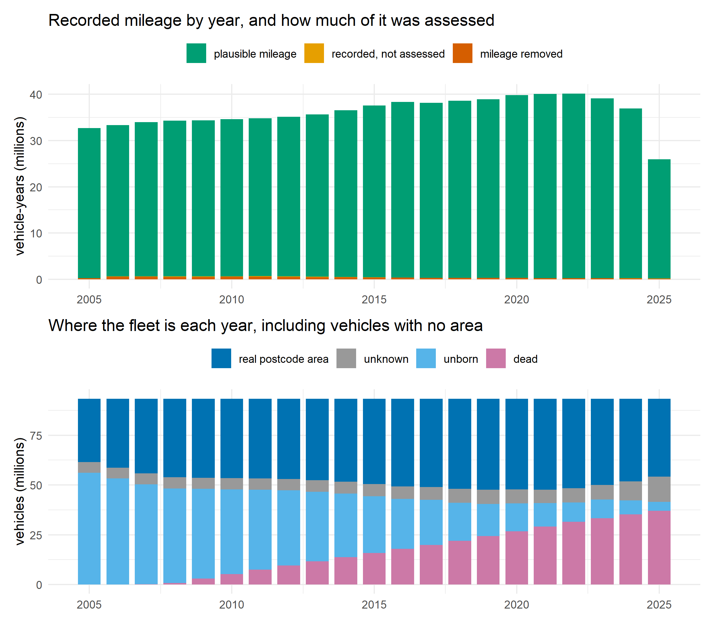

**Figure 1.** Top: the vehicle-years with a recorded mileage each year,
split into mileage the annualisation judged plausible and mileage it did
not assess, with the vehicles whose mileage it removed as implausible
(the `n_legit_mileage`, `n_unassessed_mileage` and `n_mileage_removed`
columns of the table above). Bottom: every in-scope vehicle each year by
its postcode area status (`pca_YYYY`). Both are summed from
`mileage_by_pca_year_body_fuel.csv`.

Two things to read off these charts. The unassessed share is small in
the middle of the series and large at the end: 0.03% of the mileage
recorded in 2025 was never assessed, against 0.18% in 2015, because the
last year is partial. And the `unknown` group grows from 5,284,909
vehicles in 2005 to 12,640,179 in 2025, so a larger share of the fleet
each year has no location at all. Those vehicles are in the vehicle
counts but in none of the postcode area rows.

## 5. How the values are distributed

### 5.1 Every grouping variable, with its values

#### Body type (`body_type`, harmonised)

Vehicle-years over the whole series, so a vehicle present for twenty
years counts twenty times. `pct_of_mileage` is the share of total
mileage, which is what makes the rare fuels rare. `total_mileage_bn` is
billions of miles.

| value | n_vehicle_years | pct_of_vehicle_years | total_mileage_bn | pct_of_mileage |
|:---|---:|---:|---:|---:|
| Cars | 1,585,830,729 | 80.89 | 4,574.11 | 84.98 |
| Light goods vehicles | 196,787,892 | 10.04 | 730.20 | 13.57 |
| Motorcycles | 84,436,296 | 4.31 | 45.09 | 0.84 |
| (none) | 61,380,585 | 3.13 | 9.04 | 0.17 |
| Heavy goods vehicles | 16,781,877 | 0.86 | 6.48 | 0.12 |
| Other vehicles | 11,978,862 | 0.61 | 10.48 | 0.19 |
| Buses and coaches | 3,200,820 | 0.16 | 7.23 | 0.13 |

#### Fuel group (`fuel_simple`, harmonised)

Vehicle-years over the whole series, so a vehicle present for twenty
years counts twenty times. `pct_of_mileage` is the share of total
mileage, which is what makes the rare fuels rare. `total_mileage_bn` is
billions of miles.

| value | n_vehicle_years | pct_of_vehicle_years | total_mileage_bn | pct_of_mileage |
|:---|---:|---:|---:|---:|
| Petrol | 1,094,101,806 | 55.81 | 2,526.74 | 46.94 |
| Diesel | 703,493,574 | 35.89 | 2,704.10 | 50.24 |
| Hybrid Electric | 77,635,425 | 3.96 | 88.91 | 1.65 |
| Electric | 57,573,873 | 2.94 | 29.62 | 0.55 |
| Plug-in Hybrid Electric | 22,888,005 | 1.17 | 19.69 | 0.37 |
| Other | 4,704,378 | 0.24 | 13.57 | 0.25 |

#### MOT test class (`test_class`, harmonised)

Vehicle-years over the whole series, so a vehicle present for twenty
years counts twenty times. `pct_of_mileage` is the share of total
mileage, which is what makes the rare fuels rare. `total_mileage_bn` is
billions of miles.

| value | n_vehicle_years | pct_of_vehicle_years | total_mileage_bn | pct_of_mileage |
|:---|---:|---:|---:|---:|
| Cars, Vans and Small Motorhomes | 697,229,319 | 92.81 | 5,089.13 | 94.41 |
| Motorcycles over 200cc | 22,138,601 | 2.95 | 31.28 | 0.58 |
| Light Goods Vehicles | 18,590,425 | 2.47 | 224.30 | 4.16 |
| Motorcycles up to 200cc | 8,420,781 | 1.12 | 13.74 | 0.25 |
| (none) | 3,579,053 | 0.48 | 22.63 | 0.42 |
| Minibuses and Larger Passenger Vehicles | 998,691 | 0.13 | 8.71 | 0.16 |
| Three-wheeled vehicles up to 450kg | 316,168 | 0.04 | 0.46 | 0.01 |

#### Fuel group, every recorded mileage (`fuel_simple`)

Vehicle-years over the whole series, so a vehicle present for twenty
years counts twenty times. `pct_of_mileage` is the share of total
mileage, which is what makes the rare fuels rare. `total_mileage_bn` is
billions of miles.

| value | n_vehicle_years | pct_of_vehicle_years | total_mileage_bn | pct_of_mileage |
|:---|---:|---:|---:|---:|
| Petrol | 443,941,658 | 59.09 | 2,531.54 | 46.97 |
| Diesel | 289,135,971 | 38.49 | 2,706.87 | 50.22 |
| Hybrid Electric | 10,369,071 | 1.38 | 88.92 | 1.65 |
| Electric | 3,826,995 | 0.51 | 29.62 | 0.55 |
| Plug-in Hybrid Electric | 2,107,787 | 0.28 | 19.69 | 0.37 |
| Other | 1,891,556 | 0.25 | 13.61 | 0.25 |

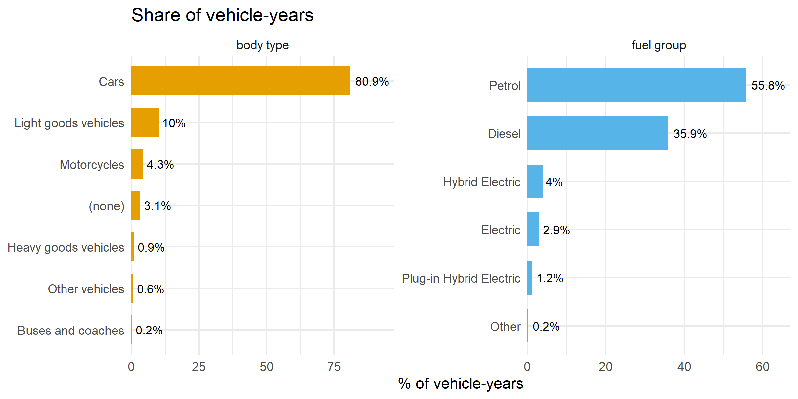

**Figure 2.** The share of all vehicle-years in each body type and fuel
group (`pct_of_vehicle_years` in the tables above), over the whole
series, so a vehicle present for twenty years counts twenty times.
Values under 0.01% are left out.

### 5.2 Where the mileage sits

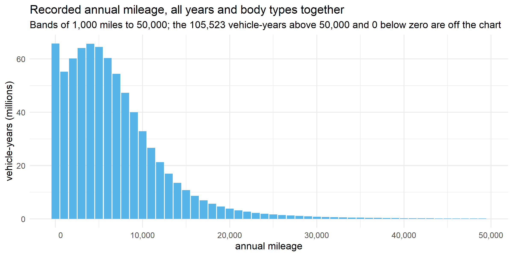

**Figure 3.** Recorded annual mileage over every year and body type, in
1,000-mile bands from 0 to 50,000: vehicle-years with a mileage, whether
the annualisation judged it plausible or did not assess it. The subtitle
counts the vehicle-years outside the range shown.

### 5.3 Mileage by age

#### Observed vehicles and their plausible mileage, by age

Every year together. A vehicle’s mileage is only known once it has had
an MOT, so the youngest ages are thin at the end of the series; section
11 shows that year by year.

| age | n_vehicles | n_legit_mileage | mean_legit_mileage |
|----:|-----------:|----------------:|-------------------:|
|   0 | 47,398,905 |      47,172,679 |            9,126.1 |
|   1 | 50,164,550 |      49,909,753 |           10,112.5 |
|   2 | 53,156,888 |      51,943,989 |            9,448.4 |
|   3 | 55,401,606 |      53,290,659 |            8,803.4 |
|   4 | 56,449,859 |      53,559,826 |            8,418.0 |
|   5 | 55,978,564 |      52,766,800 |            8,054.2 |
|   6 | 55,515,531 |      51,956,592 |            7,701.3 |
|   7 | 54,316,609 |      50,185,632 |            7,358.3 |
|   8 | 52,948,485 |      47,688,121 |            7,010.8 |
|   9 | 50,423,357 |      43,694,047 |            6,666.9 |
|  10 | 47,648,260 |      39,038,213 |            6,343.1 |
|  11 | 44,328,203 |      33,772,004 |            6,027.1 |
|  12 | 40,437,172 |      28,324,187 |            5,698.9 |
|  13 | 35,511,408 |      22,796,368 |            5,376.3 |
|  14 | 30,393,077 |      18,008,658 |            5,047.9 |
|  15 | 25,081,987 |      13,891,788 |            4,703.4 |
|  16 | 19,909,848 |      10,538,907 |            4,343.8 |
|  17 | 15,305,517 |       7,836,680 |            3,983.9 |
|  18 | 11,306,456 |       5,759,400 |            3,609.2 |
|  19 |  8,203,309 |       4,251,218 |            3,236.1 |
|  20 |  5,959,912 |       3,199,849 |            2,873.3 |
|  21 |  4,284,893 |       2,405,007 |            2,548.6 |
|  22 |  3,135,094 |       1,858,563 |            2,246.6 |
|  23 |  2,348,091 |       1,471,557 |            1,977.6 |
|  24 |  1,844,526 |       1,223,419 |            1,752.3 |
|  25 |  1,484,493 |       1,027,728 |            1,588.4 |

## 6. The fleet over time

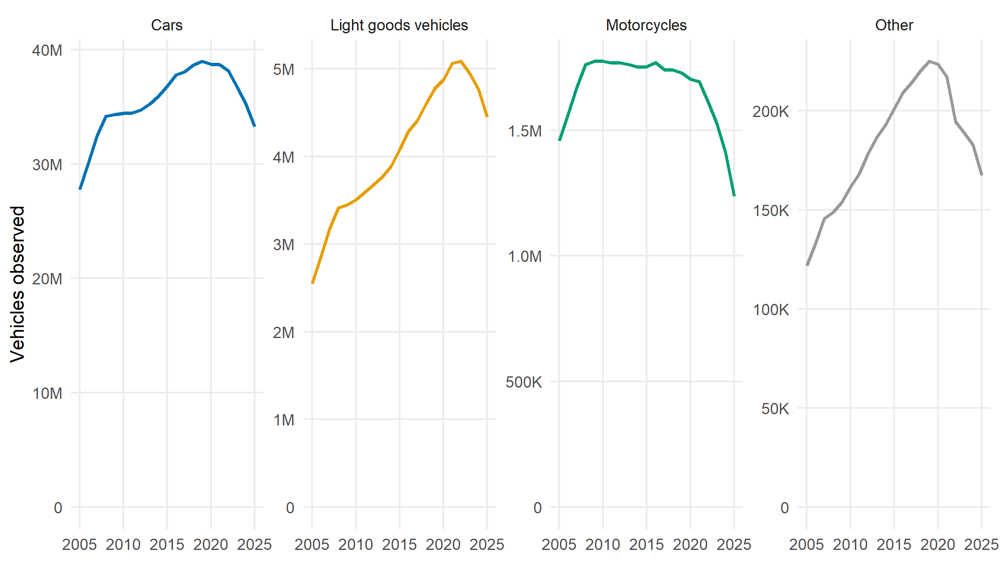

**Figure 4.** Vehicles observed each year (in a real postcode area), by
body type, summed from `mileage_by_pca_year_body_fuel.csv`. `Other`
groups buses and coaches, heavy goods vehicles, other vehicles and
vehicles with no body type. Each panel has its own scale.

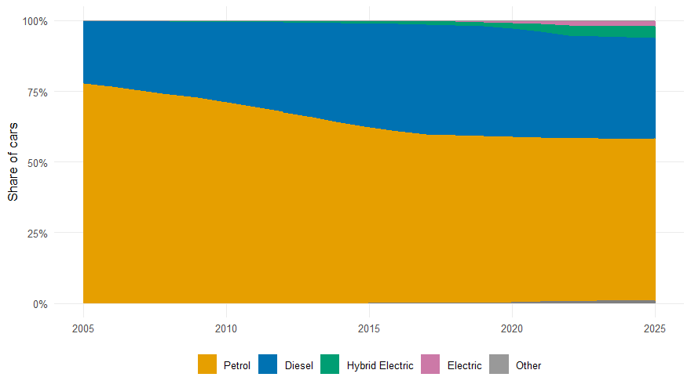

**Figure 5.** The share of each year’s observed cars in each fuel group
(`fuel_simple`), from `mileage_by_pca_year_body_fuel.csv`.

### Vehicles observed by body type

Vehicles observed in selected years, by DfT body type. Buses, heavy
goods vehicles and other vehicles are mostly tested outside the MOT
scheme, so few are here. The fall in the latest years is mainly vehicles
not yet observed in those years, rather than vehicles leaving the fleet.

| body_type            |       2006 |       2010 |       2015 |       2020 |       2022 |
|:---------------------|-----------:|-----------:|-----------:|-----------:|-----------:|
| Cars                 | 30,107,251 | 34,426,709 | 36,794,357 | 38,736,380 | 38,124,631 |
| Light goods vehicles |  2,860,477 |  3,506,363 |  4,078,829 |  4,871,530 |  5,085,133 |
| Motorcycles          |  1,561,917 |  1,773,776 |  1,753,582 |  1,703,135 |  1,614,499 |
| Unknown              |     49,443 |     47,237 |     56,021 |     61,106 |     51,412 |
| Heavy goods vehicles |      9,240 |     19,129 |     35,882 |     51,437 |     50,264 |
| Other vehicles       |     49,695 |     58,626 |     60,141 |     54,108 |     47,569 |
| Buses and coaches    |     24,519 |     36,431 |     48,856 |     56,746 |     45,287 |

## 7. Annual mileage

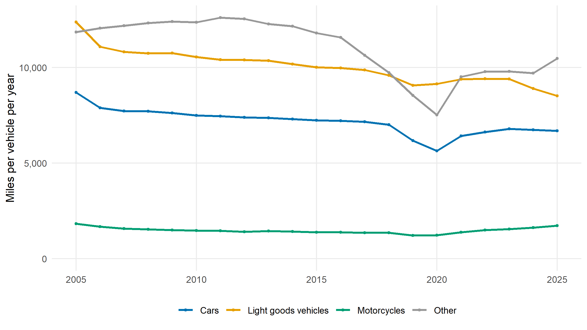

**Figure 6.** Average annual mileage of the observed vehicles by body
type: each year’s total plausible mileage divided by the vehicles with a
plausible mileage (`mileage_by_pca_year_body_fuel.csv`). Years with no
mileage are left out, and mileage in a partial final year covers fewer
vehicles.

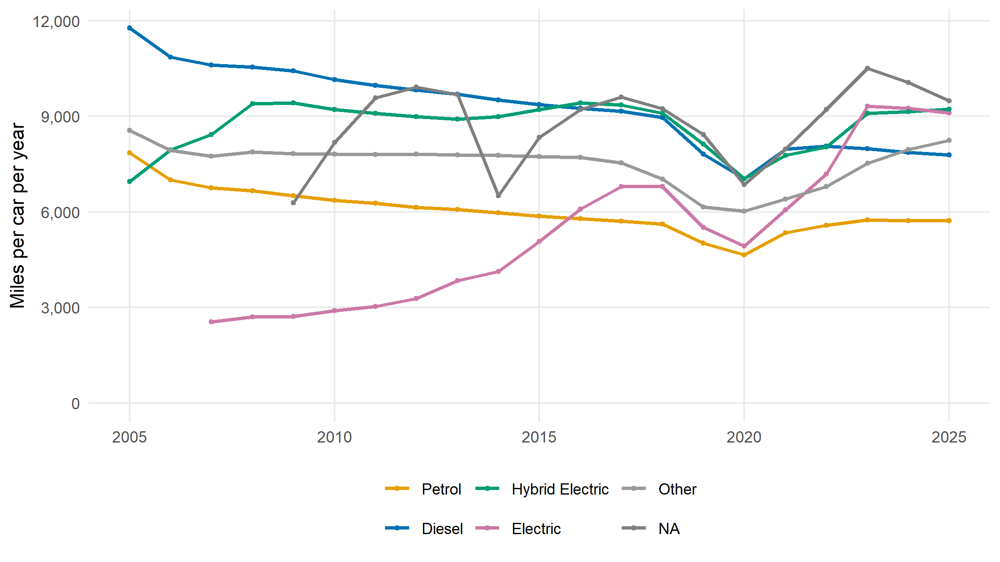

**Figure 7.** Average annual mileage of observed cars by fuel group,
calculated as in the previous figure. Years where a fuel has fewer than
1,000 cars with a plausible mileage are left out.

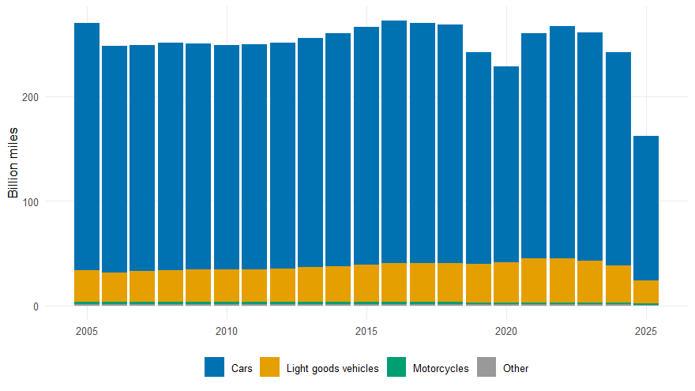

**Figure 8.** The total plausible annual mileage recorded each year, by
body type (`total_legit_mileage` summed from
`mileage_by_pca_year_body_fuel.csv`). It is the total over the vehicles
with a plausible mileage, not an estimate for the whole fleet.

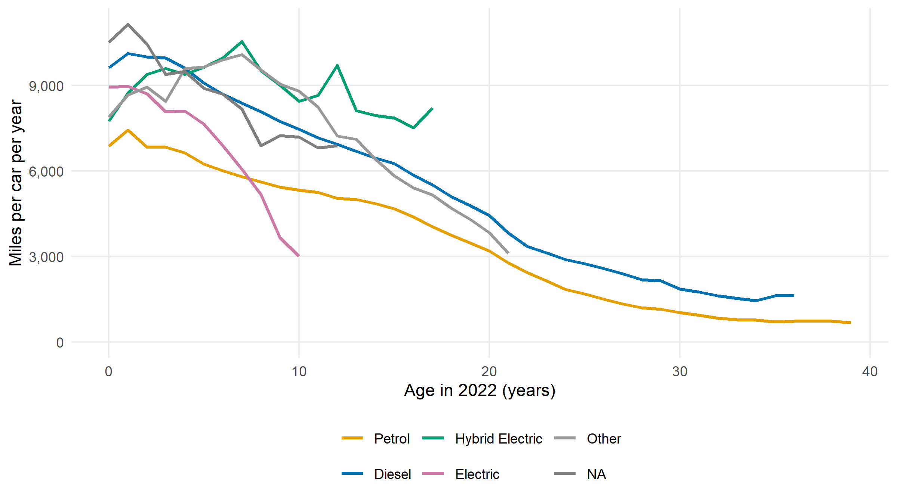

**Figure 9.** Average annual mileage of cars in 2022 by age and fuel
group: total plausible mileage divided by cars with a plausible mileage,
from `mileage_by_age_year_body_fuel.csv`. Ages with fewer than 500 such
cars are left out. Few cars are tested before age three, and those that
are, such as taxis and private hire cars, are driven much further than
most.

### Average annual mileage by body type

Miles per vehicle per year, plausible mileage only.

| body_type            |   2006 |   2010 |   2015 |   2020 |   2022 |
|:---------------------|-------:|-------:|-------:|-------:|-------:|
| Buses and coaches    | 12,216 | 11,052 |  9,615 |  5,697 |  7,234 |
| Cars                 |  7,897 |  7,500 |  7,244 |  5,641 |  6,623 |
| Heavy goods vehicles | 14,877 | 13,652 | 15,661 | 13,109 | 12,167 |
| Light goods vehicles | 11,082 | 10,552 | 10,016 |  9,147 |  9,408 |
| Motorcycles          |  1,677 |  1,476 |  1,391 |  1,232 |  1,501 |
| Other vehicles       | 12,382 | 13,033 | 11,316 |  5,662 | 10,287 |
| Unknown              |  9,676 | 11,792 | 12,448 |  6,579 |  9,959 |

## 8. Age

Average ages describe the vehicles still being tested. Compared with
DfT’s counts (`outputs/quality/dft_stock_by_age.csv`), the MOT data
holds about as many vehicles aged 3 to 16 as DfT does, but fewer and
fewer older ones (at 25 years, roughly half as many): old vehicles
declared off the road (SORN) stay in DfT’s counts but are not tested.

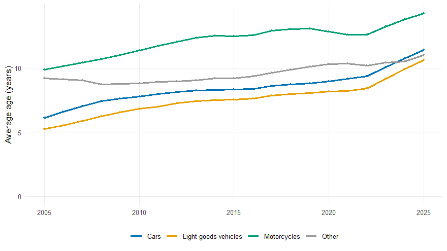

**Figure 10.** Average age of the observed vehicles each year, by body
type: whole years at 1 June since first use, averaged over the vehicles
with an age (`mileage_by_pca_year_body_fuel.csv`).

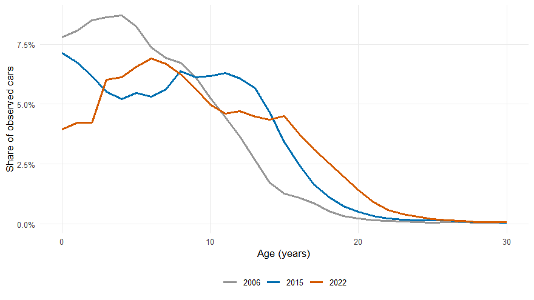

**Figure 11.** The age of observed cars in 2006, 2015 and 2022, as a
share of each year’s cars aged 0 to 30, from
`mileage_by_age_year_body_fuel.csv`.

## 9. Maps

All maps show 2022 unless stated (see the summary for why). Grey areas
have no vehicles.

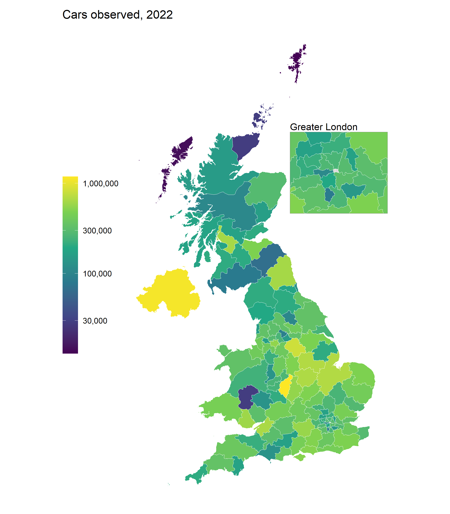

**Figure 12.** Cars observed in each postcode area in 2022, on a log
colour scale (`mileage_by_pca_year_body_fuel.csv`).

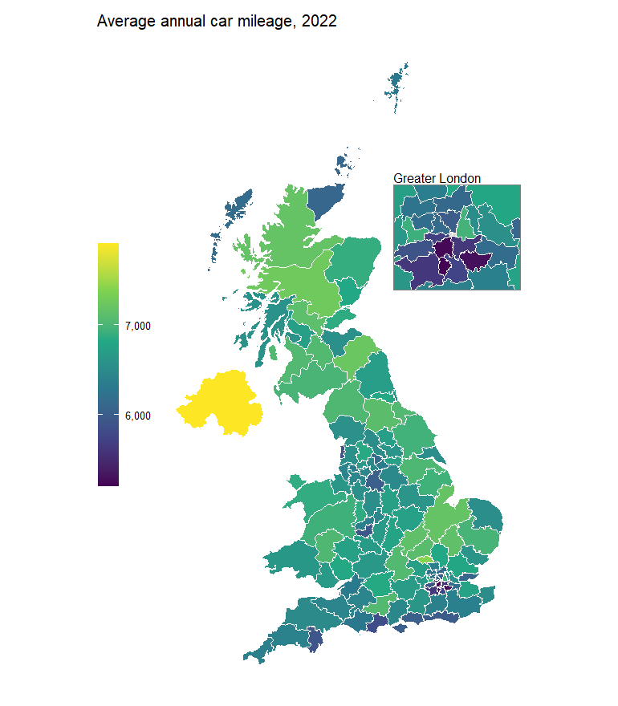

**Figure 13.** Average annual mileage of the cars observed in each
postcode area in 2022: total plausible mileage divided by cars with a
plausible mileage.

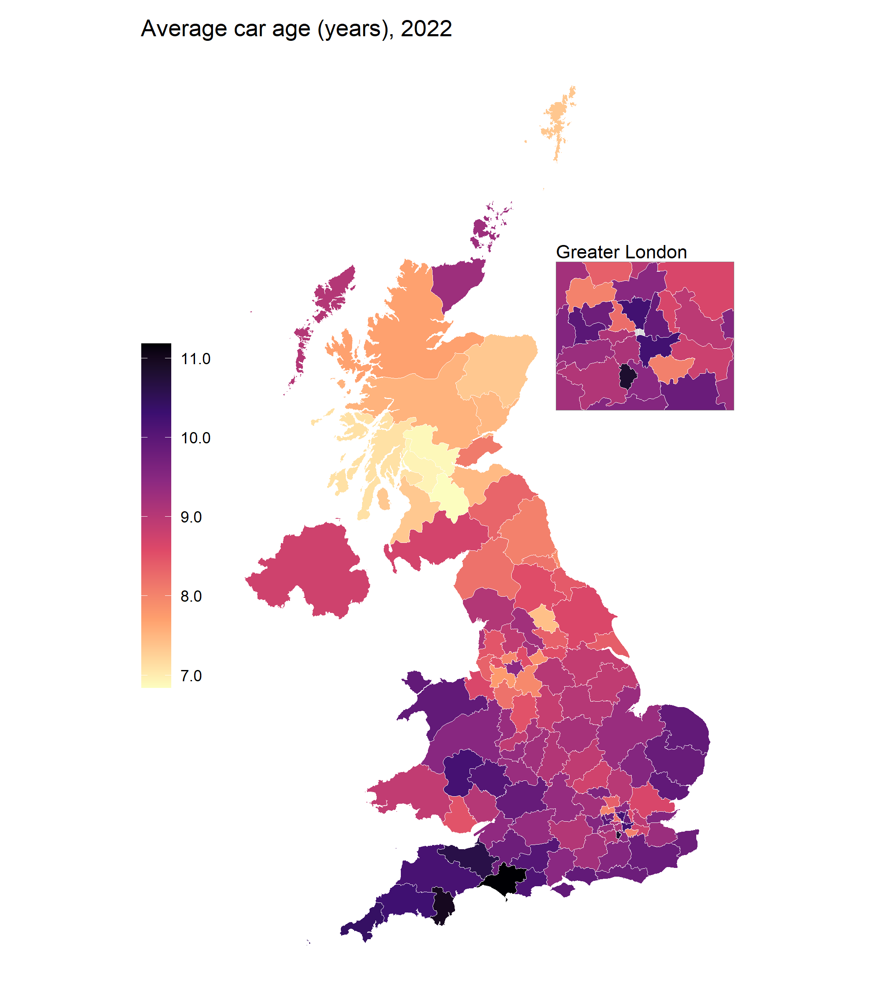

**Figure 14.** Average age of the cars observed in each postcode area in
2022.

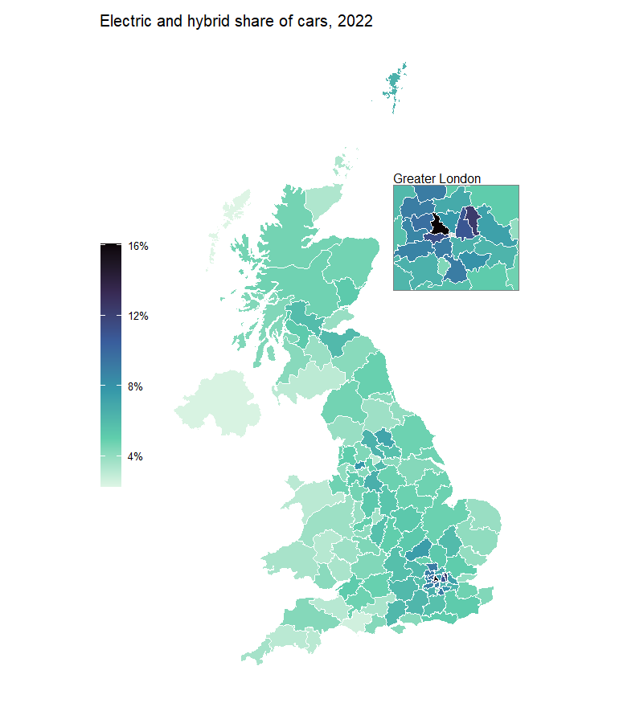

**Figure 15.** The share of the cars observed in each postcode area in
2022 whose fuel group is Electric or Hybrid Electric.

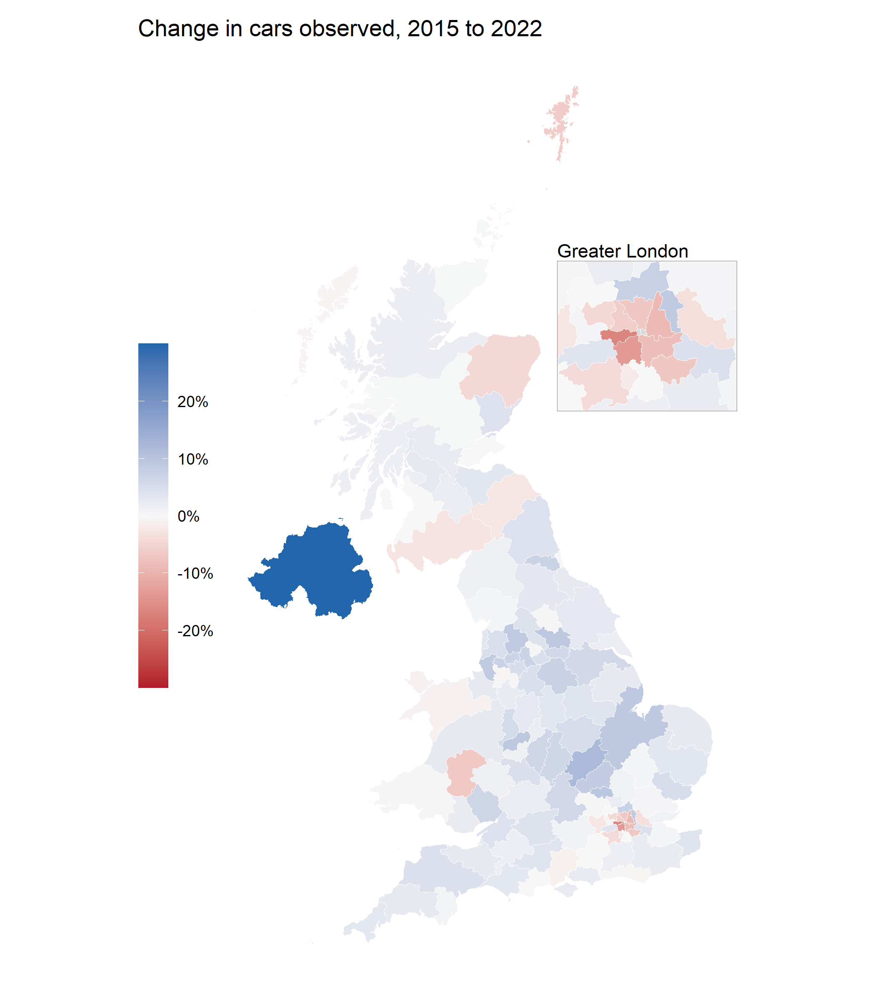

**Figure 16.** The change in the cars observed in each postcode area
from 2015 to 2022, as a share of the 2015 count. Blue is growth and red
decline; the colour scale stops at 30% either way.

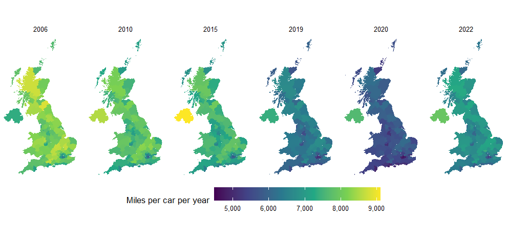

**Figure 17.** Average annual mileage of the cars observed in each
postcode area in 2006, 2010, 2015, 2019, 2020 and 2022, calculated as in
the map above, on one colour scale so that the years can be compared.

## 10. Comparison with DfT small-area counts

DfT publishes vehicle counts for small areas (LSOAs and their
equivalents) in tables VEH0125 (all vehicles by body type, keepership
and licence status), VEH0135 (ultra low emission vehicles) and VEH0145
(plug-in vehicles). `data-raw/build_dft_lsoa_vehicles_by_pca.R` takes
these tables from the PlaceBasedCarbonCalculator build, where the counts
DfT suppresses are reconstructed, and adds them up to postcode areas
(`inputs/dft_lsoa_vehicles_by_pca.csv`). The tables give the first
quarter of each year, so MOT year Y is compared with DfT counts at the
end of March of Y + 1. DfT counts here are licensed and SORN vehicles
together.

The two sources are not expected to agree exactly. DfT counts include
vehicles under three whose first MOT is not yet in the data (once it is,
the annualisation back-fills their area), and the MOT data keeps a
vehicle in its area for two years after its last test, after DfT has
stopped counting it if it was scrapped. DfT also places a vehicle at its
keeper’s address, so company and lease cars are counted where the
company is registered, while the MOT data places a vehicle where it was
observed. The maps and tables below therefore compare each postcode area
with the national ratio for 2022 (1.040 MOT cars per DfT car).

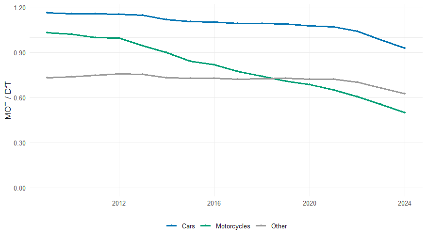

**Figure 18.** Vehicles observed in the MOT data each year divided by
DfT’s licensed and SORN count at the end of March of the following year
(VEH0125, summed from small areas to postcode areas in
`inputs/dft_lsoa_vehicles_by_pca.csv`), by body group. At 1 (grey line)
the two count the same.

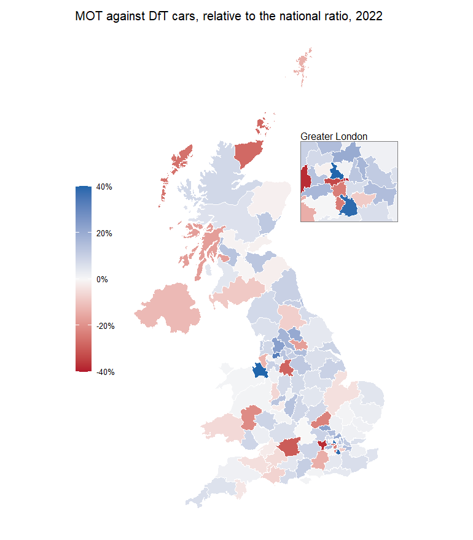

**Figure 19.** For each postcode area in 2022, its ratio of MOT cars to
DfT cars relative to the national ratio (1.040). Blue: more cars in the
MOT data than the national ratio suggests; red: fewer. The colour scale
stops at 40% either way.

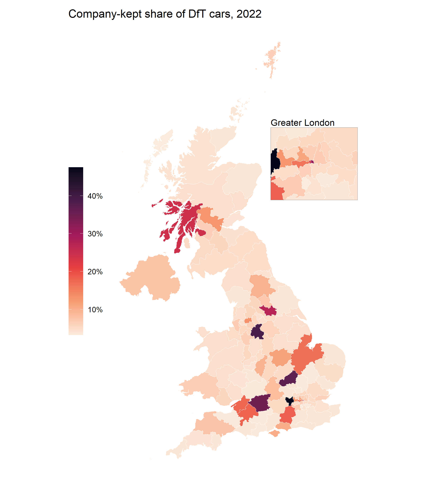

**Figure 20.** The share of each postcode area’s DfT cars kept by a
company (VEH0125 keepership), 2022. High shares mark areas where fleet
and lease cars are registered.

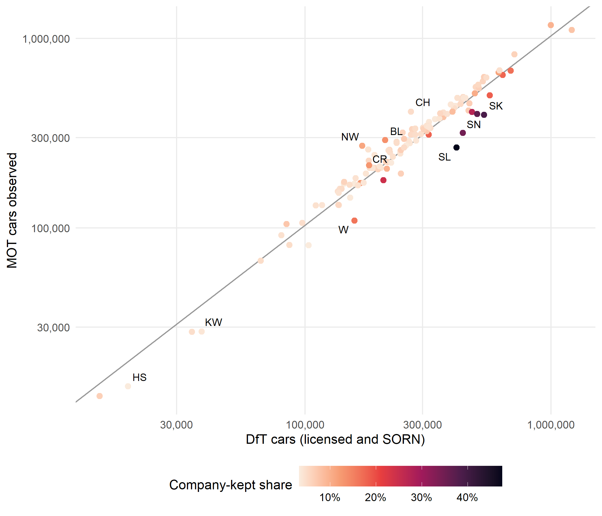

**Figure 21.** Each point is a postcode area in 2022: its DfT cars
against its MOT cars, on log scales, coloured by the share of its DfT
cars kept by a company. The grey line is the national ratio; labelled
areas differ from it by more than 25%.

### Postcode areas furthest from the national ratio, cars 2022

The 20 postcode areas whose ratio of MOT to DfT cars differs most from
the national ratio. Areas with no MOT cars are listed in section 6
instead. Where the difference shrinks when only privately kept DfT cars
are counted, company registrations explain much of it.

- `mot_cars`: cars observed in the MOT data
- `dft_cars`: DfT licensed and SORN cars, end of March of the following
  year
- `ratio`: `mot_cars` / `dft_cars`
- `difference_from_national`: how far `ratio` is above or below the
  national ratio
- `difference_private_only`: the same, counting only privately kept DfT
  cars
- `dft_company_share`: share of the DfT cars kept by a company

| pca | mot_cars | dft_cars | ratio | difference_from_national | difference_private_only | dft_company_share |
|:---|---:|---:|---:|:---|:---|:---|
| NW | 271,700 | 170,194 | 1.60 | 54% | 54% | 11% |
| CH | 412,471 | 268,890 | 1.53 | 48% | 38% | 5% |
| CR | 259,943 | 180,064 | 1.44 | 39% | 29% | 4% |
| SL | 266,329 | 411,838 | 0.65 | -38% | 5% | 47% |
| W | 109,560 | 158,392 | 0.69 | -33% | -29% | 16% |
| BL | 291,308 | 210,913 | 1.38 | 33% | 37% | 13% |
| SN | 318,219 | 437,451 | 0.73 | -30% | -4% | 35% |
| SK | 396,420 | 533,328 | 0.74 | -29% | 4% | 39% |
| KW | 28,510 | 37,920 | 0.75 | -28% | -33% | 4% |
| HS | 14,624 | 18,997 | 0.77 | -26% | -32% | 3% |
| SM | 81,311 | 103,069 | 0.79 | -24% | -30% | 3% |
| SW | 193,803 | 244,417 | 0.79 | -24% | -28% | 6% |
| BB | 319,016 | 248,786 | 1.28 | 23% | 17% | 6% |
| MK | 399,926 | 499,682 | 0.80 | -23% | 8% | 37% |
| LU | 243,694 | 191,170 | 1.27 | 23% | 14% | 4% |
| LD | 28,351 | 34,562 | 0.82 | -21% | -26% | 5% |
| HG | 105,099 | 83,911 | 1.25 | 20% | 16% | 7% |
| EN | 226,714 | 181,436 | 1.25 | 20% | 13% | 5% |
| BD | 332,526 | 271,665 | 1.22 | 18% | 11% | 6% |
| PA | 178,817 | 207,736 | 0.86 | -17% | -2% | 24% |

### Electric vehicles

Vehicles with harmonised fuel Electric observed in the MOT data, against
licensed battery electric vehicles in VEH0145 (all body types, end of
March of the following year). Most electric vehicles are new, and a
vehicle appears here only once its first MOT (at three) is in the data,
which keeps the ratio low in the most recent years and lowers it when
sales grow quickly.

| year | mot_electric | dft_battery_electric | ratio |
|:-----|-------------:|---------------------:|------:|
| 2011 |        4,001 |                7,401 |  0.54 |
| 2012 |        5,756 |                8,322 |  0.69 |
| 2013 |        8,202 |               10,318 |  0.79 |
| 2014 |       14,842 |               16,419 |  0.90 |
| 2015 |       24,734 |               24,937 |  0.99 |
| 2016 |       35,221 |               35,546 |  0.99 |
| 2017 |       45,760 |               50,441 |  0.91 |
| 2018 |       61,966 |               72,939 |  0.85 |
| 2019 |      102,267 |              127,175 |  0.80 |
| 2020 |      213,602 |              250,873 |  0.85 |
| 2021 |      414,263 |              480,518 |  0.86 |
| 2022 |      669,649 |              748,809 |  0.89 |
| 2023 |      682,404 |            1,065,308 |  0.64 |
| 2024 |      685,946 |            1,468,163 |  0.47 |

## 11. Possible problems in the data

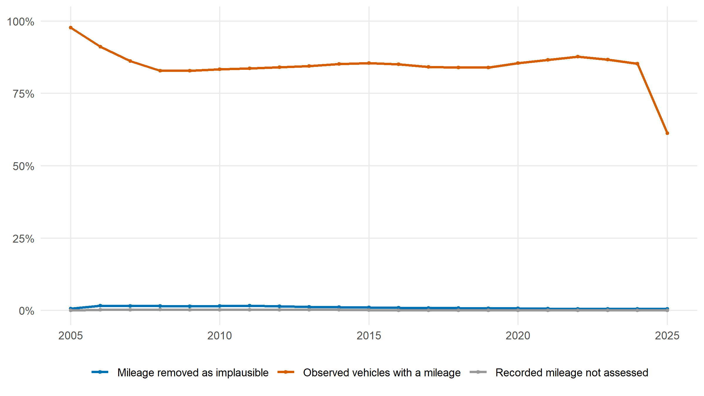

**Figure 22.** Three shares each year, from
`mileage_by_pca_year_body_fuel.csv`: the observed vehicles with an
annual mileage; of the vehicles with a mileage before the
annualisation’s checks, those whose mileage it flagged implausible and
removed; and of the recorded mileages, those it did not assess. The last
two count every vehicle, whether observed that year or not.

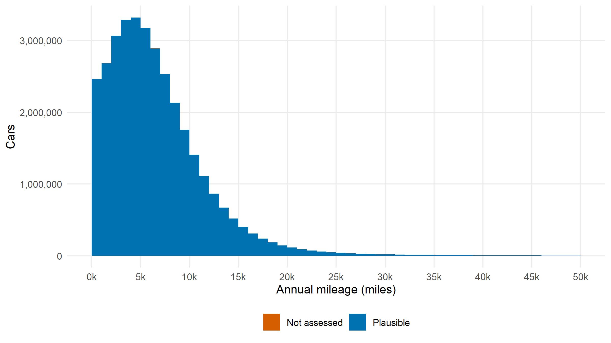

**Figure 23.** Recorded annual mileage of cars in 2022 in 1,000-mile
bands from 0 to 50,000, by whether the annualisation flagged it
plausible or did not assess it
(`mileage_distribution_by_year_body.csv`). The table below counts the
mileages outside the range shown.

### Car mileage outside the chart, 2022

Cars with a recorded annual mileage below 0 or of 50,000 miles or more.

| band             | Plausible |
|:-----------------|----------:|
| 50,000 to 99,999 |     2,792 |

### Mileage and age checks by year

Counts across all in-scope vehicles. Each column other than
`n_with_mileage` should be small.

- `n_with_mileage`: vehicles with a recorded annual mileage
- `n_not_assessed`: recorded mileage with no plausibility flag (left out
  of the averages)
- `n_mileage_removed`: vehicles whose mileage was flagged as implausible
  and removed
- `n_negative_mileage`: annual mileage below 0
- `n_over_50k_mileage`: annual mileage above 50,000 miles
- `n_mileage_not_observed`: vehicles with a mileage in a year where they
  have no postcode area (`unborn`, `dead` or `unknown`): mileage without
  a location
- `n_negative_age`: vehicles first used after 1 June of the year (age
  below 0)

| year | n_with_mileage | n_not_assessed | n_mileage_removed | n_negative_mileage | n_over_50k_mileage | n_mileage_not_observed | n_negative_age |
|:---|---:|---:|---:|---:|---:|---:|---:|
| 2005 | 32,452,735 | 0 | 218,720 | 0 | 4,384 | 1,300,784 | 1,631,176 |
| 2006 | 32,814,077 | 78,783 | 541,099 | 0 | 5,128 | 1,234,618 | 1,588,613 |
| 2007 | 33,453,711 | 91,350 | 545,479 | 0 | 4,936 | 1,139,156 | 1,637,673 |
| 2008 | 33,775,906 | 101,540 | 527,435 | 0 | 5,514 | 1,044,819 | 1,315,570 |
| 2009 | 33,847,006 | 100,690 | 515,834 | 0 | 4,932 | 950,673 | 1,409,166 |
| 2010 | 34,105,231 | 93,501 | 540,551 | 0 | 4,976 | 877,658 | 1,293,198 |
| 2011 | 34,266,679 | 96,986 | 571,335 | 0 | 5,093 | 803,307 | 1,277,885 |
| 2012 | 34,584,164 | 96,511 | 520,620 | 0 | 5,836 | 683,777 | 1,353,072 |
| 2013 | 35,209,581 | 94,883 | 449,107 | 0 | 5,373 | 628,688 | 1,515,204 |
| 2014 | 36,140,728 | 93,047 | 436,350 | 0 | 5,379 | 593,477 | 1,651,461 |
| 2015 | 37,170,928 | 65,801 | 397,347 | 0 | 5,241 | 543,905 | 1,764,151 |
| 2016 | 37,964,991 | 4,330 | 358,508 | 0 | 5,740 | 481,398 | 1,777,323 |
| 2017 | 37,800,202 | 4,563 | 333,007 | 0 | 5,170 | 386,827 | 1,294,849 |
| 2018 | 38,286,966 | 6,991 | 317,630 | 0 | 4,978 | 323,295 | 1,523,628 |
| 2019 | 38,657,512 | 7,173 | 283,619 | 0 | 4,116 | 278,710 | 1,501,049 |
| 2020 | 39,529,622 | 3,714 | 302,900 | 0 | 5,580 | 610,560 | 1,373,280 |
| 2021 | 39,832,221 | 5,136 | 253,213 | 0 | 4,642 | 296,268 | 1,142,746 |
| 2022 | 39,936,342 | 5,013 | 238,071 | 0 | 4,832 | 462,143 | 1,032,856 |
| 2023 | 38,906,652 | 5,441 | 224,155 | 0 | 4,689 | 1,280,198 | 24,482 |
| 2024 | 36,734,471 | 6,030 | 211,841 | 0 | 5,394 | 1,296,739 | 12,791 |
| 2025 | 25,803,313 | 8,170 | 147,846 | 0 | 3,590 | 1,844,937 | 253 |

### Mileage recorded without a postcode area

Vehicles with an annual mileage in a year whose status is not a postcode
area, by status. Mileage in a year before the vehicle’s birth date
(`unborn`) points to a wrong date.

| year |    dead |  unborn |   unknown |
|:-----|--------:|--------:|----------:|
| 2005 |       0 |  21,246 | 1,279,538 |
| 2006 |       3 |  20,903 | 1,213,712 |
| 2007 |      34 |  19,824 | 1,119,298 |
| 2008 |      61 |  17,771 | 1,026,987 |
| 2009 |      93 |  11,367 |   939,213 |
| 2010 |     128 |  11,138 |   866,392 |
| 2011 |     156 |  11,035 |   792,116 |
| 2012 |     190 |  13,662 |   669,925 |
| 2013 |     230 |  16,816 |   611,642 |
| 2014 |     301 |  15,178 |   577,998 |
| 2015 |     420 |  14,021 |   529,464 |
| 2016 |     814 |   9,718 |   470,866 |
| 2017 |   1,821 |   7,243 |   377,763 |
| 2018 |   3,287 |   9,688 |   310,320 |
| 2019 |   5,428 |  15,712 |   257,570 |
| 2020 |   8,668 |  14,623 |   587,269 |
| 2021 |  15,383 |  27,699 |   253,186 |
| 2022 |  56,660 |  76,854 |   328,629 |
| 2023 |  83,784 | 838,766 |   357,648 |
| 2024 | 141,430 |   5,786 | 1,149,523 |
| 2025 | 138,618 |       0 | 1,706,319 |

### Postcode areas without a match

- **Codes in the MOT data with no boundary:** `XX` (66,249
  vehicle-years).
- **Boundaries with no vehicles in the MOT data:** `EC` and `WC`. DfT
  counts cars in them, so those cars are recorded under other codes in
  the MOT data, or not at all.

### Sudden changes in a postcode area

Postcode areas (with at least 10,000 vehicles) whose number of observed
vehicles changed by more than 10 percentage points above or below the
national change from the previous year: largest 25. A steady rise over
many years suggests coverage building up; a jump that reverses the next
year points to a recording problem.

| year | pca | vehicles_previous_year |  vehicles | change | national_change |
|:-----|:----|-----------------------:|----------:|:-------|:----------------|
| 2006 | BT  |                264,565 |   325,194 | 23%    | 9%              |
| 2007 | BT  |                325,194 |   394,129 | 21%    | 8%              |
| 2009 | BT  |                452,771 |   503,134 | 11%    | 0%              |
| 2010 | BT  |                503,134 |   557,246 | 11%    | 0%              |
| 2017 | BT  |              1,060,833 | 1,179,283 | 11%    | 1%              |
| 2014 | BT  |                750,120 |   840,578 | 12%    | 2%              |

### Unusual average car mileage

Postcode area and year combinations (with at least 1,000 cars with a
plausible mileage) where the average annual car mileage is more than 20%
above or below the national average: largest 25. Rural areas are
expected to be higher; a single year out of line with the years either
side points to a problem.

| year | pca | cars_with_mileage | mean_mileage | national_mean | difference |
|:-----|:----|------------------:|-------------:|--------------:|:-----------|
| 2020 | BT  |           939,421 |        7,629 |         5,641 | 35%        |
| 2016 | BT  |           813,785 |        9,124 |         7,210 | 27%        |
| 2015 | BT  |           719,281 |        9,084 |         7,244 | 25%        |
| 2010 | SM  |            60,495 |        5,674 |         7,500 | -24%       |
| 2008 | SM  |            58,928 |        5,854 |         7,707 | -24%       |
| 2009 | SM  |            59,590 |        5,801 |         7,619 | -24%       |
| 2018 | SW  |           179,682 |        5,345 |         7,016 | -24%       |
| 2016 | SW  |           190,767 |        5,501 |         7,210 | -24%       |
| 2007 | SM  |            58,772 |        5,892 |         7,721 | -24%       |
| 2017 | SW  |           184,077 |        5,464 |         7,157 | -24%       |
| 2015 | SW  |           192,626 |        5,536 |         7,244 | -24%       |
| 2014 | SW  |           191,111 |        5,587 |         7,306 | -24%       |
| 2024 | SW  |           145,902 |        5,167 |         6,742 | -23%       |
| 2012 | SW  |           190,414 |        5,686 |         7,395 | -23%       |
| 2011 | SW  |           191,575 |        5,742 |         7,457 | -23%       |
| 2013 | SW  |           192,077 |        5,679 |         7,368 | -23%       |
| 2025 | SW  |            90,833 |        5,160 |         6,695 | -23%       |
| 2011 | SM  |            64,331 |        5,752 |         7,457 | -23%       |
| 2014 | BT  |           636,588 |        8,973 |         7,306 | 23%        |
| 2017 | BT  |           913,855 |        8,787 |         7,157 | 23%        |
| 2006 | SM  |            59,293 |        6,112 |         7,897 | -23%       |
| 2010 | SW  |           192,874 |        5,809 |         7,500 | -23%       |
| 2009 | SW  |           196,270 |        5,911 |         7,619 | -22%       |
| 2023 | SW  |           156,707 |        5,278 |         6,796 | -22%       |
| 2008 | SW  |           198,684 |        5,992 |         7,707 | -22%       |

### Vehicles with no body type, 2022

Postcode areas where the share of observed vehicles with no body type is
more than three times the national share (0.11%) and above 1%. A vehicle
with no make/model match and no test class has no body type, so is
counted under Other in the charts.

| pca | vehicles_no_body_type | share |
|:----|----------------------:|:------|
| BT  |                51,412 | 3.7%  |

## 12. Source files and how to rebuild

Every table this document describes is listed with its grain and
contents in section 2.1, and every column of every one of them in
section 2.2. Two further inputs are read directly by the charts and
maps:

- `inputs/dft_lsoa_vehicles_by_pca.csv`: DfT VEH0125, VEH0135 and
  VEH0145 by postcode area
  (`data-raw/build_dft_lsoa_vehicles_by_pca.R`).
- `inputs/postcode_areas_100m.gpkg`: postcode area boundaries simplified
  to 100 m (`data-raw/build_postcode_area_boundaries.R`).

The tables and this document are built by `targets`, so rebuilding only
repeats what changed:

``` r
# the mileage tables, their measurements and this report
targets::tar_make(names = c("mileage_tables", "mileage_area_tables",
                            "mileage_profile_tables", "mileage_report"))

# just this document, from the tables already written
targets::tar_make(names = "mileage_report")
```

Editing `reports/mileage_report.qmd` re-renders this document only.
Editing `R/summary_mileage.R` rebuilds the tables and then this
document. Every number above is read from the files listed in section
2.1 and the measurements in `outputs/quality/mileage_profile/`, so
nothing here can drift from the build it describes.

## 13. Things to be careful about, in one place

| Issue | Detail |
|:---|:---|
| The last year is partial | 2025 holds 25,803,313 vehicle-years with a recorded mileage against 36,734,471 in 2024, and 0.03% of that mileage was never assessed. Do not read a trend into the final year. |
| Young vehicles are missing from the recent years | A vehicle’s mileage is only known once it has had an MOT, at three years old; the annualisation then estimates the earlier years from that test. So the youngest ages fill in only once the first test is in the data and empty out towards the end of the series, and the vehicles that do appear there are the ones tested unusually early. Section 11 quantifies it. |
| Unassessed mileage is not zero mileage | The annualisation removed the mileage it judged implausible, so a recorded mileage is either plausible or unassessed. Treating the unassessed as zero would lose 8,170 vehicle-years in 2025 alone. |
| A growing share of the fleet has no location | The `unknown` group reaches 12,640,179 vehicles by 2025. They are in the vehicle counts and in no postcode area row, so the area rows do not sum to the fleet. |
| The mileage comes from the annualisation, not the pipeline | Annual mileage, the postcode area and the plausibility flag all come from the annualisation and are taken as given. The pipeline applies no scaling and does not re-derive them. |
| One definition of age, test class and fuel | Every table uses the churn tables’ definitions: age at 1 June, the harmonised `test_class` and the harmonised `fuel_simple`. Until October 2026 the test class and fuel tables used the columns as supplied (`test_class_ANON`, `fuel_DVSA`) and age was the calendar-year difference, so older copies of these tables are not directly comparable. |
| Vehicles with no body type | 2,922,885 vehicles (3.13%) have no DfT body type, all of them vehicles with no MOT test class. They are grouped as `Other` rather than dropped. |
| Vehicles with no age | 123 vehicles (0%) have no first use date, so they appear in the vehicle and mileage tables but in no age table. |
| Vehicles with no test class | 5,510,998 vehicles (5.9%) have no test class and are absent from the test class tables, which therefore total less than the fleet. |
| Negative and very large mileage | Over the whole series 0 vehicle-years carry a mileage below zero and 105,523 above 50,000. Both are left in the published tables and counted separately (`n_negative_mileage`, `n_over_50k_mileage`) rather than removed. |
| Negative ages are not all errors | `n_negative_age` in the area table counts every year before a vehicle was first used, and every vehicle first used after 1 June of the year, so it is large by construction and is not a count of errors. Among vehicles actually observed in a postcode area, 26,120,435 have a negative age, nearly all first used later in the year. |
| A mean has a changing denominator | A mean mileage is over the vehicles that have a recorded mileage, not over the fleet, and that denominator changes year by year. The tables carry counts and totals rather than means alone, so a mean can be recomputed over any chosen group. |
