# The RACF / SMMT car fleet, linked to the MOT data {#sec-racf-linked-report .unnumbered}

::: {.callout-note title="Generated by the pipeline"}
This appendix is `outputs/reports/racf_linked_report.md` from the MOT-pipline repository, copied unchanged into the book by `scripts/sync-pipeline.R`. Paths such as `outputs/...` refer to that repository. See @sec-maintaining.
:::

*Generated from `reports/racf_linked_report.qmd` by the MOT-pipline
`racf_linked_report` target (profile: main). Tables:
`outputs/tables/racf/`. Edit the template, not this file.*

## Summary

- **What the RACF data is.** DfT’s car fleet (the licensed and SORN cars
  of VEH0124) by make, model, year of first use and fuel, enriched by
  RACF with the SMMT segment and with each model’s mass, dimensions,
  footprint, CO2, energy use and electric range from the EU
  type-approval and Dutch RDW registers. It holds counts and model
  attributes only: no vehicle records.
- **It agrees with DfT.** The RACF fleet is 99.97%–99.98% of DfT’s
  VEH0124 car count in every year from 2014 to 2025.
- **Almost every MOT car links.** Of the 36,730,468 cars located in
  2023, 43.8% link to their exact model string and 55.3% to their
  generic model (both by year of first use and fuel); 0.9% do not link.
- **But many attributes are proxies.** Only 34.4% of the 2023 fleet is
  matched to the EU data for its exact year; the rest borrows another
  year’s or fuel’s values. Linked attributes are model averages, not
  measurements of the vehicle.
- **A defect in the RACF file.** 12.3% of the battery electric and fuel
  cell cars in the 2023 RACF fleet carry an EU CO2 above 0, mostly
  through RACF’s fuel-agnostic matches, which give an electric model a
  combustion variant’s figures. The link treats these as missing.
- **What it shows.** Between 2014 and 2023 the located car fleet’s SUV
  share rose from 10.0% to 24.6%, its mean EU mass from 1,375 to 1,415
  kg and its mean footprint from 3.97 to 4.03 m², while its mean NEDC
  CO2 fell from 147 to 133 g/km. SUVs and off-roaders were driven 7,703
  miles on average in 2023, against 6,488 for other cars.
- **Validation.** The VES CO2 of a car first used up to 2017 is
  typically 6.7% above its model’s EU NEDC figure, and the VES revenue
  weight about 1.33 times the EU mass in running order, as a gross
  weight should be.
- **Cross-checks:** 170 of 170 RACF checks pass
  (`quality/cross_checks.csv`, areas `racf` and `external`).

## 1. The data and the link

**The RACF file** (`R/racf_fleet.R`) has 1.6M rows, one per make,
generic model, model string, year of first use, year of manufacture,
fuel group and licence status, with DfT’s fleet count in each year
(`n_2014` to `n_2025`). RACF matched each row to:

- the **SMMT segment** (Mini, Supermini, Lower Medium, …, Dual Purpose,
  MPV), with crossovers / SUVs (M1) and off-road capable cars (M1G)
  marked within Dual Purpose;
- the **EU type-approval monitoring data**: mass in running order,
  wheelbase, track, footprint (wheelbase × track), NEDC and WLTP CO2,
  fuel and energy consumption, electric range;
- the **Dutch RDW register**: length, width, height, kerb weight.

Each match has a quality (`eu_match_quality`, `rdw_match_quality`): an
exact year, the nearest year or another fuel’s values, or a fuzzy name
match.

**The link** (`R/racf_linked.R`). An MOT car takes the RACF values of
rows with the same make, DfT generic model and model string (`model`),
or, failing that, the same make and generic model (`genmodel`), and in
both cases the same year of first use and fuel group. RACF groups
non-plug-in hybrids with petrol or diesel, and the pipeline’s plug-in
hybrids (`fuel_simple`, from the DfT fuel detail) with RACF’s PHEV.
Attributes are fleet-weighted means over the RACF rows of the key;
values outside a plausible range (a height of 15 mm, a wheelbase of 0)
are treated as missing.

**Which cars.** A car (`body_type` Cars) counts in year Y when it is in
a real postcode area that year, as in the DfT comparison (data quality
report). This includes the annualisation’s carried-forward years
(methodology Section 3.3), so the MOT counts exceed the RACF ones for
older cars; see Section 3.

### 1.1 What the RACF file holds

Share of the 2023 RACF fleet (weighted by its count) with each
attribute, and with a value in the plausible range the link uses.

- `attribute`: name in the linked tables
- `label`: source and unit
- `pct_fleet_present`: percentage of the fleet with a value
- `pct_fleet_plausible`: percentage with a plausible value

| attribute | label | pct_fleet_present | pct_fleet_plausible |
|:---|:---|---:|---:|
| mass_kg | EU mass in running order (kg) | 96.79 | 96.79 |
| kerb_weight_kg | RDW kerb weight (kg) | 98.14 | 98.05 |
| footprint_m2 | EU footprint, wheelbase x track (m2) | 94.79 | 94.79 |
| length_mm | RDW length (mm) | 72.07 | 72.07 |
| width_mm | RDW width (mm) | 68.27 | 68.27 |
| height_mm | RDW height (mm) | 87.67 | 87.59 |
| wheelbase_mm | Wheelbase (mm) | 98.81 | 95.18 |
| co2_nedc | EU NEDC CO2 (g/km) | 85.71 | 85.71 |
| co2_wltp | EU WLTP CO2 (g/km) | 27.65 | 27.65 |
| e_consumption_wh_km | EU energy use (Wh/km) | 13.98 | 13.95 |
| e_range_km | EU electric range (km) | 8.01 | 8.01 |

### 1.2 Electric cars with a CO2 above 0

Battery electric (BEV) and fuel cell (FCEV) cars in the 2023 RACF fleet
by EU match quality, and how many carry a CO2 above 0, which no electric
car emits at the exhaust. The fuel-agnostic match borrows a petrol or
diesel variant’s figures. The link drops these values, so electric cars’
CO2 means cover only the correct zeros.

- `fuel_group`: RACF fuel group
- `eu_match_quality`: EU match type
- `n_fleet`: cars
- `n_nedc_above_0`: cars with an EU NEDC CO2 above 0
- `n_wltp_above_0`: the same for WLTP

| fuel_group | eu_match_quality | n_fleet | n_nedc_above_0 | n_wltp_above_0 |
|:---|:---|---:|---:|---:|
| BEV | exact_year | 646,644 | 2,675 | NA |
| BEV | nearest_year_or_fuel_agnostic | 251,657 | 76,001 | 100,724 |
| BEV | NA | 15,342 | 13 | 13 |
| BEV | fuzzy_token | 10,137 | 10,137 | 10,137 |
| BEV | compact_match | 2,213 | NA | NA |
| BEV | edge_year_proxy | 19 | 0 | 0 |
| FCEV | nearest_year_or_fuel_agnostic | 100 | 0 | 0 |
| FCEV | exact_year | 66 | NA | NA |
| FCEV | edge_year_proxy | 0 | 0 | 0 |
| FCEV | NA | 0 | NA | NA |

### 1.3 Match quality

Cars in the 2023 RACF fleet by how RACF matched them to each register.
Only `exact_year` EU matches carry the model’s own figures for that
year; `nearest_year_or_fuel_agnostic` and `edge_year_proxy` borrow
another year’s or fuel’s.

- `match_quality`: match type
- `eu`: cars, EU type-approval data
- `rdw`: cars, RDW register
- `smmt`: cars, SMMT segment

| match_quality                 |         eu |        rdw |       smmt |
|:------------------------------|-----------:|-----------:|-----------:|
| nearest_year_or_fuel_agnostic | 14,243,750 |          0 |          0 |
| exact_year                    | 12,808,429 | 33,202,798 |          0 |
| edge_year_proxy               |  8,883,621 |          0 |          0 |
| (no match)                    |  1,192,541 |  1,357,649 |  1,405,611 |
| fuzzy_token                   |     52,099 |  1,328,553 |          0 |
| compact_match                 |     16,039 |    453,802 |          0 |
| nearest_year                  |          0 |    853,677 |          0 |
| matched                       |          0 |          0 | 35,790,868 |

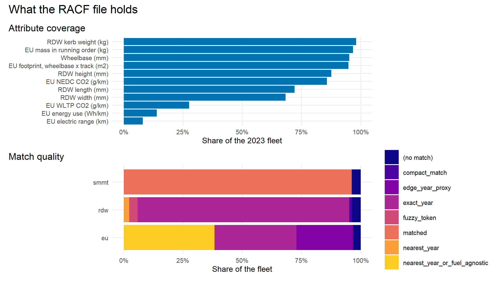

**Figure 1.** Top: the share of the 2023 RACF fleet with a plausible
value of each attribute (table 1.1, `pct_fleet_plausible` in
`racf_input_profile.csv`). Bottom: the share of the fleet with each
match quality, for each register RACF matched to (table 1.3,
`racf_input_match_quality.csv`). Both are weighted by RACF’s DfT fleet
count.

## 2. The RACF fleet against DfT

### 2.1 RACF fleet against DfT VEH0124 cars

The RACF file is DfT’s car fleet enriched, so its yearly totals should
equal VEH0124’s licensed and SORN cars (`dft_stock.parquet`). A ratio
far from 1 would mean a different DfT release or rows lost in the
enrichment; the cross-check warns outside 0.99-1.01.

- `year`: year (end of year)
- `n_racf`: cars in the RACF file
- `n_dft_cars`: cars in VEH0124
- `ratio`: `n_racf` / `n_dft_cars`

| year |     n_racf | n_dft_cars | ratio |
|:-----|-----------:|-----------:|------:|
| 2014 | 31,911,908 | 31,919,157 |     1 |
| 2015 | 32,918,077 | 32,926,134 |     1 |
| 2016 | 34,074,222 | 34,081,888 |     1 |
| 2017 | 34,715,356 | 34,724,188 |     1 |
| 2018 | 35,228,456 | 35,236,719 |     1 |
| 2019 | 35,860,516 | 35,868,441 |     1 |
| 2020 | 35,949,512 | 35,959,398 |     1 |
| 2021 | 36,181,234 | 36,189,987 |     1 |
| 2022 | 36,583,498 | 36,593,163 |     1 |
| 2023 | 37,196,479 | 37,207,362 |     1 |
| 2024 | 37,742,840 | 37,753,146 |     1 |
| 2025 | 38,481,083 | 38,490,385 |     1 |

## 3. Linking the MOT cars

### 3.1 Link coverage

Cars in a real postcode area each year by how they link to the RACF
fleet. The totals equal the DfT comparison’s MOT car counts
(cross-checked).

- `model`: same make, generic model, model string, year of first use and
  fuel group
- `genmodel`: same make, generic model, year and fuel group, but not the
  model string
- `none`: no RACF row (an unmatched model, a year or fuel DfT does not
  have)
- `pct_linked`: percentage linked at either level

| year |   genmodel |      model |    none | pct_linked |
|:-----|-----------:|-----------:|--------:|-----------:|
| 2014 | 19,139,127 | 16,415,337 | 359,438 |      99.00 |
| 2015 | 19,983,244 | 16,469,948 | 341,165 |      99.07 |
| 2016 | 20,920,110 | 16,520,631 | 335,907 |      99.11 |
| 2017 | 21,437,961 | 16,306,635 | 334,955 |      99.12 |
| 2018 | 22,193,996 | 16,105,638 | 346,961 |      99.10 |
| 2019 | 22,647,754 | 15,949,988 | 364,014 |      99.07 |
| 2020 | 22,395,579 | 15,983,406 | 357,395 |      99.08 |
| 2021 | 21,967,133 | 16,383,318 | 350,176 |      99.10 |
| 2022 | 21,111,965 | 16,687,794 | 324,872 |      99.15 |
| 2023 | 20,326,482 | 16,090,513 | 313,473 |      99.15 |
| 2024 | 19,509,530 | 15,410,333 | 294,997 |      99.16 |
| 2025 | 18,442,647 | 14,560,649 | 270,537 |      99.19 |

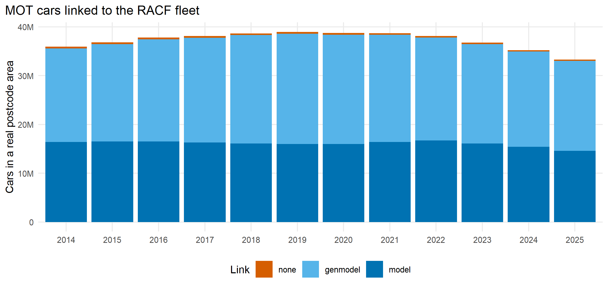

**Figure 2.** Table 3.1 as a chart: the MOT cars in a real postcode area
each year, by whether they link to an RACF row at the model string
(`model`) or generic model (`genmodel`) level, or not at all
(`racf_link_coverage.csv`).

## 4. Validation

### 4.1 Stock by fuel and SMMT segment

#### Cars by fuel group: MOT against RACF

Cars in a real postcode area in 2023 against the RACF (DfT) fleet, by
RACF fuel group. The MOT count is above DfT’s for petrol and diesel
because the annualisation keeps a car in its area for two years after
its last MOT; it is below for battery electric cars, most of which are
under three years old and have not had a first test (the data quality
report explains both). Every year is in `racf_stock_by_fuel.csv`.

- `fuel_group`: RACF fuel group (hybrids with petrol or diesel)
- `n_mot`: MOT cars
- `n_racf`: RACF cars
- `ratio_mot_to_racf`: `n_mot` / `n_racf`

| fuel_group |      n_mot |     n_racf | ratio_mot_to_racf |
|:-----------|-----------:|-----------:|------------------:|
| PETROL     | 22,396,615 | 23,173,503 |              0.97 |
| DIESEL     | 13,297,779 | 12,652,683 |              1.05 |
| BEV        |    631,710 |    926,012 |              0.68 |
| PHEV       |    336,391 |    415,105 |              0.81 |
| OTHER      |     67,945 |     29,010 |              2.34 |
| FCEV       |         28 |        166 |              0.17 |

#### Cars by SMMT segment: MOT against RACF

The same by SMMT segment. A segment’s ratio departs from the fuel ratios
when its cars are older or newer than average (Specialist Sports cars
are kept long and tested rarely). `(not linked)` cars have no RACF row;
`(missing)` have one with no segment.

- `smmt_type`: SMMT segment
- `n_mot`: MOT cars
- `n_racf`: RACF cars
- `ratio_mot_to_racf`: `n_mot` / `n_racf`

| smmt_type         |     n_mot |    n_racf | ratio_mot_to_racf |
|:------------------|----------:|----------:|------------------:|
| Dual Purpose      | 8,793,741 | 9,491,211 |              0.93 |
| Supermini         | 8,841,464 | 8,521,597 |              1.04 |
| Lower Medium      | 8,489,868 | 8,196,368 |              1.04 |
| Upper Medium      | 3,654,043 | 3,522,220 |              1.04 |
| Mini              | 2,574,446 | 2,557,155 |              1.01 |
| (missing)         |   566,321 | 1,405,611 |              0.40 |
| Executive         | 1,107,821 | 1,099,919 |              1.01 |
| MPV               | 1,192,724 | 1,077,130 |              1.11 |
| Specialist Sports |   876,435 | 1,002,387 |              0.87 |
| Luxury Saloon     |   220,045 |   242,307 |              0.91 |
| Other             |   100,087 |    80,414 |              1.24 |
| Pick-up           |         0 |       160 |                NA |
| (not linked)      |   313,473 |         0 |                NA |

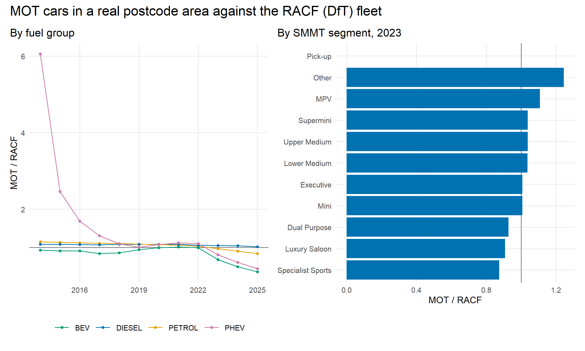

**Figure 3.** The MOT cars in a real postcode area divided by the RACF
(DfT) cars: left, each year for the main fuel groups
(`racf_stock_by_fuel.csv`); right, in 2023 for each SMMT segment
(`racf_stock_by_smmt.csv`), the second table above. At 1 (grey line) the
two count the same.

### 4.2 Fuel, model by model

#### Fuel shares of the largest generic models, 2023

For each generic model with at least 1,000 RACF cars, the share of each
fuel group among the MOT cars located that year and in the RACF fleet.
They test the recorded fuel and the pipeline’s plug-in hybrid detection
(`fuel_DFT`, methodology Section 5.5) model by model: an MOT plug-in
share well below RACF’s means plug-ins kept as petrol or diesel. The 25
largest are shown; every model is in `racf_fuel_by_model.csv`.

- `n_mot`: MOT cars
- `mot_*`: share of the MOT cars with each fuel group
- `n_racf`: RACF cars
- `racf_*`: share of the RACF cars

| Make | GenModel | n_mot | mot_petrol | mot_diesel | mot_bev | mot_phev | n_racf | racf_petrol | racf_diesel | racf_bev | racf_phev |
|:---|:---|---:|---:|---:|---:|---:|---:|---:|---:|---:|---:|
| FORD | FORD FIESTA | 1,630,943 | 0.86 | 0.14 | 0.00 | 0.00 | 1,527,512 | 0.89 | 0.11 | 0.00 | 0.00 |
| VOLKSWAGEN | VOLKSWAGEN GOLF | 1,142,260 | 0.49 | 0.50 | 0.01 | 0.00 | 1,110,946 | 0.50 | 0.48 | 0.00 | 0.01 |
| FORD | FORD FOCUS | 1,204,690 | 0.68 | 0.31 | 0.00 | 0.00 | 1,105,045 | 0.69 | 0.31 | 0.00 | 0.00 |
| VAUXHALL | VAUXHALL CORSA | 1,148,655 | 0.90 | 0.09 | 0.01 | 0.00 | 1,084,842 | 0.92 | 0.07 | 0.01 | 0.00 |
| VAUXHALL | VAUXHALL ASTRA | 858,323 | 0.69 | 0.31 | 0.00 | 0.00 | 758,215 | 0.71 | 0.29 | 0.00 | 0.00 |
| VOLKSWAGEN | VOLKSWAGEN POLO | 745,303 | 0.91 | 0.09 | 0.00 | 0.00 | 727,602 | 0.92 | 0.08 | 0.00 | 0.00 |
| NISSAN | NISSAN QASHQAI | 643,519 | 0.53 | 0.47 | 0.00 | 0.00 | 656,129 | 0.57 | 0.43 | 0.00 | 0.00 |
| BMW | BMW 3 SERIES | 634,959 | 0.37 | 0.57 | 0.00 | 0.07 | 628,517 | 0.35 | 0.61 | 0.00 | 0.04 |
| TOYOTA | TOYOTA YARIS | 561,224 | 0.95 | 0.05 | 0.00 | 0.00 | 564,712 | 0.96 | 0.04 | 0.00 | 0.00 |
| MINI | MINI COOPER | 602,495 | 0.85 | 0.12 | 0.03 | 0.00 | 532,451 | 0.83 | 0.14 | 0.03 | 0.00 |
| AUDI | AUDI A3 | 515,060 | 0.48 | 0.50 | 0.00 | 0.02 | 469,019 | 0.47 | 0.51 | 0.00 | 0.02 |
| BMW | BMW 1 SERIES | 458,879 | 0.44 | 0.55 | 0.00 | 0.00 | 417,039 | 0.45 | 0.55 | 0.00 | 0.00 |
| MERCEDES | MERCEDES C CLASS | 452,067 | 0.38 | 0.62 | 0.00 | 0.01 | 416,887 | 0.34 | 0.65 | 0.00 | 0.02 |
| FIAT | FIAT 500 | 398,054 | 0.94 | 0.05 | 0.02 | 0.00 | 411,033 | 0.94 | 0.04 | 0.02 | 0.00 |
| RENAULT | RENAULT CLIO | 426,630 | 0.80 | 0.19 | 0.00 | 0.00 | 409,476 | 0.81 | 0.19 | 0.00 | 0.00 |
| MERCEDES | MERCEDES A CLASS | 397,736 | 0.47 | 0.49 | 0.00 | 0.04 | 386,678 | 0.48 | 0.49 | 0.00 | 0.04 |
| HONDA | HONDA JAZZ | 383,542 | 1.00 | 0.00 | 0.00 | 0.00 | 366,388 | 1.00 | 0.00 | 0.00 | 0.00 |
| NISSAN | NISSAN JUKE | 341,074 | 0.74 | 0.26 | 0.00 | 0.00 | 359,266 | 0.76 | 0.24 | 0.00 | 0.00 |
| KIA | KIA SPORTAGE | 324,559 | 0.49 | 0.51 | 0.00 | 0.00 | 345,401 | 0.54 | 0.44 | 0.00 | 0.02 |
| FORD | FORD KUGA | 327,887 | 0.19 | 0.75 | 0.00 | 0.06 | 344,806 | 0.24 | 0.69 | 0.00 | 0.07 |
| HONDA | HONDA CIVIC | 354,888 | 0.77 | 0.23 | 0.00 | 0.00 | 332,998 | 0.77 | 0.23 | 0.00 | 0.00 |
| LAND ROVER | LAND ROVER DISCOVERY | 301,124 | 0.04 | 0.94 | 0.00 | 0.02 | 321,675 | 0.04 | 0.94 | 0.00 | 0.02 |
| AUDI | AUDI A4 | 344,777 | 0.31 | 0.68 | 0.00 | 0.00 | 316,183 | 0.31 | 0.69 | 0.00 | 0.00 |
| NISSAN | NISSAN MICRA | 309,567 | 0.97 | 0.02 | 0.00 | 0.00 | 295,616 | 0.98 | 0.02 | 0.00 | 0.00 |
| VOLKSWAGEN | VOLKSWAGEN TIGUAN | 277,246 | 0.28 | 0.72 | 0.00 | 0.00 | 294,812 | 0.32 | 0.67 | 0.00 | 0.01 |

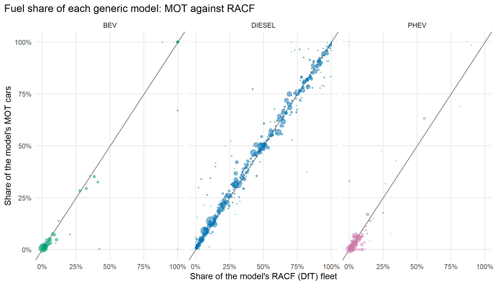

**Figure 4.** For every generic model with at least 1,000 RACF cars in
2023 (all of `racf_fuel_by_model.csv`, not only the 25 in the table),
the share of its MOT cars with each fuel group against the share of its
RACF cars. A point is drawn where either share is above 0.5%, sized by
the RACF fleet. On the grey line the two agree; a plug-in point below it
is a model whose plug-ins the MOT data keeps as petrol or diesel.

### 4.3 CO2: VES against the EU type-approval figure

#### VES CO2 against EU CO2

Cars located in 2023 with a recorded VES CO2 and a model-level link, by
year of first use and fuel group (groups of 100+). The EU figures are
the model’s fleet-weighted type-approval averages, so a single car’s VES
figure (its own variant) scatters around them; the medians show whether
the two registers agree on average. NEDC applies to cars first
registered up to 2017 and WLTP after; VES records the figure the car was
registered with.

Battery electric cars are left out (both registers say 0 or close to
it).

- `first_use_year`: year of first use
- `fuel_group`: RACF fuel group
- `n_vehicles`: cars
- `n_with_nedc`: cars whose model has an EU NEDC figure
- `n_with_wltp`: the same for WLTP
- `median_ves_co2`: median VES CO2 (g/km)
- `median_eu_nedc`: median EU NEDC CO2 of their models
- `median_eu_wltp`: median EU WLTP CO2
- `median_ratio_to_nedc`: median of VES / EU NEDC
- `median_ratio_to_wltp`: median of VES / EU WLTP
- `pct_within_10pct_nedc`: percentage within 10% of the NEDC figure
- `pct_within_10pct_wltp`: the same for WLTP

| first_use_year | fuel_group | n_vehicles | n_with_nedc | n_with_wltp | median_ves_co2 | median_eu_nedc | median_eu_wltp | median_ratio_to_nedc | median_ratio_to_wltp | pct_within_10pct_nedc | pct_within_10pct_wltp |
|---:|:---|---:|---:|---:|---:|---:|---:|---:|---:|---:|---:|
| 2,001 | DIESEL | 18,895 | 17,961 | 1 | 163 | 147.7 | 173.5 | 1.08 | 1.64 | 52.4 | 0.0 |
| 2,002 | DIESEL | 43,124 | 41,974 | 1 | 151 | 145.5 | 173.5 | 1.13 | 1.49 | 46.4 | 0.0 |
| 2,003 | DIESEL | 62,260 | 60,446 | 1 | 154 | 145.5 | 173.5 | 1.09 | 1.58 | 50.3 | 0.0 |
| 2,004 | DIESEL | 84,810 | 82,312 | 569 | 157 | 147.7 | 173.5 | 1.09 | 1.20 | 50.8 | 8.6 |
| 2,005 | DIESEL | 120,260 | 117,792 | 1,205 | 158 | 147.7 | 173.5 | 1.11 | 1.20 | 44.1 | 6.5 |
| 2,006 | DIESEL | 153,108 | 151,284 | 1,558 | 158 | 145.5 | 173.5 | 1.11 | 1.20 | 44.1 | 3.7 |
| 2,007 | DIESEL | 200,267 | 198,470 | 1,958 | 156 | 145.5 | 173.5 | 1.09 | 1.20 | 53.3 | 0.8 |
| 2,008 | DIESEL | 212,809 | 210,013 | 9 | 148 | 129.7 | 173.5 | 1.08 | 1.20 | 60.7 | 44.4 |
| 2,009 | DIESEL | 214,798 | 211,978 | 2 | 139 | 129.7 | 238.9 | 1.02 | 0.93 | 75.6 | 100.0 |
| 2,010 | DIESEL | 240,947 | 240,524 | 20 | 127 | 124.0 | 238.9 | 0.99 | 0.94 | 78.0 | 100.0 |
| 2,011 | DIESEL | 266,164 | 265,353 | 14 | 120 | 121.6 | 238.9 | 0.99 | 0.94 | 76.2 | 92.9 |
| 2,012 | DIESEL | 284,267 | 279,880 | 17 | 119 | 121.7 | 238.9 | 0.99 | 0.82 | 76.9 | 47.1 |
| 2,013 | DIESEL | 296,646 | 290,135 | 30 | 115 | 119.5 | 238.9 | 0.97 | 0.82 | 71.1 | 3.3 |
| 2,014 | DIESEL | 325,530 | 319,726 | 7 | 112 | 107.6 | 238.9 | 1.06 | 0.82 | 63.1 | 0.0 |
| 2,015 | DIESEL | 312,704 | 310,539 | 5 | 109 | 106.3 | 238.9 | 0.99 | 0.82 | 75.9 | 20.0 |
| 2,016 | DIESEL | 301,184 | 296,824 | 21 | 109 | 110.6 | 238.9 | 0.98 | 0.94 | 76.3 | 52.4 |
| 2,017 | DIESEL | 222,083 | 218,102 | 67,596 | 112 | 114.7 | 180.0 | 0.98 | 0.63 | 75.7 | 0.9 |
| 2,018 | DIESEL | 145,337 | 142,863 | 137,977 | 119 | 118.1 | 150.8 | 0.99 | 0.78 | 77.9 | 9.6 |
| 2,019 | DIESEL | 169,715 | 167,562 | 164,249 | 131 | 133.4 | 166.4 | 1.01 | 0.80 | 72.3 | 9.7 |
| 2,020 | DIESEL | 166,365 | 165,693 | 165,329 | 149 | 132.7 | 160.3 | 1.14 | 0.94 | 28.9 | 55.6 |
| 2,021 | DIESEL | 157,017 | 89,636 | 156,240 | 157 | 42.6 | 159.5 | 3.93 | 0.98 | 0.1 | 80.1 |
| 2,022 | DIESEL | 108,527 | 53,530 | 106,523 | 157 | 33.6 | 160.3 | 4.15 | 0.98 | 0.0 | 75.9 |
| 2,023 | DIESEL | 5,994 | 208 | 5,667 | 170 | 179.0 | 171.0 | 1.15 | 0.98 | 2.4 | 69.8 |
| 2,001 | PETROL | 87,337 | 86,042 | 1,073 | 182 | 145.4 | 129.5 | 1.16 | 1.37 | 38.2 | 2.4 |
| 2,002 | PETROL | 139,368 | 138,559 | 1,093 | 172 | 144.3 | 129.5 | 1.14 | 1.37 | 41.3 | 14.0 |
| 2,003 | PETROL | 195,776 | 194,454 | 393 | 167 | 144.3 | 159.5 | 1.14 | 1.09 | 41.8 | 50.9 |
| 2,004 | PETROL | 236,477 | 234,096 | 540 | 161 | 140.6 | 159.5 | 1.12 | 1.42 | 46.3 | 46.9 |
| 2,005 | PETROL | 277,209 | 275,779 | 361 | 159 | 140.6 | 159.5 | 1.09 | 1.09 | 50.7 | 57.6 |
| 2,006 | PETROL | 335,908 | 334,298 | 76 | 157 | 140.1 | 159.5 | 1.09 | 1.09 | 53.5 | 73.7 |
| 2,007 | PETROL | 378,554 | 377,098 | 3 | 152 | 140.1 | 419.0 | 1.09 | 1.17 | 54.2 | 0.0 |
| 2,008 | PETROL | 360,623 | 360,266 | 0 | 147 | 138.0 | NA | 1.07 | NA | 61.6 | NA |
| 2,009 | PETROL | 407,696 | 407,013 | 0 | 139 | 131.0 | NA | 1.02 | NA | 77.0 | NA |
| 2,010 | PETROL | 418,950 | 418,439 | 0 | 134 | 132.2 | NA | 1.00 | NA | 85.9 | NA |
| 2,011 | PETROL | 374,375 | 374,251 | 2 | 129 | 129.2 | 170.7 | 1.01 | 0.88 | 84.8 | 0.0 |
| 2,012 | PETROL | 423,106 | 422,986 | 1 | 129 | 127.3 | 162.1 | 1.01 | 0.96 | 86.4 | 100.0 |
| 2,013 | PETROL | 479,681 | 479,482 | 500 | 125 | 128.7 | 162.1 | 1.00 | 0.96 | 62.6 | 100.0 |
| 2,014 | PETROL | 525,347 | 524,444 | 4 | 120 | 113.6 | 162.1 | 1.09 | 0.94 | 62.1 | 75.0 |
| 2,015 | PETROL | 566,715 | 566,180 | 1,685 | 119 | 114.4 | 162.1 | 1.01 | 0.86 | 78.1 | 7.1 |
| 2,016 | PETROL | 556,623 | 556,136 | 3,292 | 116 | 115.3 | 162.1 | 0.98 | 0.86 | 75.2 | 0.1 |
| 2,017 | PETROL | 527,858 | 526,609 | 93,382 | 116 | 119.7 | 180.0 | 0.98 | 0.78 | 75.2 | 11.7 |
| 2,018 | PETROL | 499,290 | 494,354 | 487,960 | 114 | 115.2 | 139.0 | 0.99 | 0.83 | 74.4 | 12.9 |
| 2,019 | PETROL | 574,352 | 566,414 | 544,415 | 121 | 114.6 | 134.3 | 1.04 | 0.88 | 57.8 | 33.7 |
| 2,020 | PETROL | 628,745 | 625,764 | 619,096 | 129 | 113.6 | 134.3 | 1.16 | 0.96 | 31.9 | 68.4 |
| 2,021 | PETROL | 785,895 | 240,932 | 770,719 | 131 | 34.4 | 131.2 | 4.17 | 0.99 | 0.9 | 90.4 |
| 2,022 | PETROL | 822,086 | 236,046 | 812,534 | 131 | 31.4 | 131.5 | 4.41 | 0.98 | 0.5 | 85.9 |
| 2,023 | PETROL | 48,763 | 5,662 | 48,183 | 129 | 42.5 | 131.1 | 3.83 | 0.97 | 6.0 | 83.4 |
| 2,014 | PHEV | 235 | 235 | 0 | 49 | 49.0 | NA | 1.00 | NA | 87.7 | NA |
| 2,015 | PHEV | 739 | 739 | 0 | 49 | 49.0 | NA | 1.00 | NA | 89.0 | NA |
| 2,016 | PHEV | 556 | 555 | 0 | 49 | 49.2 | NA | 1.00 | NA | 82.0 | NA |
| 2,017 | PHEV | 400 | 400 | 54 | 49 | 48.9 | 180.0 | 1.00 | 0.21 | 60.0 | 0.0 |
| 2,018 | PHEV | 1,587 | 1,586 | 1,586 | 57 | 115.1 | 144.0 | 0.50 | 0.40 | 23.1 | 23.0 |
| 2,019 | PHEV | 5,240 | 5,212 | 5,212 | 44 | 113.1 | 137.0 | 0.41 | 0.33 | 5.1 | 4.0 |
| 2,020 | PHEV | 43,602 | 43,166 | 43,166 | 35 | 106.6 | 129.2 | 0.35 | 0.30 | 0.3 | 6.4 |
| 2,021 | PHEV | 96,078 | 87,746 | 93,348 | 33 | 38.8 | 110.6 | 0.96 | 0.29 | 23.4 | 7.6 |
| 2,022 | PHEV | 80,973 | 64,881 | 80,362 | 31 | 30.6 | 108.3 | 0.93 | 0.29 | 31.7 | 0.4 |
| 2,023 | PHEV | 5,620 | 470 | 5,578 | 31 | 26.0 | 119.7 | 0.92 | 0.27 | 79.1 | 0.4 |

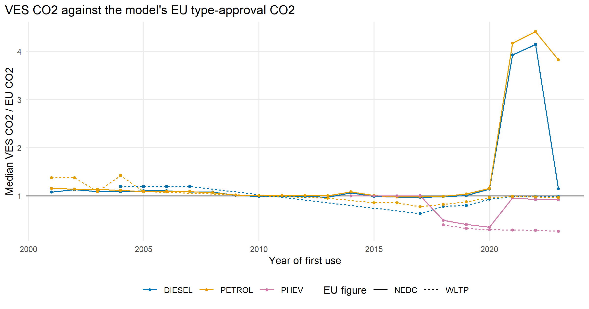

**Figure 5.** From the table above (`racf_co2_validation.csv`): for the
cars located in 2023 with a recorded VES CO2 and a model-level link, the
median of each car’s VES CO2 divided by its model’s EU NEDC (solid) or
WLTP (dashed) figure, by year of first use and fuel group. Only points
with at least 100 cars with that EU figure are drawn. At 1 (grey line)
the registers agree on average.

### 4.4 Weight: VES revenue weight against the EU mass

#### VES revenue weight against EU mass

Cars located in 2023 with a recorded VES revenue weight and a
model-level link. The revenue weight is the car’s maximum (gross) weight
and the EU mass its mass in running order, so the ratio should be above
1, typically 1.2-1.5; a revenue weight below the running-order mass is
impossible for the same variant and points to the wrong model, a
different variant or a recording error.

- `first_use_band`: years of first use
- `fuel_group`: RACF fuel group
- `n_vehicles`: cars
- `median_revenue_weight`: median VES revenue weight (kg)
- `median_eu_mass`: median EU mass of their models (kg)
- `median_ratio`: median revenue weight / EU mass
- `p10_ratio`: 10th percentile of the ratio
- `p90_ratio`: 90th percentile
- `pct_below_eu_mass`: percentage with a revenue weight below the EU
  mass

| first_use_band | fuel_group | n_vehicles | median_revenue_weight | median_eu_mass | median_ratio | p10_ratio | p90_ratio | pct_below_eu_mass |
|:---|:---|---:|---:|---:|---:|---:|---:|---:|
| 2010-2015 | BEV | 210 | 1,500.0 | 1,214 | 1.24 | 1.17 | 1.29 | 0.48 |
| 2015-2020 | BEV | 5,839 | 2,020.0 | 1,615 | 1.25 | 1.22 | 1.25 | 0.10 |
| 2020+ | BEV | 227,559 | 2,244.0 | 1,807 | 1.23 | 1.18 | 1.26 | 0.46 |
| 2005-2010 | DIESEL | 142,050 | 2,505.0 | 1,945 | 1.29 | 1.05 | 1.33 | 5.24 |
| 2010-2015 | DIESEL | 910,994 | 1,920.0 | 1,399 | 1.37 | 1.22 | 1.43 | 3.88 |
| 2015-2020 | DIESEL | 750,442 | 1,930.0 | 1,423 | 1.35 | 1.02 | 1.43 | 8.75 |
| 2020+ | DIESEL | 314,324 | 2,145.0 | 1,835 | 1.30 | 0.83 | 1.39 | 22.28 |
| \<2005 | DIESEL | 54,844 | 2,575.0 | 2,100 | 1.08 | 1.04 | 1.23 | 5.15 |
| 2005-2010 | PETROL | 140,470 | 1,502.0 | 1,172 | 1.23 | 0.98 | 1.41 | 19.06 |
| 2010-2015 | PETROL | 1,201,202 | 1,530.0 | 1,088 | 1.41 | 1.00 | 1.44 | 7.88 |
| 2015-2020 | PETROL | 1,717,264 | 1,590.0 | 1,159 | 1.40 | 1.02 | 1.47 | 6.97 |
| 2020+ | PETROL | 1,385,936 | 1,760.0 | 1,339 | 1.35 | 1.04 | 1.42 | 5.44 |
| \<2005 | PETROL | 40,450 | 1,515.5 | 1,313 | 1.12 | 0.97 | 1.30 | 12.47 |
| 2010-2015 | PHEV | 1 | 2,050.0 | 1,354 | 1.51 | 1.51 | 1.51 | 0.00 |
| 2015-2020 | PHEV | 403 | 2,270.0 | 1,590 | 1.47 | 1.08 | 1.54 | 0.99 |
| 2020+ | PHEV | 132,156 | 2,222.0 | 1,671 | 1.37 | 0.90 | 1.47 | 11.20 |

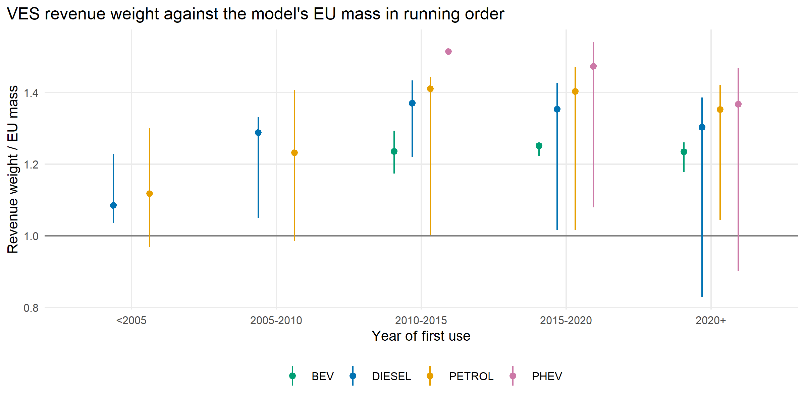

**Figure 6.** From the table above (`racf_mass_validation.csv`): for the
cars located in 2023 with a recorded VES revenue weight and a
model-level link, each car’s revenue weight divided by its model’s EU
mass in running order, by band of first use and fuel group. Points are
the median and bars the 10th to 90th percentile. Below 1 (grey line) is
impossible for the same variant.

### 4.5 SMMT segment against the DVLA type approval

#### SMMT segment against type approval, 2023

Linked cars by their model’s SMMT segment and their harmonised DVLA type
approval (recorded or backfilled; the full split by source is in
`racf_smmt_by_type_approval.csv`). Every SMMT segment is a car body, so
nearly all should be M1; an N1 (van) approval on an SMMT car segment is
a car- derived van (Pick-up, car-derived vans) or a model matched to a
car of the same name.

- `smmt_type`: SMMT segment of the model
- `M1, N1, ...`: cars with that type approval

| smmt_type         |  (none) |  L7 |        M1 |     N1 |  N3 | other |  SP |
|:------------------|--------:|----:|----------:|-------:|----:|------:|----:|
| (no segment)      | 146,033 | 649 |   419,450 |    162 |   0 |    23 |   4 |
| Dual Purpose      |  22,836 |   0 | 8,768,946 |  1,944 |   6 |     9 |   0 |
| Executive         |  18,186 |   0 | 1,089,606 |     22 |   6 |     1 |   0 |
| Lower Medium      |  84,704 |   0 | 8,384,554 | 20,578 |   9 |    23 |   0 |
| Luxury Saloon     |  28,119 |   0 |   191,907 |     10 |   0 |     9 |   0 |
| Mini              |  22,955 | 592 | 2,550,870 |     25 |   0 |     4 |   0 |
| MPV               |  17,439 |   0 | 1,174,769 |    463 |   0 |    14 |  39 |
| Other             |       1 |   0 |    99,768 |    318 |   0 |     0 |   0 |
| Specialist Sports |  45,631 |   0 |   830,786 |      8 |   1 |     9 |   0 |
| Supermini         |  51,011 |   0 | 8,737,785 | 52,661 |   0 |     7 |   0 |
| Upper Medium      |  28,575 |   0 | 3,625,352 |    105 |   1 |    10 |   0 |

## 5. What the linked data shows

### 5.1 The located car fleet, year by year

Fleet-weighted model attributes of the cars located in a real postcode
area each year, all fuels. Each mean is over the cars with that
attribute (`n_*` in `racf_characteristics_by_year.csv`, which also
splits every year by fuel group). Length and width come from the RDW
register and cover fewer cars (Section 1.1). `suv_share` is the share of
cars whose model SMMT calls a crossover / SUV or an off-roader. The
means level off from about 2022 because cars first used in the last
three years are located only once their first MOT is in the data (data
quality report).

- `n_vehicles`: cars located
- `n_linked`: linked to RACF
- `mean_mass_kg`: EU mass in running order (kg)
- `mean_footprint_m2`: EU footprint, wheelbase x track (m2)
- `mean_length_mm, ...`: RDW dimensions (mm)
- `mean_co2_nedc`: EU NEDC CO2 (g/km)
- `mean_co2_wltp`: EU WLTP CO2 (g/km, models with one)
- `suv_share`: share SUV / off-road
- `eu_exact_share`: share of the EU match that is for the exact year

| year | n_vehicles | n_linked | mean_mass_kg | mean_footprint_m2 | mean_length_mm | mean_width_mm | mean_height_mm | mean_co2_nedc | mean_co2_wltp | suv_share | eu_exact_share |
|:---|---:|---:|---:|---:|---:|---:|---:|---:|---:|---:|---:|
| 2014 | 35,913,902 | 35,554,464 | 1,374.88 | 3.97 | 4,113.56 | 1,713.60 | 1,489.10 | 147.07 | 149.73 | 0.10 | 0.19 |
| 2015 | 36,794,357 | 36,453,192 | 1,377.25 | 3.98 | 4,131.67 | 1,723.93 | 1,493.38 | 144.85 | 151.89 | 0.11 | 0.23 |
| 2016 | 37,776,648 | 37,440,741 | 1,381.22 | 3.98 | 4,150.32 | 1,733.23 | 1,497.88 | 142.91 | 156.05 | 0.13 | 0.26 |
| 2017 | 38,079,551 | 37,744,596 | 1,385.38 | 3.99 | 4,165.65 | 1,739.55 | 1,501.50 | 141.59 | 167.29 | 0.14 | 0.28 |
| 2018 | 38,646,595 | 38,299,634 | 1,390.06 | 4.00 | 4,183.48 | 1,746.71 | 1,505.51 | 140.28 | 157.84 | 0.16 | 0.31 |
| 2019 | 38,961,756 | 38,597,742 | 1,395.79 | 4.00 | 4,201.29 | 1,753.07 | 1,509.59 | 139.00 | 156.04 | 0.18 | 0.31 |
| 2020 | 38,736,380 | 38,378,985 | 1,401.32 | 4.01 | 4,215.20 | 1,758.00 | 1,512.91 | 137.71 | 154.53 | 0.20 | 0.33 |
| 2021 | 38,700,627 | 38,350,451 | 1,407.79 | 4.02 | 4,227.91 | 1,762.49 | 1,515.99 | 135.49 | 152.38 | 0.22 | 0.35 |
| 2022 | 38,124,631 | 37,799,759 | 1,413.88 | 4.03 | 4,238.50 | 1,766.25 | 1,519.17 | 133.49 | 150.88 | 0.24 | 0.36 |
| 2023 | 36,730,468 | 36,416,995 | 1,415.36 | 4.03 | 4,241.27 | 1,766.95 | 1,520.44 | 132.84 | 150.78 | 0.25 | 0.37 |
| 2024 | 35,214,860 | 34,919,863 | 1,416.17 | 4.03 | 4,243.69 | 1,767.63 | 1,521.61 | 132.09 | 150.72 | 0.25 | 0.38 |
| 2025 | 33,273,833 | 33,003,296 | 1,415.66 | 4.03 | 4,245.49 | 1,768.36 | 1,522.64 | 131.19 | 150.58 | 0.26 | 0.39 |

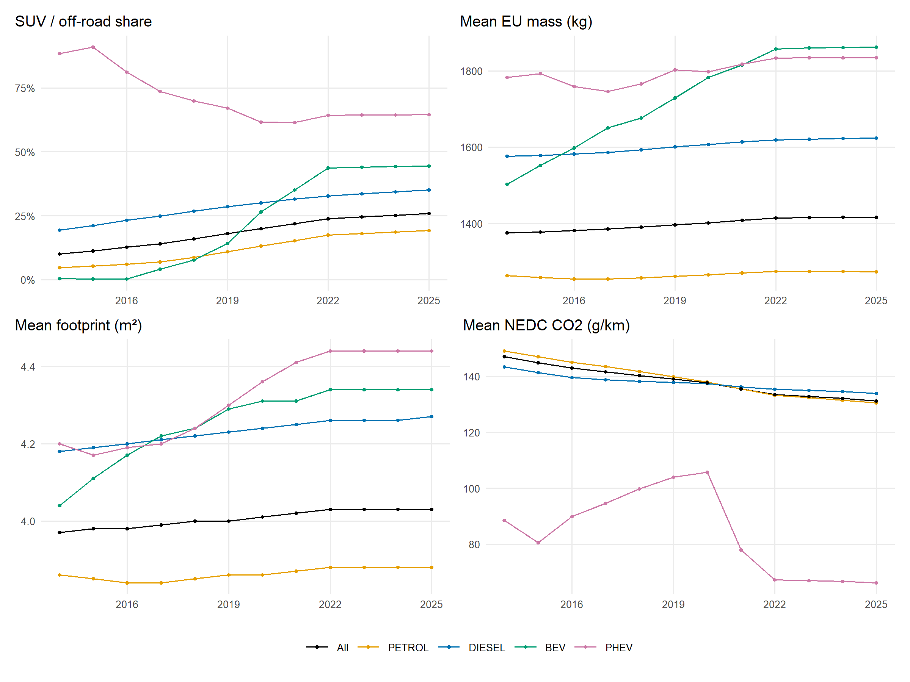

**Figure 7.** Four columns of table 5.1 by year, for all located cars
(black) and for each main fuel group
(`racf_characteristics_by_year.csv`): the SUV / off-road share, and the
fleet-weighted means of the models’ EU mass, footprint and NEDC CO2.
Each mean is over the linked cars with that attribute.

### 5.2 By year of first use, cars located in 2023

The same attributes for the cars located in 2023 by the year they were
first used (1990 onwards shown; every cohort is in
`racf_characteristics_by_cohort.csv`). Unlike 5.1, this separates what
was sold from what survived: each cohort is the cars of that year still
located.

- `first_use_year`: year of first use

| first_use_year | n_vehicles | n_linked | mean_mass_kg | mean_footprint_m2 | mean_co2_nedc | mean_co2_wltp | suv_share |
|---:|---:|---:|---:|---:|---:|---:|---:|
| 1,990 | 27,804 | 25,153 | 1,388.67 | 3.90 | 178.46 | NA | 0.02 |
| 1,991 | 24,791 | 22,080 | 1,362.80 | 3.82 | 175.74 | 139.00 | 0.04 |
| 1,992 | 21,793 | 19,972 | 1,405.87 | 3.84 | 182.77 | 139.00 | 0.05 |
| 1,993 | 26,025 | 24,491 | 1,538.16 | 3.91 | 200.80 | 139.00 | 0.22 |
| 1,994 | 27,785 | 25,946 | 1,530.96 | 4.04 | 192.04 | 139.00 | 0.14 |
| 1,995 | 36,086 | 33,401 | 1,558.23 | 4.09 | 193.36 | 147.40 | 0.14 |
| 1,996 | 49,749 | 46,878 | 1,585.63 | 4.02 | 198.54 | 151.59 | 0.22 |
| 1,997 | 71,305 | 68,055 | 1,535.23 | 3.99 | 192.02 | 130.55 | 0.17 |
| 1,998 | 95,550 | 92,337 | 1,510.36 | 3.99 | 187.01 | 129.70 | 0.16 |
| 1,999 | 131,776 | 128,468 | 1,503.81 | 4.03 | 181.75 | 129.90 | 0.14 |
| 2,000 | 179,182 | 175,363 | 1,437.51 | 3.96 | 175.19 | 129.60 | 0.13 |
| 2,001 | 274,829 | 271,471 | 1,415.37 | 3.96 | 167.90 | 132.73 | 0.11 |
| 2,002 | 433,289 | 429,217 | 1,398.69 | 3.95 | 163.01 | 139.48 | 0.11 |
| 2,003 | 614,936 | 609,701 | 1,400.83 | 3.95 | 161.80 | 159.88 | 0.11 |
| 2,004 | 801,237 | 795,370 | 1,409.29 | 3.97 | 160.73 | 167.04 | 0.12 |
| 2,005 | 1,008,175 | 1,001,516 | 1,416.79 | 3.99 | 158.28 | 170.78 | 0.12 |
| 2,006 | 1,252,641 | 1,244,728 | 1,399.94 | 3.98 | 154.51 | 173.12 | 0.10 |
| 2,007 | 1,543,962 | 1,532,134 | 1,399.24 | 3.99 | 152.02 | 173.94 | 0.10 |
| 2,008 | 1,536,097 | 1,524,094 | 1,376.26 | 3.97 | 147.72 | 234.72 | 0.08 |
| 2,009 | 1,628,282 | 1,618,355 | 1,346.61 | 3.93 | 144.16 | 237.97 | 0.09 |
| 2,010 | 1,736,888 | 1,726,559 | 1,365.38 | 3.95 | 143.73 | 238.76 | 0.11 |
| 2,011 | 1,716,682 | 1,705,852 | 1,384.70 | 3.99 | 137.75 | 238.34 | 0.14 |
| 2,012 | 1,869,934 | 1,855,733 | 1,377.14 | 3.97 | 132.78 | 228.06 | 0.16 |
| 2,013 | 2,121,899 | 2,113,781 | 1,377.61 | 3.96 | 130.36 | 187.47 | 0.18 |
| 2,014 | 2,349,406 | 2,340,711 | 1,362.27 | 4.00 | 119.50 | 179.01 | 0.21 |
| 2,015 | 2,515,968 | 2,497,756 | 1,390.68 | 4.02 | 120.86 | 168.12 | 0.24 |
| 2,016 | 2,587,696 | 2,576,390 | 1,412.71 | 4.05 | 122.87 | 178.02 | 0.28 |
| 2,017 | 2,457,396 | 2,444,775 | 1,430.34 | 4.05 | 124.72 | 169.27 | 0.32 |
| 2,018 | 2,319,191 | 2,295,072 | 1,434.07 | 4.11 | 127.18 | 156.30 | 0.38 |
| 2,019 | 2,277,709 | 2,246,504 | 1,460.44 | 4.14 | 127.39 | 153.89 | 0.42 |
| 2,020 | 1,605,020 | 1,592,122 | 1,491.58 | 4.17 | 123.94 | 149.37 | 0.46 |
| 2,021 | 1,604,323 | 1,595,499 | 1,522.27 | 4.17 | 43.29 | 142.12 | 0.49 |
| 2,022 | 1,495,908 | 1,490,961 | 1,541.29 | 4.19 | 37.91 | 141.78 | 0.54 |
| 2,023 | 85,653 | 85,147 | 1,553.65 | 4.14 | 76.12 | 140.62 | 0.51 |
| 2,024 | 272 | 230 | 1,795.26 | 4.49 | 44.13 | 163.33 | 0.52 |
| 2,025 | 239 | 204 | 1,869.87 | 4.53 | 41.72 | 170.22 | 0.59 |
| 2,026 | 119 | 0 | NA | NA | NA | NA | NA |

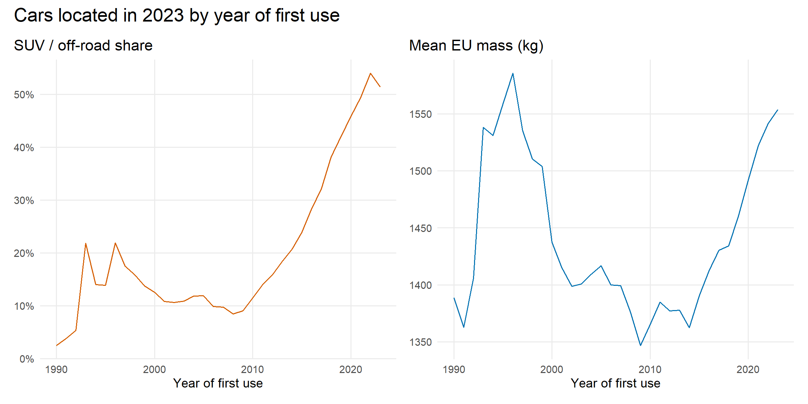

**Figure 8.** Two columns of table 5.2: for the cars located in 2023,
the SUV / off-road share and the fleet-weighted mean EU mass of each
year of first use from 1990 (`racf_characteristics_by_cohort.csv`).
Years with fewer than 1,000 cars are left out.

### 5.3 By postcode area

#### The ten postcode areas with the highest SUV share, 2023

Cars located in each postcode area in 2023 and their fleet-weighted
model attributes. Every area is in `racf_by_area.csv`; the lowest ten
follow, and the maps below show them all.

- `pca`: postcode area
- `n_vehicles`: cars located
- `n_linked`: linked to RACF
- `suv_share`: share SUV / off-road
- `mean_footprint_m2`: mean footprint (m2)
- `mean_mass_kg`: mean EU mass (kg)
- `mean_co2_nedc`: mean EU NEDC CO2 (g/km)
- `bev_share`: share battery electric (MOT fuel)
- `phev_share`: share plug-in hybrid
- `pct_linked`: percentage linked

| pca | n_vehicles | n_linked | suv_share | mean_footprint_m2 | mean_mass_kg | mean_co2_nedc | bev_share | phev_share | pct_linked |
|:---|---:|---:|---:|---:|---:|---:|---:|---:|---:|
| PH | 101,330 | 100,090 | 0.32 | 4.06 | 1,448.7 | 130.4 | 0.02 | 0.01 | 98.8 |
| AB | 274,676 | 272,329 | 0.31 | 4.06 | 1,437.9 | 130.5 | 0.02 | 0.01 | 99.1 |
| IV | 146,601 | 145,294 | 0.31 | 4.05 | 1,433.8 | 129.6 | 0.01 | 0.01 | 99.1 |
| LD | 27,558 | 27,303 | 0.31 | 4.01 | 1,440.0 | 137.8 | 0.01 | 0.00 | 99.1 |
| TD | 64,667 | 64,074 | 0.30 | 4.02 | 1,420.5 | 131.0 | 0.01 | 0.01 | 99.1 |
| HG | 99,546 | 98,552 | 0.30 | 4.06 | 1,459.0 | 131.5 | 0.03 | 0.02 | 99.0 |
| PA | 169,866 | 168,512 | 0.29 | 4.02 | 1,390.2 | 127.1 | 0.02 | 0.01 | 99.2 |
| BR | 135,029 | 134,262 | 0.29 | 4.03 | 1,407.3 | 132.5 | 0.02 | 0.02 | 99.4 |
| FK | 163,435 | 162,291 | 0.29 | 4.03 | 1,402.5 | 126.0 | 0.02 | 0.01 | 99.3 |
| CA | 200,335 | 198,468 | 0.29 | 4.04 | 1,420.9 | 129.2 | 0.01 | 0.01 | 99.1 |

#### The ten with the lowest, 2023

| pca | n_vehicles | n_linked | suv_share | mean_footprint_m2 | mean_mass_kg | mean_co2_nedc | bev_share | phev_share | pct_linked |
|:---|---:|---:|---:|---:|---:|---:|---:|---:|---:|
| UB | 212,387 | 210,960 | 0.19 | 4.08 | 1,443.3 | 137.8 | 0.02 | 0.01 | 99.3 |
| M | 538,335 | 534,980 | 0.19 | 4.01 | 1,389.1 | 131.0 | 0.01 | 0.01 | 99.4 |
| LU | 240,773 | 239,332 | 0.20 | 4.05 | 1,424.2 | 134.3 | 0.01 | 0.01 | 99.4 |
| E | 283,433 | 281,374 | 0.21 | 4.08 | 1,439.5 | 136.5 | 0.02 | 0.01 | 99.3 |
| BS | 611,885 | 606,290 | 0.21 | 3.99 | 1,379.1 | 132.8 | 0.02 | 0.01 | 99.1 |
| B | 1,150,135 | 1,142,257 | 0.21 | 4.03 | 1,407.2 | 132.3 | 0.01 | 0.01 | 99.3 |
| SM | 78,193 | 77,617 | 0.21 | 4.00 | 1,388.0 | 139.0 | 0.01 | 0.01 | 99.3 |
| HA | 217,410 | 216,008 | 0.21 | 4.07 | 1,434.3 | 136.7 | 0.02 | 0.01 | 99.4 |
| TR | 199,679 | 197,532 | 0.21 | 3.98 | 1,388.0 | 133.9 | 0.01 | 0.01 | 98.9 |
| N | 248,775 | 247,039 | 0.21 | 4.06 | 1,433.9 | 139.2 | 0.02 | 0.01 | 99.3 |

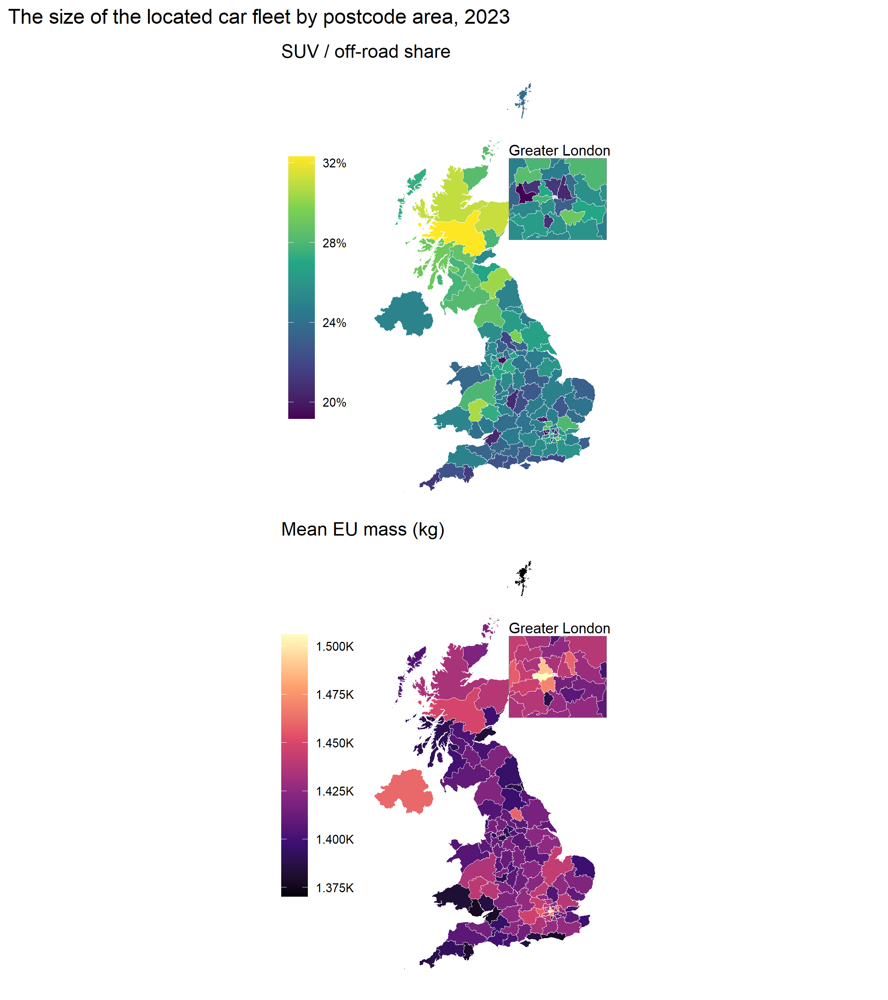

**Figure 9.** Every postcode area in `racf_by_area.csv`, of which the
tables above show the highest and lowest ten: the SUV / off-road share
(top) and the fleet-weighted mean EU mass (bottom) of the cars located
in the area in 2023. Each map has an inset of Greater London.

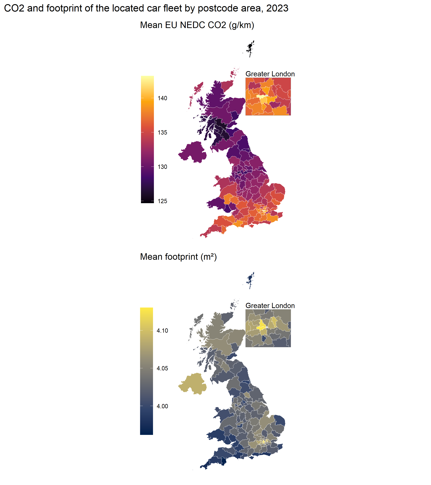

**Figure 10.** As the previous figure, for the fleet-weighted mean EU
NEDC CO2 (top) and mean footprint, wheelbase × track (bottom), of the
cars located in each postcode area in 2023 (`racf_by_area.csv`).

### 5.4 Annual mileage by size

#### Annual mileage by SMMT segment, SUV, footprint and mass, 2023

Cars with a plausible mileage that year, under the fleet profile’s
filter (a real postcode area, Great Britain only, the plausible-mileage
flag) , so `all` equals the fleet profile’s car count (cross-checked).
Larger and heavier cars are driven further, but they are also younger
and more often diesel, so the gradient is not an effect of size alone;
every year is in `racf_mileage_by_size.csv`.

- `dimension`: the grouping
- `category`: its category (bands by the starting value)
- `n_vehicles`: cars
- `mean_mileage`: mean annual mileage
- `median_mileage`: median annual mileage

| dimension | category          | n_vehicles | mean_mileage | median_mileage |
|:----------|:------------------|-----------:|-------------:|---------------:|
| all       | All               | 31,115,036 |      6,760.5 |          5,785 |
| smmt_type | Dual Purpose      |  8,046,119 |      7,703.1 |          6,964 |
| smmt_type | Supermini         |  7,541,018 |      5,790.5 |          4,913 |
| smmt_type | Lower Medium      |  6,891,562 |      7,266.4 |          6,158 |
| smmt_type | Upper Medium      |  2,811,540 |      7,814.5 |          6,654 |
| smmt_type | Mini              |  2,336,446 |      4,852.0 |          3,953 |
| smmt_type | MPV               |    905,330 |      7,799.5 |          6,435 |
| smmt_type | Executive         |    887,878 |      7,923.6 |          6,650 |
| smmt_type | Specialist Sports |    748,702 |      3,408.5 |          2,281 |
| smmt_type | (no segment)      |    420,024 |      4,549.3 |          3,081 |
| smmt_type | (not linked)      |    254,089 |      4,467.1 |          3,092 |
| smmt_type | Luxury Saloon     |    182,380 |      5,224.4 |          3,358 |
| smmt_type | Other             |     89,948 |      7,532.4 |          5,241 |
| suv       | other             | 22,335,531 |      6,487.6 |          5,391 |
| suv       | SUV / off-road    |  8,036,339 |      7,703.2 |          6,964 |
| suv       | (unknown)         |    743,166 |      4,768.7 |          3,351 |
| footprint | 4.0-4.2           |  7,924,568 |      7,333.6 |          6,355 |
| footprint | 3.6-3.8           |  5,593,878 |      5,524.4 |          4,621 |
| footprint | 3.8-4.0           |  4,546,958 |      6,462.4 |          5,588 |
| footprint | 4.2-4.4           |  4,008,721 |      7,902.8 |          7,044 |
| footprint | \<3.6             |  3,586,606 |      4,886.6 |          3,960 |
| footprint | 4.6+              |  2,500,946 |      8,357.1 |          7,391 |
| footprint | 4.4-4.6           |  2,122,721 |      8,295.9 |          7,205 |
| footprint | (missing)         |    830,638 |      5,098.7 |          3,749 |
| mass      | 1250-1500         | 10,225,055 |      7,073.0 |          6,088 |
| mass      | 1000-1250         |  8,190,778 |      5,645.7 |          4,760 |
| mass      | 1500-1750         |  6,263,659 |      7,594.1 |          6,712 |
| mass      | 1750-2000         |  2,313,100 |      8,224.7 |          7,139 |
| mass      | \<1000            |  1,854,558 |      4,800.1 |          3,905 |
| mass      | 2000+             |  1,701,500 |      7,981.5 |          7,154 |
| mass      | (missing)         |    566,386 |      4,795.5 |          3,256 |

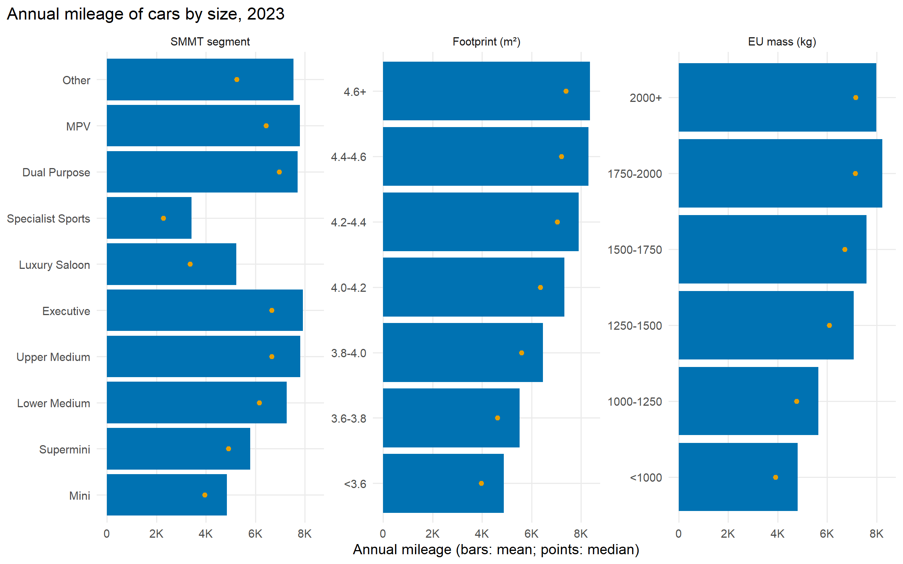

**Figure 11.** The table above as a chart: the mean (bars) and median
(points) annual mileage in 2023 of the cars in each SMMT segment,
footprint band and EU mass band (`racf_mileage_by_size.csv`). Cars count
under the fleet profile’s filter: a plausible mileage, in a real
postcode area, Great Britain only. Cars with no value for the grouping
are left out.

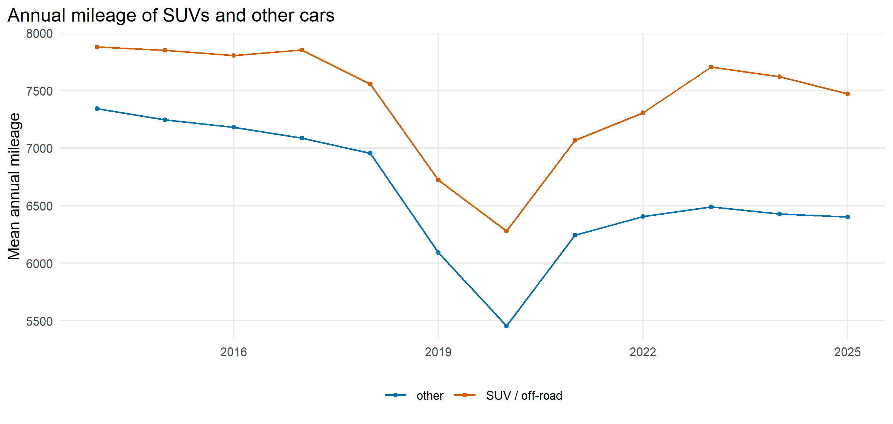

**Figure 12.** The mean annual mileage each year of the cars whose model
SMMT calls a crossover / SUV or off-roader, against all other linked
cars (the `suv` rows of `racf_mileage_by_size.csv`), under the same
filter as the previous figure.

## 6. Cross-checks

## RACF cross-checks

Every check of the RACF tables in `quality/cross_checks.csv`, by check
(one row per year or category in the file). The link coverage, the stock
tables, the characteristics, the area and cohort tables all count the
same located cars, and that count is checked against the DfT comparison,
computed by different code; the mileage table is checked against the
fleet profile; the RACF counts against each other and against DfT
VEH0124.

- `check`: check name
- `pass`: rows that pass
- `fail`: rows that fail
- `warn`: rows that warn

| check                                | pass | fail | warn |
|:-------------------------------------|-----:|-----:|-----:|
| racf_by_area_total                   |    1 |    0 |    0 |
| racf_characteristics_by_cohort_total |    1 |    0 |    0 |
| racf_characteristics_fuels           |   12 |    0 |    0 |
| racf_characteristics_linked          |   12 |    0 |    0 |
| racf_characteristics_total           |   12 |    0 |    0 |
| racf_coverage_vs_dft_stock           |   12 |    0 |    0 |
| racf_mileage_partition               |   48 |    0 |    0 |
| racf_mileage_vs_profile              |   12 |    0 |    0 |
| racf_stock_by_fuel_mot               |   12 |    0 |    0 |
| racf_stock_by_fuel_racf              |   12 |    0 |    0 |
| racf_stock_by_smmt_mot               |   12 |    0 |    0 |
| racf_stock_by_smmt_racf              |   12 |    0 |    0 |
| racf_vs_dft_cars                     |   12 |    0 |    0 |

## 7. Limitations

- **Attributes are model averages.** A car takes the fleet-weighted mean
  of its model, year and fuel, not its own variant’s figure: an estate
  and a hatchback of one model share a footprint. Means over thousands
  of cars are sound; a single car’s value is not.
- **Many are borrowed.** Only 34.4% of the 2023 fleet has EU figures for
  its exact year; for the rest RACF used the nearest year or another
  fuel (Section 1.3). WLTP CO2 covers only models approved since
  2017-2018, so the WLTP means describe a newer subset.
- **Cars only.** RACF covers DfT cars; vans, motorcycles and buses have
  no segment or attributes.
- **The MOT stock includes carried-forward years** (methodology Section
  3.3), so older cars are over-represented against DfT (Section 4.1),
  and new cars before their first test are missing; fleet means lean
  slightly towards older models.
- **The link uses the pipeline’s names.** A car whose make or model did
  not match a DfT name links at best to its generic model, or not at all
  (Section 3).
