# Does the MOT data hold every registered vehicle? {#sec-registration-report .unnumbered}

::: {.callout-note title="Generated by the pipeline"}
This appendix is `outputs/reports/registration_report.md` from the MOT-pipline repository, copied unchanged into the book by `scripts/sync-pipeline.R`. Paths such as `outputs/...` refer to that repository. See @sec-maintaining.
:::


This report compares the vehicles in the MOT data with the vehicles DfT
counts as registered, nationally and by postcode area, and breaks the
comparison down by body type, age, fuel and engine size. It sets out
what each source counts, where the two should and should not agree, and
which kinds of vehicle never appear in the MOT data at all. A section
looks at motorcycles, where the MOT data appears to fall further behind
the registered fleet every year.

Every number here is computed from the tables in
`outputs/tables/registration/` (section 11) and the DfT small-area
counts in `inputs/dft_lsoa_vehicles_by_pca.csv`, so it changes with the
build.

## 1. Summary

- **Counted like for like, the MOT data holds about as many cars and
  vans as DfT.** A vehicle counts as part of the year-end MOT stock if
  it has a postcode area in the year and an MOT after it. On that basis
  there are 33,672,852 cars in 2022 against 33,187,308 licensed in DfT’s
  statistics: a ratio of 1.01, and between 1.00 and 1.03 in every year
  from 2014 to 2022. For vans the range is 0.96 to 1.00.
- **The comparison the mileage and quality reports used to make
  overstates cars and understates motorcycles.** Their count kept every
  vehicle with a postcode area, including vehicles carried on for two
  years after their last MOT. They also divided by DfT’s licensed *plus*
  SORN count, and SORN vehicles have no MOT. That gives 1.04 for cars
  and 0.60 for motorcycles in 2022, against 1.01 and 0.97 like for like
  (section 3).
- **Most of the apparent motorcycle shortfall is in DfT’s count, not the
  MOT data.** DfT’s SORN motorcycles grew from 746,761 in 2014 to
  1,521,447 in 2025. That is more than the 1,360,270 licensed ones. A
  SORN declaration does not need renewing, so bikes laid up, broken for
  parts or scrapped without notice stay in that count indefinitely.
  Against licensed motorcycles only, the MOT stock ratio is 1.22 in 2014
  and 0.97 in 2022 (section 8).
- **Real gaps in motorcycles remain, and they are concentrated in small
  and old bikes**:
  - **Bikes over 40 have been exempt from the MOT since May 2018.** In
    2022 DfT had 140,337 licensed motorcycles aged 40 or more; the MOT
    stock had 10,493.
  - **About one bike in 9 never reaches an MOT.** Of the motorcycles
    first used from 2012 to 2021, 88% of DfT’s count at age one ever
    appear in the MOT data, against 103% of cars. The missing bikes are
    mostly small (mopeds, 125cc scooters and learner bikes from low-cost
    makes) or are enduro and trials bikes registered for the road but
    ridden off it (section 7).
  - **Fewer small bikes are tested each year.** Motorcycles of up to
    125cc in the MOT stock fell from 419,990 in 2014 to 294,816 in 2022.
    DfT’s licensed count of them went from 374,346 to 369,983 over the
    same years.
  - **Some taxed bikes have no valid MOT.** Of the taxed motorcycles
    aged 3 to 39, 7.3% had no valid MOT when the DVLA record was read,
    against 2.3% of cars.
- **Seasonal SORN works the other way.** 13% of the motorcycles still
  being tested were SORN when the DVLA record was read, against 2% of
  cars. Many bikes are taken off the road for the winter, so they are
  tested but not licensed at DfT’s year-end count.
- **Other vehicles missing from the MOT data by design.** Heavy goods
  vehicles and most buses take a separate annual test, so few are here.
  Vehicles under three (four in Northern Ireland) are missing in the
  most recent years, until their first MOT copies a postcode area back
  to their registration. The last 3 years (2023 to 2025) are incomplete
  for that reason and because the stock count needs a later MOT.
- **By postcode area, the main differences come from where each source
  puts a vehicle.** The MOT data puts it where it was tested; DfT puts
  it at its registered keeper’s address. Company and lease cars are
  registered at a few fleet addresses, so areas such as SL, SN, SK and
  MK hold many more DfT cars than MOT cars. Across areas, the difference
  from the national ratio correlates with the company share of each
  area’s cars (-0.57; section 9). DfT also counts vehicles with no
  usable address in a separate “Miscellaneous” row that has no MOT
  counterpart.

## 2. What each source counts

### 2.1 The two counts

| Source | Counts | Used |
|:---|:---|:---|
| DfT VEH0124 | Licensed and SORN vehicles by body type, make, model and year of first use, UK, at the end of each year | National totals, age, cohorts (sections 3, 4, 6, 8) |
| DfT VEH0220 | The same, by fuel and engine size | Fuel and engine size (section 5) |
| DfT VEH0125 | Licensed and SORN vehicles by body group (cars, motorcycles, other) and keepership, for small areas, at the end of March | Postcode areas (section 9) |
| DfT VEH0145 | Licensed plug-in vehicles by fuel, for small areas, at the end of March | Plug-in vehicles by postcode area (section 9) |
| MOT located | Vehicles with a postcode area in the year (`pca_YYYY` not `unborn`, `dead` or `unknown`) | As the earlier reports did; shown for comparison |
| MOT stock | Located vehicles with an MOT after the year (`last_mot_year` later than the year, or missing) | The like-for-like count throughout |

The DfT tables are the vehicle licensing statistics, built from the DVLA
register. They are read from `inputs/df_VEH0124_*.csv` and
`inputs/df_VEH0220.csv` (through
`outputs/intermediate/dft_stock.parquet`), and from
`inputs/dft_lsoa_vehicles_by_pca.csv`, which sums the small-area tables
to postcode areas (built by
`data-raw/build_dft_lsoa_vehicles_by_pca.R`). **Licensed** means taxed
or exempt from tax and allowed on the road. **SORN** means declared off
the road. The MOT counts come from
`outputs/vehicles_enhanced_maximal.parquet`, which holds every vehicle
in the input, tested or not. Age is the year minus the year of first use
in both sources, so a vehicle first used in 2019 is age 3 in 2022.

**Why two MOT counts.** The annualisation gives a vehicle a postcode
area from its first registration (copied back from its first MOT) until
two years after its last MOT. A located vehicle is therefore one
observed at some point in the year, plus up to two years of vehicles
that have already gone. That is the right population for mileage (a car
scrapped in October was driven until October). It is the wrong one for a
count of the fleet at the end of the year, which is what DfT publishes.
The stock count keeps only the vehicles tested again later, so it is
close to DfT’s year-end licensed count. It is slightly low, because a
vehicle whose last MOT was in the year was often still on the road at
its end.

### 2.2 Differences that are there by design

| Difference | Effect |
|:---|:---|
| Vehicles under three | No MOT until three (four in Northern Ireland). The annualisation copies the first test’s area back to registration, so they are counted once that test is in the data, but not before: the youngest ages empty out in the last years. |
| Vehicles over 40 | Exempt from the MOT since 20 May 2018 unless substantially changed (before that, vehicles built before 1960). Most stop being tested, so they are missing from the stock count. |
| Heavy goods vehicles, buses, other vehicles | Tested under the separate annual test for goods and passenger vehicles, not the MOT. Only the minority with an MOT class (minibuses, motor caravans, light HGVs) appear. |
| SORN | In DfT’s count but not tested, so not in the stock count. SORN does not lapse, so the SORN count includes long-gone vehicles and grows every year. |
| Seasonal SORN | A vehicle declared SORN over the winter is in DfT’s SORN count at the end of the year but is tested, so is in the MOT stock count. This matters for motorcycles. |
| Carried-forward years | The located count keeps a vehicle for two years after its last MOT (see 2.1). The stock count drops them. |
| The last years of data | The stock count needs an MOT after the year, and a vehicle registered recently has not had its first. Years after 2022 are incomplete. |
| Location | MOT: the postcode area of the test station. DfT: the registered keeper’s address, so company and lease vehicles are counted where the company is registered. DfT counts vehicles with no usable address as “Miscellaneous”. |
| Timing | VEH0124 and VEH0220: 31 December. The small-area tables: 31 March of the following year, compared here with MOT year Y. |

## 3. National totals

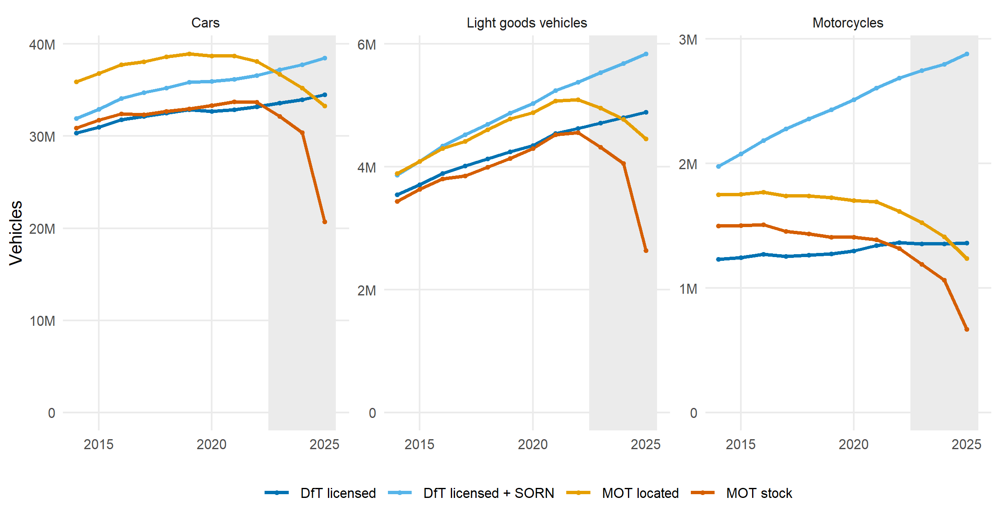

**Figure 1.** Vehicles each year by body type: DfT licensed, and
licensed plus SORN (VEH0124, end of year, UK); MOT located and MOT stock
(section 2.1). The shaded years after 2022 are incomplete: the stock
count needs an MOT after the year, and the youngest vehicles have not
had their first.

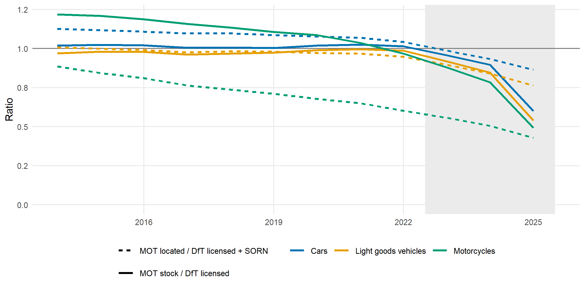

**Figure 2.** The like-for-like ratio (solid: MOT stock to DfT licensed)
and the one the earlier reports used (dashed: every located vehicle to
DfT licensed plus SORN). At 1 (grey line) the two sources agree. The
shaded years after 2022 are incomplete: the stock count needs an MOT
after the year, and the youngest vehicles have not had their first.

### Every body type, 2022

All body types, including those outside the MOT scheme. `Unknown` is MOT
vehicles with no DfT body type (no make/model match and no test class);
DfT has no such row.

- `mot_located`: vehicles with a postcode area in the year
- `mot_stock`: located vehicles with an MOT after the year
- `dft_licensed`: DfT licensed vehicles, 31 December (VEH0124)
- `dft_sorn`: DfT SORN vehicles, 31 December
- `stock_to_licensed`: `mot_stock` / `dft_licensed`: the like-for-like
  ratio
- `located_to_all`: `mot_located` / (`dft_licensed` + `dft_sorn`): the
  ratio the earlier reports used

| body_type | mot_located | mot_stock | dft_licensed | dft_sorn | stock_to_licensed | located_to_all |
|:---|---:|---:|---:|---:|---:|---:|
| Cars | 38,115,086 | 33,672,852 | 33,187,308 | 3,405,855 | 1.01 | 1.04 |
| Light goods vehicles | 5,092,210 | 4,557,315 | 4,623,911 | 752,540 | 0.99 | 0.95 |
| Motorcycles | 1,614,065 | 1,319,185 | 1,363,661 | 1,322,859 | 0.97 | 0.60 |
| Other vehicles | 47,309 | 34,908 | 843,051 | 232,344 | 0.04 | 0.04 |
| Heavy goods vehicles | 50,366 | 42,886 | 536,519 | 226,431 | 0.08 | 0.07 |
| Buses and coaches | 45,360 | 37,823 | 143,203 | 54,727 | 0.26 | 0.23 |
| Unknown | 51,318 | 39,653 | 0 | 0 | NA | NA |

Cars and vans agree closely once both counts mean the same thing. The
stock count is a little higher than DfT’s licensed count in most years,
which is the opposite of what its definition alone would give (section
2.1). Two kinds of vehicle push it up:

- a vehicle laid up for a winter is tested but SORN at the year end;
- a vehicle whose tax has lapsed without a SORN is in neither of DfT’s
  counts, but may still be tested.

Heavy goods vehicles, buses and the “other vehicles” group (agricultural
tractors and other special types among them) are mostly outside the MOT
scheme, so their ratios are low by design.

## 4. Age

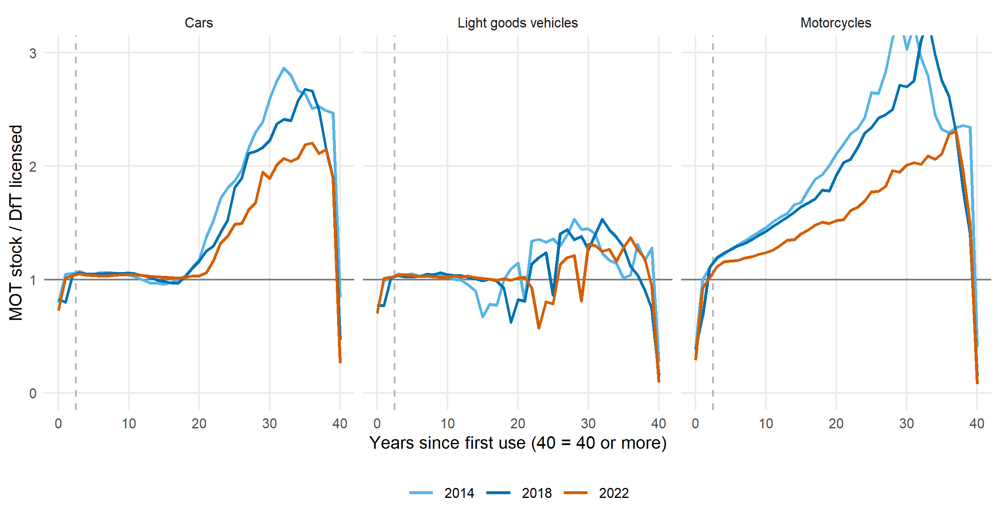

**Figure 3.** The like-for-like ratio by age, in 2014, 2018 and 2022.
Left of the dashed line, vehicles not yet due an MOT. The vertical axis
stops at 3.

The ratio is close to 1 for cars and vans of every age between 3 and the
late 30s. Three ages behave differently:

- **0 to 2.** Most young vehicles are counted, because the annualisation
  copies the first test’s area back to registration. Some are not: a
  vehicle scrapped, exported or stolen before its first test never gets
  an area. For motorcycles that is a large share (section 6).
- **40 and over.** Vehicles over 40 have been exempt from the MOT since
  20 May 2018, so most stop being tested and drop out. Before that only
  vehicles built before 1960 were exempt.
- **Motorcycles aged 3 to 39.** The MOT stock is well above DfT’s
  licensed count, by more at older ages. These bikes are tested but were
  SORN on 31 December: laid up for the winter, or kept for summer use.
  Section 8 follows this up.

### Vehicles aged 40 or more

Cars and motorcycles first used at least 40 years before the year. The
exemption for vehicles over 40 began on 20 May 2018. The stock ratio
already falls in 2017, because a year’s stock needs an MOT after it, and
vehicles that stopped being tested in 2018 had none. The 40+ group grows
each year as another cohort turns 40, so the number of registered
vehicles that no MOT will ever see grows with it.

- `dft_licensed`: DfT licensed vehicles aged 40+
- `dft_sorn`: DfT SORN vehicles aged 40+
- `mot_located`: MOT located vehicles aged 40+
- `mot_stock`: MOT stock aged 40+
- `stock_to_licensed`: `mot_stock` / `dft_licensed`

| body_type   | year | dft_licensed | dft_sorn | mot_located | mot_stock | stock_to_licensed |
|:------------|:-----|-------------:|---------:|------------:|----------:|------------------:|
| Cars        | 2014 |      185,726 |   80,346 |     197,400 |   156,153 |              0.84 |
| Cars        | 2015 |      189,017 |   92,363 |     181,757 |   154,348 |              0.82 |
| Cars        | 2016 |      191,488 |  103,112 |     180,303 |   147,978 |              0.77 |
| Cars        | 2017 |      195,215 |  120,156 |     179,426 |   116,556 |              0.60 |
| Cars        | 2018 |      214,907 |  121,285 |     178,538 |   100,444 |              0.47 |
| Cars        | 2019 |      227,042 |  128,288 |     173,652 |    91,276 |              0.40 |
| Cars        | 2020 |      234,929 |  137,313 |     141,673 |    87,563 |              0.37 |
| Cars        | 2021 |      245,120 |  143,052 |     123,099 |    76,677 |              0.31 |
| Cars        | 2022 |      252,602 |  151,022 |     109,888 |    66,149 |              0.26 |
| Cars        | 2023 |      256,097 |  164,306 |     107,256 |    56,010 |              0.22 |
| Cars        | 2024 |      264,772 |  175,284 |      96,387 |    44,988 |              0.17 |
| Cars        | 2025 |      267,626 |  198,027 |      83,780 |    21,772 |              0.08 |
| Motorcycles | 2014 |       88,918 |   33,110 |      53,723 |    36,013 |              0.41 |
| Motorcycles | 2015 |       89,910 |   41,737 |      48,106 |    36,371 |              0.40 |
| Motorcycles | 2016 |       92,195 |   51,260 |      50,723 |    35,105 |              0.38 |
| Motorcycles | 2017 |       95,041 |   64,183 |      52,645 |    21,885 |              0.23 |
| Motorcycles | 2018 |      106,706 |   70,130 |      53,705 |    15,773 |              0.15 |
| Motorcycles | 2019 |      115,076 |   81,181 |      52,539 |    14,278 |              0.12 |
| Motorcycles | 2020 |      124,067 |   94,687 |      40,321 |    14,125 |              0.11 |
| Motorcycles | 2021 |      133,739 |  109,036 |      35,373 |    12,650 |              0.09 |
| Motorcycles | 2022 |      140,337 |  121,164 |      31,548 |    10,493 |              0.07 |
| Motorcycles | 2023 |      143,781 |  130,866 |      28,686 |     8,090 |              0.06 |
| Motorcycles | 2024 |      148,122 |  140,472 |      23,656 |     5,585 |              0.04 |
| Motorcycles | 2025 |      147,029 |  157,875 |      19,619 |     2,092 |              0.01 |

## 5. Fuel and engine size

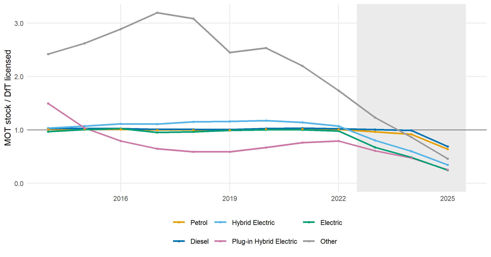

**Figure 4.** Cars: the like-for-like ratio by fuel group. DfT fuels
(VEH0220) are grouped as the harmonised `fuel_simple`: plug-in hybrids
and range extenders as Plug-in Hybrid Electric, other hybrids as Hybrid
Electric, gas, fuel cells and the rest as Other. The shaded years after
2022 are incomplete: the stock count needs an MOT after the year, and
the youngest vehicles have not had their first.

### Cars by fuel group, 2022

Cars with no harmonised fuel are left out of the MOT column. Battery
electric and plug-in hybrid cars are young, so more of them are not yet
due an MOT, and their ratio is low and falls as sales grow. The two
sources also identify fuel differently. DfT records plug-in hybrids
directly. Here they are attached by make and model from DfT’s own
counts, so some plug-ins stay Hybrid Electric, and diesel hybrids may be
recorded as Diesel by DVSA.

- `mot_stock`: MOT stock
- `dft_licensed`: DfT licensed cars (VEH0220)
- `dft_sorn`: DfT SORN cars
- `stock_to_licensed`: `mot_stock` / `dft_licensed`

| fuel_simple             |  mot_stock | dft_licensed |  dft_sorn | stock_to_licensed |
|:------------------------|-----------:|-------------:|----------:|------------------:|
| Petrol                  | 19,310,695 |   19,099,791 | 2,345,809 |              1.01 |
| Diesel                  | 12,007,632 |   11,746,622 | 1,021,709 |              1.02 |
| Hybrid Electric         |  1,362,978 |    1,271,160 |    12,047 |              1.07 |
| Plug-in Hybrid Electric |    327,487 |      413,759 |     5,457 |              0.79 |
| Electric                |    617,178 |      628,984 |     4,919 |              0.98 |
| Other                   |     46,882 |       26,992 |    15,914 |              1.74 |

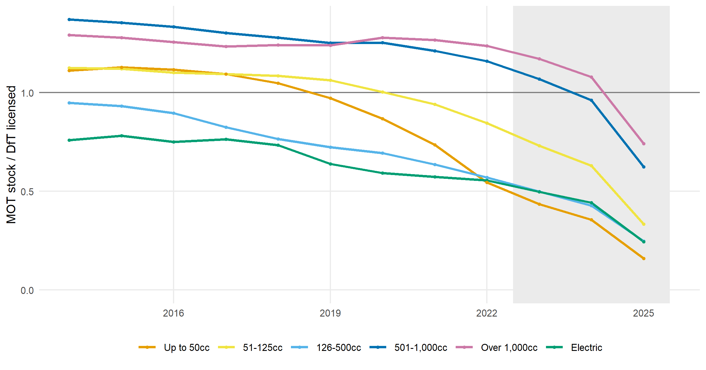

**Figure 5.** Motorcycles: the like-for-like ratio by engine size
(VEH0220 engine size bands; electric motorcycles separately). The shaded
years after 2022 are incomplete: the stock count needs an MOT after the
year, and the youngest vehicles have not had their first.

### Motorcycles by engine size, 2014 and 2022

The ratio fell in every band, most for the smallest bikes and for
126-500cc. That band holds many classic bikes over 40 years old, which
stopped being tested from 2018. The smallest bikes are the ones most
often never tested at all (section 7).

- `stock`: MOT stock
- `licensed`: DfT licensed motorcycles (VEH0220)
- `sorn`: DfT SORN motorcycles
- `ratio`: MOT stock / DfT licensed

| engine | stock_2014 | licensed_2014 | ratio_2014 | stock_2022 | licensed_2022 | sorn_2022 | ratio_2022 |
|:---|---:|---:|---:|---:|---:|---:|---:|
| Up to 50cc | 111,628 | 100,350 | 1.11 | 32,603 | 59,909 | 141,693 | 0.54 |
| 51-125cc | 308,362 | 273,996 | 1.13 | 262,213 | 310,074 | 276,107 | 0.85 |
| 126-500cc | 175,548 | 185,155 | 0.95 | 134,630 | 236,396 | 238,358 | 0.57 |
| 501-1,000cc | 635,673 | 463,717 | 1.37 | 564,845 | 487,219 | 485,529 | 1.16 |
| Over 1,000cc | 266,532 | 206,266 | 1.29 | 317,421 | 256,527 | 176,544 | 1.24 |
| Electric | 692 | 912 | 0.76 | 7,472 | 13,438 | 4,467 | 0.56 |

## 6. Registration cohorts: who ever reaches an MOT

The input holds nearly every vehicle on the register, tested or not. It
includes those never tested, because DVLA activity (tax, a V5C, first
registration) keeps a vehicle in scope. A registration cohort can
therefore be followed from DfT’s count of it to the share that ever has
an MOT.

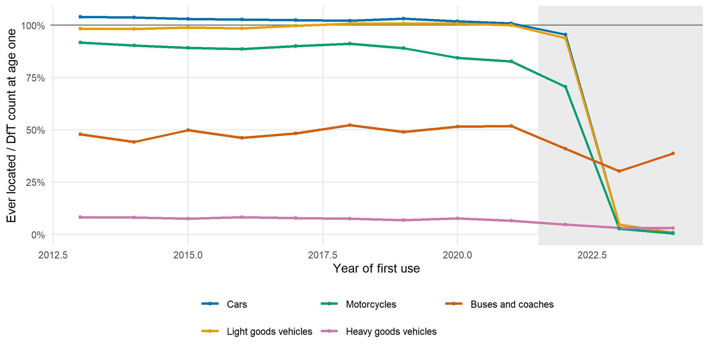

**Figure 6.** For each year of first use: vehicles that ever have a
postcode area in the MOT data, as a share of DfT’s licensed plus SORN
count of that cohort at the end of the following year (VEH0124). The
shaded cohorts, first used after 2021, were not all due their first MOT
inside the data. Above 100%: vehicles DfT had already lost by age one
(exported or scrapped) but which were tested, or vehicles first used
abroad.

### Cohorts first used 2012 to 2021

Totals over the settled cohorts. Cars and vans almost all reach an MOT.
About one motorcycle in 9 does not, and most heavy goods vehicles and
buses never do because they are tested outside the MOT. The input holds
more vehicles of each cohort than DfT counts at age one (`data_to_dft`
above 1): it also keeps vehicles DfT had already lost by then, exported
or scrapped in their first year.

- `vehicles_in_data`: vehicles of that body type and cohort in the input
- `ever_located`: of those, vehicles with a postcode area in at least
  one year
- `dft_at_age_one`: DfT licensed + SORN count of the cohorts at the end
  of the year after first use
- `data_to_dft`: `vehicles_in_data` / `dft_at_age_one`: near 1 means the
  input holds the whole register
- `located_to_dft`: `ever_located` / `dft_at_age_one`

| body_type | vehicles_in_data | ever_located | dft_at_age_one | data_to_dft | located_to_dft |
|:---|---:|---:|---:|---:|---:|
| Cars | 20,948,777 | 20,314,060 | 19,766,120 | 1.06 | 1.03 |
| Light goods vehicles | 3,116,750 | 3,011,089 | 3,021,732 | 1.03 | 1.00 |
| Motorcycles | 978,262 | 770,422 | 870,820 | 1.12 | 0.88 |
| Heavy goods vehicles | 341,224 | 32,117 | 423,725 | 0.81 | 0.08 |
| Other vehicles | 218,233 | 23,665 | 405,646 | 0.54 | 0.06 |
| Buses and coaches | 64,029 | 33,558 | 69,005 | 0.93 | 0.49 |

## 7. Which vehicles never reach an MOT

This section looks at the vehicles first used from 2012 to 2021 that
never have a postcode area. Each was due its first MOT inside the data,
even allowing for Northern Ireland’s four-year rule and the six-month
extension of 2020. Tax status is from the DVLA record attached to the
input (one reading, taken after the end of the data).

### Vehicles never located, by body type

Vehicles of the settled cohorts. A taxed vehicle that never had an MOT
is either exempt (heavy vehicles and buses with their own test, some
special types) or on the road without one. An untaxed or SORN vehicle
may be off the road, scrapped without notice or stolen. `Unknown`
vehicles have no body type because they matched no make/model and have
no test class. Where a make is recorded they are mostly lorries (DAF,
Scania, Volvo), plant and farm machinery (JCB, Manitou, Thwaites, Massey
Ferguson), scooters and mobility scooters: vehicles that never take an
MOT.

- `vehicles`: vehicles of the settled cohorts
- `never_located`: of those, with no postcode area in any year
- `share_never`: `never_located` / `vehicles`
- `taxed`: never located and taxed in the DVLA record
- `sorn`: never located and SORN
- `untaxed`: never located and untaxed (including not taxed for road
  use)
- `no_ves_record`: never located, with no DVLA record attached
- `marked_for_export`: never located and marked for export (also counted
  in one of the columns before)

| body_type | vehicles | never_located | share_never | taxed | sorn | untaxed | no_ves_record | marked_for_export |
|:---|---:|---:|:---|---:|---:|---:|---:|---:|
| Cars | 23,031,696 | 692,151 | 3.0% | 92,439 | 82,029 | 338,592 | 179,091 | 264,393 |
| Light goods vehicles | 3,354,062 | 112,234 | 3.3% | 13,458 | 19,826 | 52,484 | 26,466 | 40,245 |
| Motorcycles | 1,072,713 | 227,194 | 21.2% | 16,784 | 89,160 | 97,182 | 24,068 | 32,718 |
| Unknown | 516,697 | 494,027 | 95.6% | 188,130 | 83,985 | 181,375 | 40,537 | 38,549 |
| Heavy goods vehicles | 366,237 | 330,238 | 90.2% | 190,575 | 52,653 | 85,351 | 1,659 | 50,273 |
| Other vehicles | 236,517 | 210,020 | 88.8% | 116,093 | 29,134 | 62,797 | 1,996 | 31,802 |
| Buses and coaches | 70,738 | 32,944 | 46.6% | 28,914 | 1,613 | 1,635 | 782 | 999 |

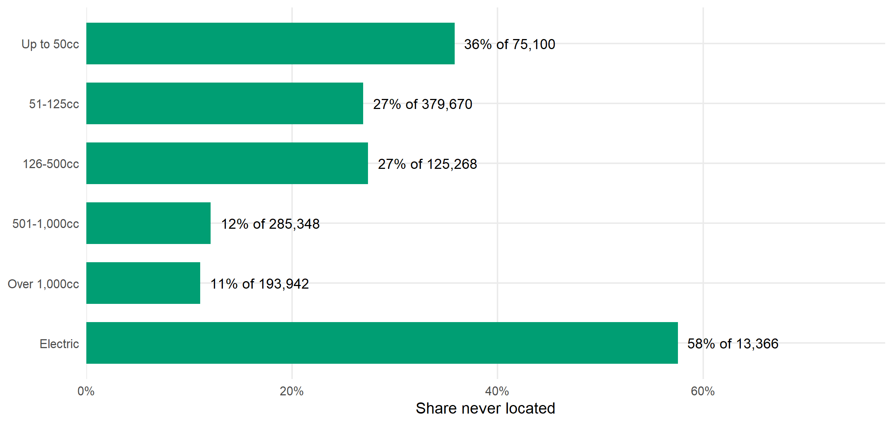

**Figure 7.** Motorcycles first used 2012 to 2021: the share that never
have a postcode area, by engine size (electric motorcycles, which have
none, separately). Petrol engine bands include electric bikes recorded
with an engine size.

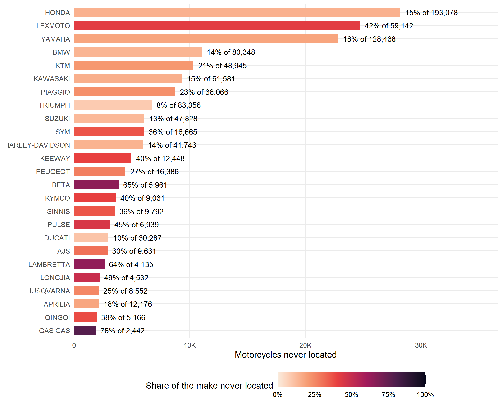

**Figure 8.** The 25 motorcycle makes with the most bikes first used
2012 to 2021 that never have a postcode area. Bar length is the number
never located; the label and colour give it as a share of the make’s
bikes in those cohorts.

Two groups stand out among the motorcycles:

- **Small, low-cost bikes:** mopeds and 125cc scooters, from Lexmoto,
  SYM, Keeway, Kymco, Sinnis, Pulse and similar makes. These are the
  bikes of learners and of delivery work, kept for a short time and
  often written off, stolen or scrapped before they are three.
- **Enduro and trials bikes:** Beta, Sherco, Gas Gas, KTM and Husqvarna.
  They are road registered so that they can be ridden between off-road
  sections, but many are only used off the road and never taken for an
  MOT.

Honda and Yamaha top the chart by number because they sell the most
bikes. Most of the bikes that never reach an MOT were SORN or untaxed
when the DVLA record was read; few are taxed (table above).

### Cars and vans never located: the makes with most

The 12 makes of car and of van with the most vehicles first used 2012 to
2021 that never have a postcode area. For cars and vans the shares are
small, and higher for the prestige makes that are exported young: 38% of
the cars never located are marked for export. Most of them are untaxed
or have no DVLA record: exported, written off, stolen or scrapped before
their first MOT.

- `share_never`: `never_located` / `vehicles`

| body_type | make | vehicles | never_located | share_never | taxed | sorn | untaxed | marked_for_export |
|:---|:---|---:|---:|:---|---:|---:|---:|---:|
| Cars | MERCEDES | 1,401,455 | 89,413 | 6.4% | 4,807 | 15,814 | 56,562 | 43,271 |
| Cars | BMW | 1,538,485 | 66,210 | 4.3% | 6,669 | 8,134 | 35,418 | 27,208 |
| Cars | FORD | 2,652,162 | 56,773 | 2.1% | 5,787 | 5,274 | 30,389 | 21,494 |
| Cars | AUDI | 1,484,682 | 56,701 | 3.8% | 5,614 | 5,762 | 29,287 | 23,502 |
| Cars | VOLKSWAGEN | 1,968,745 | 54,866 | 2.8% | 9,036 | 4,482 | 22,827 | 17,599 |
| Cars | TOYOTA | 1,051,033 | 43,340 | 4.1% | 9,934 | 3,452 | 14,464 | 11,962 |
| Cars | VAUXHALL | 2,023,898 | 31,183 | 1.5% | 4,705 | 2,023 | 10,591 | 6,076 |
| Cars | NISSAN | 1,171,060 | 29,693 | 2.5% | 3,345 | 2,917 | 15,340 | 12,650 |
| Cars | LAND ROVER | 666,549 | 27,632 | 4.1% | 3,185 | 4,352 | 15,322 | 9,782 |
| Cars | HYUNDAI | 797,200 | 26,483 | 3.3% | 3,053 | 2,844 | 14,805 | 14,351 |
| Cars | PEUGEOT | 889,860 | 22,553 | 2.5% | 4,259 | 2,231 | 9,333 | 7,693 |
| Cars | HONDA | 496,472 | 15,505 | 3.1% | 2,823 | 2,189 | 5,128 | 5,024 |
| Light goods vehicles | FORD | 1,004,587 | 31,005 | 3.1% | 4,013 | 4,742 | 14,579 | 10,015 |
| Light goods vehicles | MERCEDES | 307,921 | 14,733 | 4.8% | 802 | 2,873 | 7,960 | 3,382 |
| Light goods vehicles | VOLKSWAGEN | 403,007 | 9,961 | 2.5% | 1,698 | 1,534 | 4,316 | 3,748 |
| Light goods vehicles | PEUGEOT | 291,365 | 9,475 | 3.3% | 1,014 | 2,179 | 3,962 | 4,314 |
| Light goods vehicles | CITROEN | 259,055 | 8,049 | 3.1% | 635 | 1,533 | 3,598 | 3,725 |
| Light goods vehicles | VAUXHALL | 309,675 | 7,310 | 2.4% | 1,014 | 1,315 | 2,841 | 2,582 |
| Light goods vehicles | TOYOTA | 94,961 | 5,287 | 5.6% | 367 | 830 | 3,253 | 2,747 |
| Light goods vehicles | NISSAN | 124,949 | 5,056 | 4.0% | 506 | 854 | 2,822 | 2,473 |
| Light goods vehicles | RENAULT | 182,876 | 5,042 | 2.8% | 522 | 687 | 2,528 | 2,299 |
| Light goods vehicles | FIAT | 131,100 | 3,855 | 2.9% | 437 | 612 | 1,693 | 1,568 |
| Light goods vehicles | LAND ROVER | 42,871 | 2,629 | 6.1% | 371 | 720 | 1,318 | 1,072 |
| Light goods vehicles | MITSUBISHI | 76,559 | 2,500 | 3.3% | 121 | 304 | 1,316 | 1,014 |

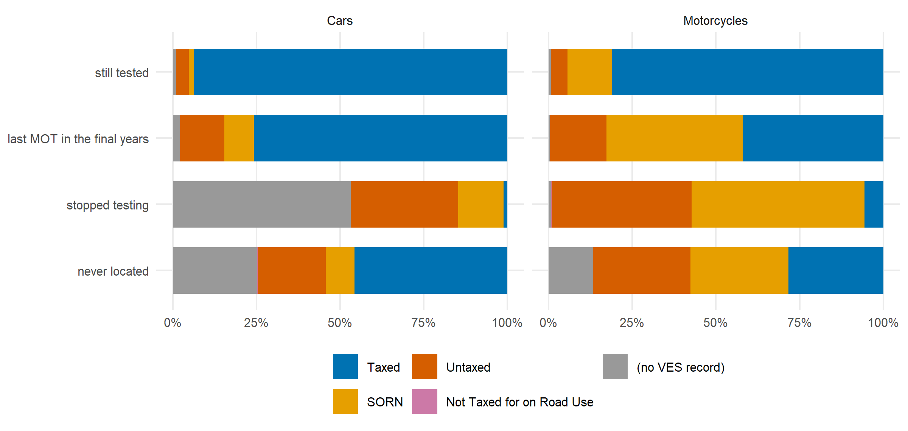

**Figure 9.** DVLA tax status of every car and motorcycle in the input,
by MOT history: still being tested (no last MOT year), last MOT in 2023
to 2025 (which mostly marks the end of the data rather than the end of
testing), stopped testing earlier, or never located. The tax status is
one reading taken after the end of the data.

## 8. Why the MOT data seems to undercount motorcycles

### From DfT’s count to the MOT stock: motorcycles

DfT counts (VEH0124, 31 December) split by licence status and age,
against the MOT stock of the same ages. From 2014 to 2022 DfT’s
motorcycle count grew by 709,204. Of that, 576,098 was SORN and 51,419
was licensed bikes aged 40+, two groups no MOT count can include.
Licensed bikes aged 3-39 changed by 10,606, and the MOT stock of the
same ages by -160,326.

| count                 |      2014 |      2018 |      2022 |
|:----------------------|----------:|----------:|----------:|
| DfT licensed + SORN   | 1,977,316 | 2,357,871 | 2,686,520 |
| of which SORN         |   746,761 | 1,092,729 | 1,322,859 |
| of which licensed     | 1,230,555 | 1,265,142 | 1,363,661 |
| licensed, aged 0-2    |   350,324 |   396,697 |   421,405 |
| licensed, aged 40+    |    88,918 |   106,706 |   140,337 |
| licensed, aged 3-39   |   791,313 |   761,739 |   801,919 |
| MOT stock, aged 3-39  | 1,233,791 | 1,177,645 | 1,073,465 |
| MOT stock, aged 0-2   |   228,634 |   240,952 |   235,227 |
| MOT stock, aged 40+   |    36,013 |    15,773 |    10,493 |
| MOT stock, all ages   | 1,498,438 | 1,434,370 | 1,319,185 |
| MOT located, all ages | 1,749,608 | 1,738,583 | 1,614,065 |

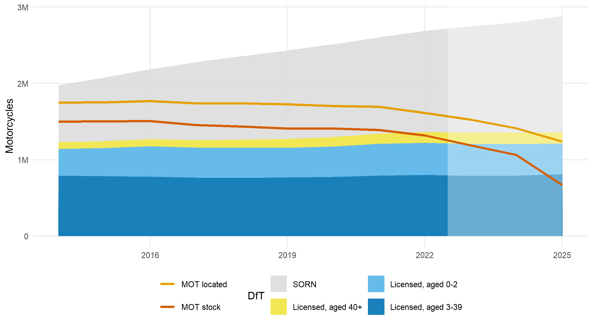

**Figure 10.** DfT’s motorcycles (VEH0124, 31 December) stacked by
licence status and age, with the two MOT counts as lines. The paler
years after 2022 are incomplete in the MOT data.

The motorcycle shortfall that the earlier reports showed has six parts.
The first two are in DfT’s count and no MOT count could match them; the
next three are bikes that really are registered but not tested; the last
works the other way.

1.  **DfT’s SORN count keeps growing.** SORN motorcycles went from
    746,761 to 1,521,447 between 2014 and 2025, while licensed ones
    barely changed. A SORN declaration does not need renewing: it lasts
    until the vehicle is taxed, sold, scrapped or exported. A bike
    stripped for parts, kept as a project or scrapped without telling
    the DVLA stays SORN for good. Of the motorcycles that have stopped
    being tested, 816,444 are SORN in the DVLA record. Comparing the MOT
    data with licensed + SORN therefore divides by a number that grows
    whatever happens on the road. This is the largest part of the
    change.
2.  **Bikes over 40 are no longer tested.** Since May 2018 a vehicle
    over 40 years old needs no MOT. Old bikes are a much larger share of
    the motorcycle fleet than old cars are of the car fleet. In 2022
    they made up 10% of licensed motorcycles but only 1% of licensed
    cars, and the group grows every year as another cohort turns
    40. 
3.  **About one bike in 9 is never tested.** Section 7 shows who: small
    scooters and mopeds that are scrapped, stolen or abandoned young,
    and off-road bikes that are road registered. Of the settled cohorts,
    90% of the bikes first used from 2013 to 2019 ever reached an MOT,
    and 84% of those first used in 2020 and 2021.
4.  **Fewer small bikes are tested each year.** The table above shows
    the MOT stock of bikes aged 3 to 39 falling by 160,326 from 2014 to
    2022, while DfT’s licensed count of the same ages hardly moved. Most
    of that fall is in bikes of up to 125cc: their MOT stock went from
    419,990 to 294,816, while DfT’s licensed count of them went from
    374,346 to 369,983 (section 5). The data do not say why. Small bikes
    change hands often and many are laid up, scrapped or stolen between
    tests; the next point may be part of it.
5.  **Some taxed bikes are ridden without a valid MOT.** Of the
    motorcycles aged 3 to 39 that were taxed when the DVLA record was
    read, 7.3% had no valid MOT, against 2.3% of cars and 4.0% of vans.
    Such a bike is licensed in DfT’s count but in no MOT count.
6.  **Working the other way: seasonal SORN.** Many bikes that are tested
    every year are SORN on 31 December. 13% of the motorcycles still
    being tested were SORN when the DVLA record was read, against 2% of
    cars. This is why the MOT stock of bikes aged 3 to 39 is larger than
    DfT’s licensed count of the same ages. For tested motorcycles, the
    right DfT comparison therefore lies between the licensed and the
    licensed + SORN counts.

On top of these, the last 3 years are incomplete for every body type
(section 2.2). Young bikes are a larger share of the motorcycle fleet
than young cars are of the car fleet, so motorcycles fall faster at the
end of the series.

## 9. By postcode area

The two sources place vehicles differently:

- **The MOT data** puts a vehicle in the postcode area of the station
  that tested it. For the years before its first test this is the first
  test’s area; for the two years after its last, the last test’s area.
- **DfT** puts it at the registered keeper’s address. Company and lease
  vehicles are therefore counted where the company is registered, and
  vehicles with no usable address go in a “Miscellaneous” row (661,433
  licensed cars in 2022).
- **Timing:** DfT’s small-area counts are for the end of March, so MOT
  year Y is compared with DfT at the end of March of Y + 1.

The maps therefore show each area relative to the national ratio, not
the raw ratio. The national ratio leaves out the Miscellaneous row, and
is 1.03 for cars in 2022 (MOT stock per DfT licensed car).

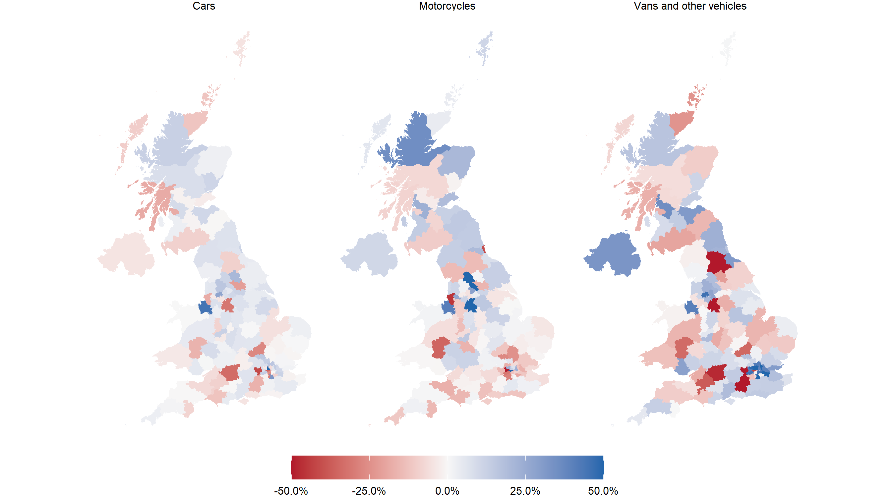

**Figure 11.** Each postcode area’s ratio of MOT stock to DfT licensed
vehicles in 2022, relative to the national ratio, for cars, motorcycles,
and vans with every other body type (DfT’s “other vehicles”). Blue: more
vehicles in the MOT data than the national ratio suggests; red: fewer.
The colour scale stops at 50% either way. Grey areas (EC, WC) have no
MOT vehicles.

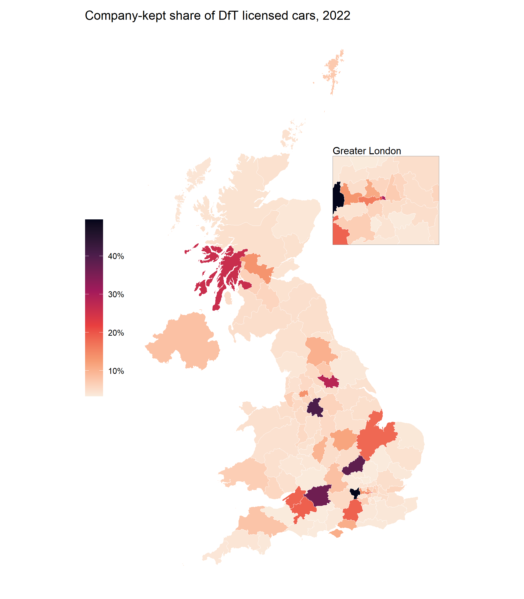

**Figure 12.** The share of each postcode area’s licensed cars whose
keeper is a company (VEH0125 keepership), 2022. High shares mark the
areas where fleet and lease cars are registered.

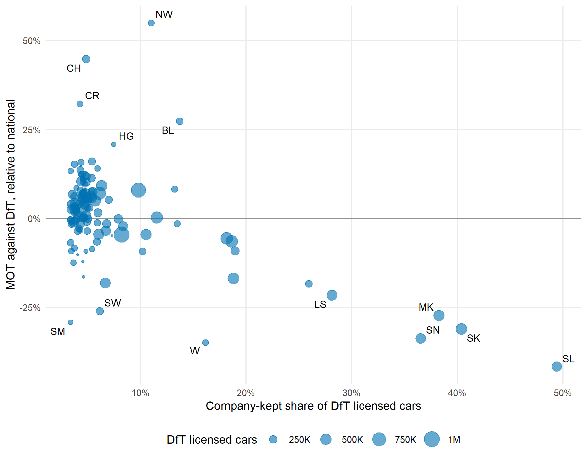

**Figure 13.** Each point is a postcode area in 2022: the company-kept
share of its DfT cars against how far its MOT-to-DfT car ratio is from
the national ratio (correlation -0.57). Labelled: areas more than 20%
from the national ratio, or with a company share above 30%.

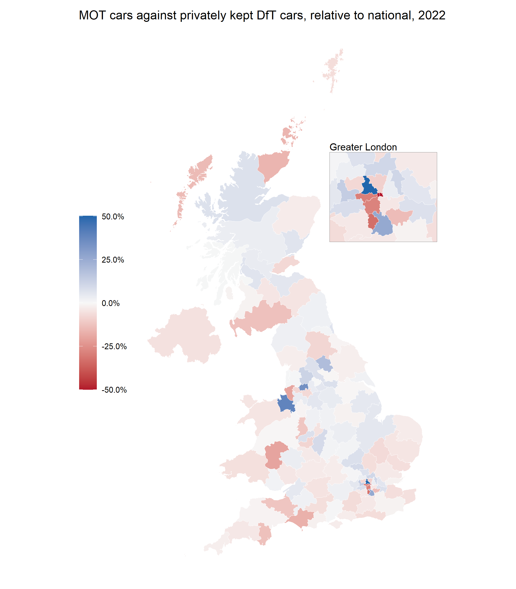

**Figure 14.** As the cars map above, but against privately kept DfT
cars only. Taking company cars out removes most of the fleet-address
pattern. What is left is mostly where vehicles are tested against where
their keepers live: areas whose test stations serve their neighbours are
blue (CH, for example, borders North Wales), and the neighbours red.

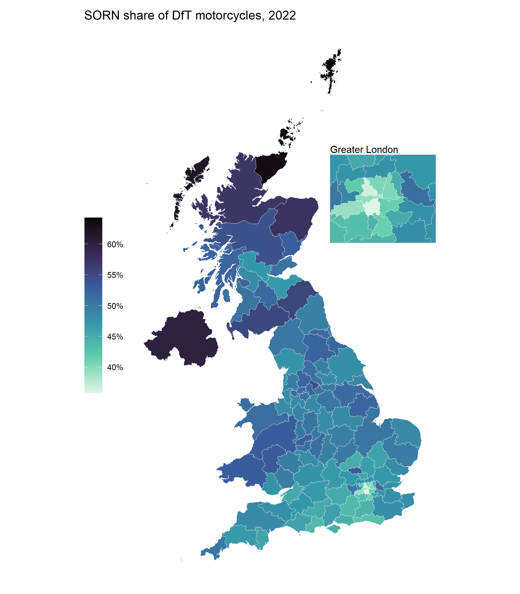

**Figure 15.** SORN motorcycles as a share of each area’s licensed +
SORN motorcycles (VEH0125), end of March 2023. Motorcycle MOTs need a
bay and tester for bikes, so many bikes are tested outside their home
area, and the motorcycle ratio map is noisier than the car map.

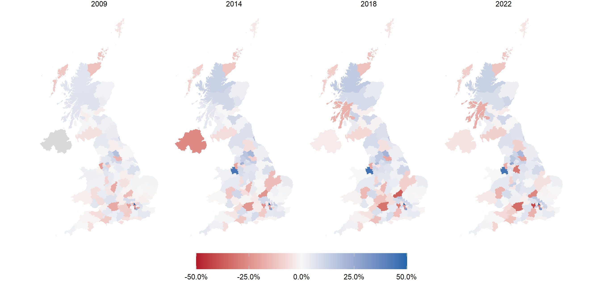

**Figure 16.** Cars: each area’s MOT-to-DfT ratio relative to the
national ratio in 2009, 2014, 2018 and 2022, on one colour scale. The
pattern is stable, which points to lasting causes (fleet registration,
test station catchments) rather than recording problems.

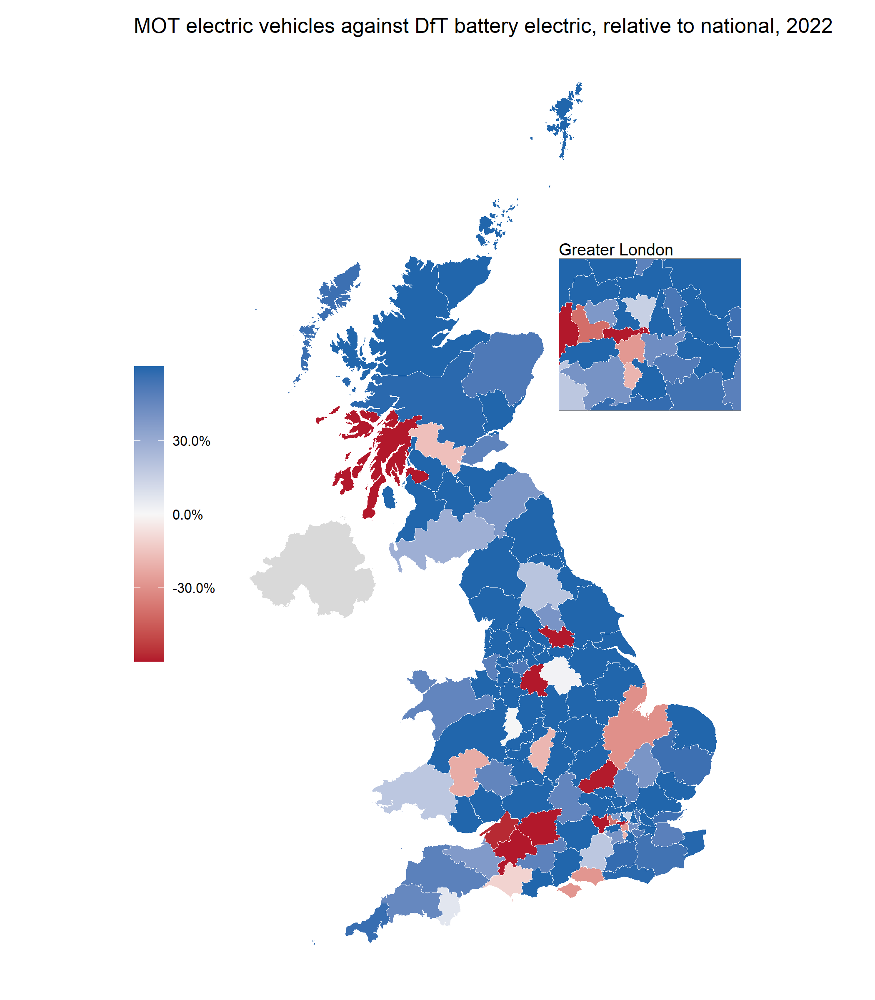

**Figure 17.** Electric vehicles of every body type in the MOT stock
against DfT licensed battery electric vehicles (VEH0145), relative to
the national ratio (0.89 in 2022). Areas with fewer than 50 DfT battery
electric vehicles are grey. Most electric vehicles are young and company
kept, so this map shows the fleet registration pattern most strongly.

### Postcode areas furthest from the national ratio, cars 2022

The 20 postcode areas whose ratio of MOT to DfT cars differs most from
the national ratio. Where the difference shrinks when only privately
kept DfT cars are counted, company registration explains much of it.
Where it does not, the area tests many cars from elsewhere (blue) or
sends many elsewhere (red).

- `mot_stock`: MOT stock cars in the area
- `dft_licensed`: DfT licensed cars, end of March of the following year
  (VEH0125)
- `ratio`: `mot_stock` / `dft_licensed`
- `difference_from_national`: how far `ratio` is above or below the
  national ratio
- `difference_private_only`: the same, counting only privately kept DfT
  cars
- `dft_company_share`: share of the DfT licensed cars kept by a company

| pca | mot_stock | dft_licensed | ratio | difference_from_national | difference_private_only | dft_company_share |
|:---|---:|---:|---:|:---|:---|:---|
| NW | 241,852 | 151,134 | 1.60 | 55% | 59% | 11% |
| CH | 370,091 | 247,535 | 1.50 | 45% | 39% | 5% |
| SL | 234,612 | 389,471 | 0.60 | -42% | 5% | 49% |
| W | 97,243 | 144,637 | 0.67 | -35% | -29% | 16% |
| SN | 282,858 | 413,127 | 0.68 | -34% | -5% | 37% |
| CR | 224,707 | 164,613 | 1.37 | 32% | 26% | 4% |
| SK | 363,739 | 511,149 | 0.71 | -31% | 5% | 40% |
| SM | 69,999 | 95,689 | 0.73 | -29% | -33% | 3% |
| BL | 259,797 | 197,650 | 1.31 | 27% | 34% | 14% |
| MK | 355,092 | 472,684 | 0.75 | -27% | 7% | 38% |
| SW | 172,076 | 225,608 | 0.76 | -26% | -28% | 6% |
| LS | 364,499 | 450,482 | 0.81 | -22% | -1% | 28% |
| HG | 97,737 | 78,375 | 1.25 | 21% | 19% | 7% |
| PA | 162,597 | 193,061 | 0.84 | -18% | 0% | 26% |
| L | 367,259 | 434,507 | 0.85 | -18% | -20% | 7% |
| GU | 452,811 | 527,041 | 0.86 | -17% | -7% | 19% |
| LD | 24,598 | 28,503 | 0.86 | -16% | -20% | 5% |
| BB | 274,361 | 229,065 | 1.20 | 16% | 12% | 5% |
| EN | 195,611 | 163,593 | 1.20 | 16% | 10% | 4% |
| LU | 205,185 | 172,314 | 1.19 | 15% | 9% | 4% |

### Areas in one source only, 2022

Postcode areas with DfT licensed vehicles and no MOT vehicles, or the
reverse, and DfT’s Miscellaneous row (vehicles with no usable address).
EC and WC, in central London, have no MOT test stations, so their
vehicles are tested in neighbouring areas.

| pca | n_located.Cars | dft_licensed.Cars | n_located.Motorcycles | dft_licensed.Motorcycles | n_located.Other | dft_licensed.Other |
|:---|---:|---:|---:|---:|---:|---:|
| EC | 0 | 6,923 | 0 | 574 | 0 | 1,555 |
| Miscellaneous | 0 | 661,433 | 0 | 32,894 | 0 | 117,918 |
| WC | 0 | 4,043 | 0 | 276 | 0 | 920 |

Northern Ireland (BT) has a ratio of 0.99 MOT cars per DfT car, against
1.03 nationally, so Northern Ireland is as well covered as Great Britain
once its stock is counted the same way. Vehicles there are first tested
at four, not three, at the DVA’s own test centres.

## 10. Things to be careful about

| Issue | Detail |
|:---|:---|
| The last years are incomplete | The stock count needs an MOT after the year. For 2023 to 2025 many vehicles have not had their next or first one yet. The annualisation also marks a last MOT year where the data simply ends: most cars whose last MOT year is 2025 are taxed with a valid MOT. Single-year comparisons here use 2022. |
| The stock count is slightly low by design | A vehicle whose final MOT falls in the year is not in that year’s stock, though many were still on the road on 31 December. |
| The located count is the wrong comparator for DfT | It includes two years of vehicles after their last MOT. It is right for mileage, not for the size of the fleet. |
| Licensed + SORN is the wrong denominator | SORN vehicles are not tested, and the SORN count grows without limit because declarations never lapse. |
| Fuel is identified differently | Plug-in hybrids are attached by make and model from DfT’s counts; diesel hybrids and some plug-ins keep their DVSA fuel. |
| Postcode areas mean different things | Test station (MOT) against keeper’s address (DfT). Area differences are about who tests where and who registers where, as much as about coverage. |
| One DVLA reading | Tax status and export marking are from one reading of the DVLA record after the end of the data, not from the year in question. |

## 11. Source files and how to rebuild

The tables are in `outputs/tables/registration/`:

| File | Grain | Contents |
|:---|:---|:---|
| registration_by_age.csv | year x body type x age (0-40, 40 = 40+) | MOT located and stock; DfT licensed and SORN (VEH0124) |
| registration_by_fuel_engine.csv | year x body type x fuel group x engine band | MOT located and stock; DfT licensed and SORN (VEH0220) |
| registration_by_pca.csv | year x postcode area x body group x (fuel group or age band) | MOT located and stock. Each row splits by fuel or by age band, and the other column reads `All` |
| registration_cohorts.csv | body type x year of first use | Vehicles in the input, ever located, never located by tax status; DfT count at ages 0, 1 and 4 |
| registration_never_located.csv | body type x one characteristic (make, engine band, fuel, test class, tax status) | For vehicles first used 2012 to 2021: vehicles, ever located, never located by tax status |
| registration_tax_status.csv | body type x MOT history x DVLA tax status | Vehicles |

They are built by `build_registration_tables()` in `R/registration.R`,
and this document by `reports/registration_report.qmd`. Settings are
under `registration:` in `config.yml`.

``` r
# the tables and this report
targets::tar_make(names = c("registration_tables", "registration_report"))

# just this document, from the tables already written
targets::tar_make(names = "registration_report")
```
